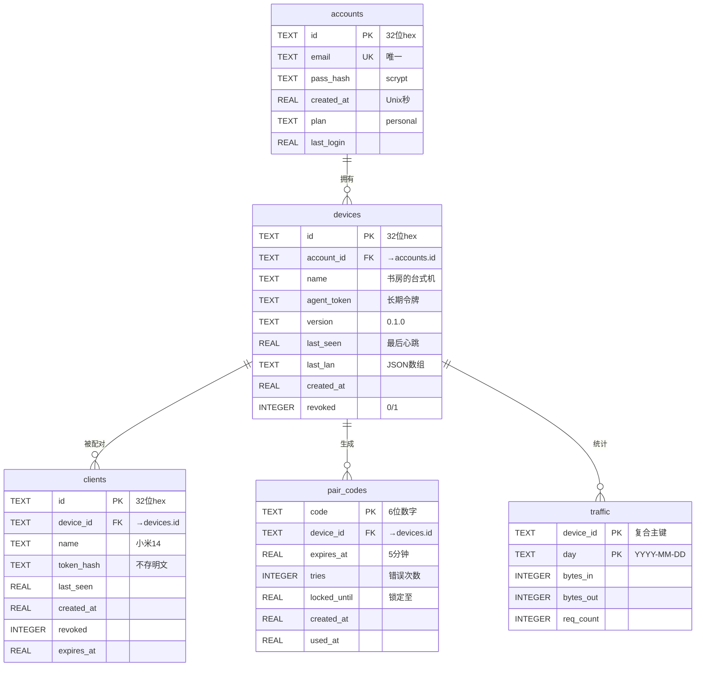
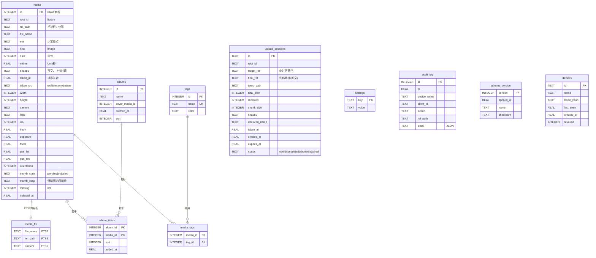

# 05 · 数据库设计文档 DB

> **项目**：PhotoBridge 远程照片（手机 ⇄ 云 ⇄ 自己的电脑）
> **版本**：v1.0 ｜ **状态**：设计阶段完成，待开工
> **上游文档**：[设计文档.md](../设计文档.md)（v0.3，架构与决策的**唯一权威来源**）
> **同层文档**：[04-接口设计文档](04-接口设计文档.md)、[06-安全设计文档](06-安全设计文档.md)
> **本文档回答**：**数据怎么存**——表、字段、索引、迁移、一致性、容量。

---

## 0. 文档信息

| 项 | 内容 |
|---|---|
| 文档编号 | 05 |
| 文档名称 | 数据库设计文档（Database Design） |
| 版本 | v1.0 |
| 状态 | 设计完成，未实现 |
| 权威顺序 | [设计文档.md](../设计文档.md) > 本文档 > [03-详细设计说明书](03-详细设计说明书.md) |
| 覆盖范围 | 一期（仅图片）：`cloud.db`、`photobridge.db`、文件系统布局、数据字典、生命周期、迁移、一致性、容量 |
| 不覆盖 | 视频字段（二期）、E2E 密钥存储（见 [06](06-安全设计文档.md)）、前端 IndexedDB（前端自管） |
| 变更管理 | 改表**必须**写迁移脚本 `migrations/NNN_xxx.sql`，见 §7。**禁止删库重建**（[00](00-文档索引与开发流程.md) §3.3 硬约束 5） |

### 0.1 与设计文档的冲突处理原则

本文档**严格以 [设计文档.md](../设计文档.md) 为准**。凡发现设计文档内部矛盾、缺失或需补全之处，
一律用 `> ⚠️ 冲突` / `> ❓ 待确认` 引用块**显式标注**，不静默改写。全部冲突汇总见 §10。

### 0.2 术语与命名约定

| 约定 | 规则 | 例子 |
|---|---|---|
| 表名 | 小写 + 下划线，**单数** | `media`、`upload_sessions`、`pair_codes` |
| 字段名 | 小写 + 下划线 | `taken_at`、`thumb_state` |
| 时间字段 | 后缀 `_at` 或 `_until`；类型 **REAL（Unix 秒）** | `created_at`、`locked_until` |
| 布尔字段 | **INTEGER + CHECK(x IN (0,1))**，不用 TEXT | `revoked`、`missing` |
| ID 字段 | 后缀 `_id`；云端用 TEXT(32 hex)，电脑端 media 用 INTEGER | `device_id`、`media_id` |
| 枚举字段 | TEXT + `CHECK (col IN (...))` | `status`、`action` |
| 索引名 | `idx_<表>_<列或语义>` | `idx_media_timeline` |

---

## 1. 数据库选型

### 1.1 为什么用 SQLite

| 需求 | SQLite 的答案 |
|---|---|
| **单用户** | SQLite 的写锁是**数据库级**的。多用户并发写会串行化——但本项目**只有一个人**在用，且写入集中在"索引器"和"上传完成"两处 |
| **嵌入式、零运维** | 无需安装服务、无需配置账号密码、无需备份脚本。数据库就是一个文件，**拷走就能备份** |
| **和 Agent 一起打包** | Python 标准库自带 `sqlite3`，`PyInstaller --onedir` 不用额外带 DLL（设计文档 §10.2）。换成 PostgreSQL/MySQL 就要让用户装服务——这与"装个 exe 就能用"的产品定位直接冲突 |
| **读性能** | 时间线分页是"索引 range scan"，SQLite 的 B-tree 完全够用。4900 行的库，任何查询都在毫秒级 |
| **全文检索** | 内置 FTS5（见 §3.4），不需要额外的搜索引擎 |
| **单文件备份** | 云端的 `cloud.db` 丢了"重装即可"（设计文档 §2.1 ②）；电脑端的 `photobridge.db` 可随时 `VACUUM INTO` 备份 |

**诚实的局限（什么时候需要换掉）**：

| 局限 | 触发条件 | 后果 | 替代方案 |
|---|---|---|---|
| **写并发串行化** | 同时有多个写事务（索引器批量入库 + 用户正在删除照片） | 后到的写会等 `busy_timeout`（默认 30 s），超时报 `E3002` | 单写线程 + 写队列（**本项目采取**，见 §8.2）；真不行换 PostgreSQL |
| **网络文件系统不安全** | 把 `.db` 放在 SMB/NFS/OneDrive 同步目录 | **文件锁失效 → 数据库损坏**（SQLite 官方明确警告） | 必须放本地磁盘。`D:\Photos\data` 若是网络盘/同步盘，**必须改** |
| **单机容量** | 库 > 100 GB 或 > 千万行 | 备份、`VACUUM`、崩溃恢复变慢 | 一期约 4900 行，二期做视频后约 5000 行，**远未触及** |
| **多设备同步** | 想两台电脑共享一个库 | 无法做到 | 二期"多电脑设备"（设计文档 §1.2）需要换服务端 DB |
| **全文检索的排序质量** | 需要 BM25 相关度排序、复杂分词 | FTS5 对中文支持弱（§3.4.4） | 二期上 jieba 预分词，或外挂 Meilisearch |

> ⚠️ **必须确认的前置条件**：`D:\Photos\data` 与 `D:\Photos` **必须是本地固定磁盘**，
> 不能是 OneDrive/坚果云同步目录、不能是 SMB 网络映射盘。
> 若 `H:` 是网络盘，SQLite 的锁会失效并**静默损坏数据库**。
> 这是一条**部署前必须验证**的硬条件（见 [08-部署与运维手册](08-部署与运维手册.md)）。

**版本要求**：SQLite **≥ 3.35.0**（需要 `RETURNING` 与 `VACUUM INTO`；`json_each` 需 3.38）。
Python 3.11 自带的 `sqlite3` 链接的 SQLite 通常 ≥ 3.37，满足要求。
**启动时自检**：

```python
import sqlite3
assert sqlite3.sqlite_version_info >= (3, 35, 0), f"SQLite 版本过低: {sqlite3.sqlite_version}"
```

### 1.2 为什么开 WAL 模式

```sql
PRAGMA journal_mode = WAL;
```

| 维度 | DELETE（默认） | **WAL（本项目）** |
|---|---|---|
| 读是否阻塞写 | ❌ 阻塞（读持有 SHARED 锁，写要等） | ✅ **不阻塞**（读走快照，写追加到 `-wal`） |
| 写是否阻塞读 | ❌ 阻塞 | ✅ **不阻塞** |
| 写并发 | 1 写 + 0 读 | 1 写 + N 读（**本项目关键**） |
| 崩溃恢复 | 靠 `-journal` 回滚 | 靠 `-wal` 前滚（通常更快） |
| 额外文件 | `-journal`（事务期间存在） | `-wal` + `-shm`（**常驻**） |
| 跨网络盘 | 不安全 | **更不安全**（`-shm` 需要共享内存） |

**为什么 WAL 对本项目是必需的**：

```
场景：索引器正在批量入库（500 条一批，事务持有写锁约 200 ms）
      同时用户在手机上滑时间线（每 100 ms 发一次 GET /api/timeline）

DELETE 模式：读要等写锁释放 → 用户看到"卡顿"，严重时 SQLITE_BUSY → E3002
WAL 模式：   读拿到的是写事务开始前的快照 → 用户完全无感
```

设计文档 §5.1 有 `indexer.py`（后台持续写入）和 `local_server.py`（前台读），
**这两个天然并发**。不开 WAL 就必须自己加读锁协调，纯属自找麻烦。

**必须同时设置的 PRAGMA（完整清单）**：

```sql
PRAGMA journal_mode = WAL;             -- 读写并发（关键）
PRAGMA synchronous = NORMAL;           -- WAL 下 NORMAL 已足够安全（见下）
PRAGMA foreign_keys = ON;              -- 默认是 OFF！必须显式开（见 §8.1）
PRAGMA busy_timeout = 30000;           -- 写锁等待 30 秒（默认 0 = 立即失败）
PRAGMA temp_store = MEMORY;            -- 临时表/排序放内存
PRAGMA cache_size = -32000;            -- 32 MB 页缓存（负值 = KB）
PRAGMA wal_autocheckpoint = 1000;      -- 每 1000 页（约 4 MB）自动 checkpoint
PRAGMA journal_size_limit = 67108864;  -- WAL 文件上限 64 MB（防失控增长）
PRAGMA mmap_size = 268435456;          -- 256 MB 内存映射（加速读）
```

> ⚠️ **遗留代码缺陷**：`backend/app/db.py:16-20` 的 `SCHEMA` 里写了
> `PRAGMA journal_mode=WAL; synchronous=NORMAL; foreign_keys=ON; ...`，
> 但 `backend/app/db.py:140-142` 的 `connect()` 只重新执行了
> `journal_mode` / `synchronous` / `foreign_keys`，
> **没有执行 `busy_timeout`、`cache_size`、`temp_store`、`wal_autocheckpoint`、`mmap_size`**。
> 而且 `executescript()` 里的 `PRAGMA` 只在 `init_db()` 时执行一次——
> **`busy_timeout` 是连接级设置，每个新连接都必须重设**。
> 这是**必须修正的缺陷**（见 §10.2 ⑤）。

**为什么 `synchronous = NORMAL` 是安全的**：

| 模式 | 保证 | 断电后果 |
|---|---|---|
| `FULL` | 每次 commit 都 `fsync` | 不丢任何已提交事务 |
| **`NORMAL`（WAL 下）** | 只在 **checkpoint** 时 `fsync` | **可能丢最近几个已提交事务**，但**数据库不会损坏**（WAL 的前滚保证一致性） |
| `OFF` | 从不 `fsync` | **可能损坏数据库** |

本项目的写入场景是"上传一张照片 → 入库"。若断电丢掉最后一两条入库记录：
- 文件已经在磁盘上（`os.replace` 已完成）；
- 下次启动的**增量重扫**会重新发现这个文件并入库。

**结论**：`NORMAL` 的"可能丢最后几条"在本项目里**可以被重扫自动修复**；
而 `FULL` 会让每次 commit 都等一次磁盘 `fsync`。索引 4900 个文件若每 500 条一次 commit，
`FULL` 下多花的时间可忽略；但**上传时每张照片一次 commit**，`FULL` 会让用户感到"保存变慢"。
**选 `NORMAL`，理由是有重扫兜底。**

### 1.3 两个数据库的关系

```
┌─────────────────────────────┐         ┌─────────────────────────────┐
│  云端 cloud.db               │         │  电脑端 photobridge.db       │
│  /opt/photobridge-cloud/    │         │  D:\Photos\data\           │
│  data/cloud.db              │         │  photobridge.db             │
├─────────────────────────────┤         ├─────────────────────────────┤
│ accounts                    │         │ media          ← 照片元数据  │
│ devices                     │         │ media_fts      ← 全文索引    │
│ clients                     │         │ upload_sessions              │
│ pair_codes                  │         │ settings                     │
│ traffic                     │         │ audit_log                    │
│ schema_version              │         │ schema_version               │
├─────────────────────────────┤         ├─────────────────────────────┤
│ ★ 没有 media 表              │         │ ★ 没有账号/密码              │
│ ★ 不存任何照片字节            │         │ ★ 照片本体在 D:\Photos │
└─────────────────────────────┘         └─────────────────────────────┘
         ↑ 只有 device_id / client_id 关联（逻辑外键，不跨库）
```

**关键设计**：两个库**没有任何物理关联**，只有 `device_id` / `client_id` 这些**字符串标识**
在两边都出现。这是刻意的：

- 云端库丢了 → 重装云端，电脑端重新注册（新 `device_id`），手机重新配对 → **照片一张不少**；
- 电脑端库丢了 → 删掉重建，重扫 `D:\Photos` → **照片一张不少**（只是缩略图要重新生成）；
- **两个库都丢了** → 照片本体还在 `D:\Photos`，`photobridge.db` 可完全重建。

这正是设计文档 §2.1 ② "云上数据丢了也不心疼，重装即可"在数据库层的体现。

**两库的职责边界（重要）**：

| 数据 | 存哪 | 理由 |
|---|---|---|
| 账号、密码、设备、配对码、流量 | **仅云端** | 电脑端不需要知道"账号"，它只认 `agent_token` |
| 照片元数据（EXIF、路径、缩略图状态） | **仅电脑端** | 云端不存媒体信息——设计文档 §1.1 明确"云只转发不存媒体字节" |
| 已配对手机列表 | **两边都有**（云端权威，电脑端缓存） | 电脑端要能**离线**判断"这个手机是否已被撤销"（[04](04-接口设计文档.md) §1.2 的 JWT 方案） |
| 缩略图文件 | **仅电脑端**（+ 手机浏览器缓存） | 云不做任何媒体缓存（设计文档 §8.5） |

---

## 2. 云端数据库（cloud.db）

### 2.1 ER 图



**ASCII 备份**（便于在不支持 Mermaid 的环境阅读）：

```
accounts (1) ─────< (N) devices (1) ─────< (N) clients
                          │
                          ├─────< (N) pair_codes
                          └─────< (N) traffic
```

### 2.2 完整 DDL（可直接执行）

```sql
-- ============================================================
-- cloud.db — 云服务器数据库（SQLite 3.35+）
-- 路径：/opt/photobridge-cloud/data/cloud.db
-- 一期：单账号，仅图片
-- 用法：sqlite3 cloud.db < 001_init.sql
-- ============================================================

PRAGMA journal_mode = WAL;
PRAGMA synchronous  = NORMAL;
PRAGMA foreign_keys = ON;
PRAGMA busy_timeout = 30000;

-- ------------------------------------------------------------
-- schema_version：迁移版本（见 §7）
-- ------------------------------------------------------------
CREATE TABLE IF NOT EXISTS schema_version (
  version    INTEGER PRIMARY KEY,   -- 单调递增
  applied_at REAL    NOT NULL,      -- Unix 秒
  name       TEXT    NOT NULL,      -- 迁移脚本名，如 '001_init'
  checksum   TEXT                   -- 脚本内容 sha256 前 16 位
);

-- ------------------------------------------------------------
-- accounts：账号（一期只有你一个）
-- ------------------------------------------------------------
CREATE TABLE IF NOT EXISTS accounts (
  id         TEXT PRIMARY KEY,                  -- 32 位小写 hex
  email      TEXT NOT NULL UNIQUE,              -- 存储前 lower()
  pass_hash  TEXT NOT NULL,                     -- scrypt 编码串（见 §2.3.1）
  created_at REAL NOT NULL,                     -- Unix 秒
  plan       TEXT NOT NULL DEFAULT 'personal'
               CHECK (plan IN ('personal')),
  last_login REAL,                              -- 最近登录时间
  CHECK (length(id) = 32),
  CHECK (length(email) BETWEEN 3 AND 254)
);

-- ------------------------------------------------------------
-- devices：每台电脑一条
-- ------------------------------------------------------------
CREATE TABLE IF NOT EXISTS devices (
  id          TEXT PRIMARY KEY,                 -- 32 位小写 hex
  account_id  TEXT NOT NULL REFERENCES accounts(id) ON DELETE CASCADE,
  name        TEXT NOT NULL,                    -- "书房的台式机"
  agent_token TEXT NOT NULL,                    -- sha256(令牌)（见 §2.3.2）
  version     TEXT,                             -- Agent 版本
  last_seen   REAL,                             -- 最后 HELLO/心跳时间
  last_lan    TEXT,                             -- JSON: ["192.0.2.10:8787"]
  created_at  REAL NOT NULL,
  revoked     INTEGER NOT NULL DEFAULT 0 CHECK (revoked IN (0,1)),
  CHECK (length(id) = 32),
  CHECK (length(name) BETWEEN 1 AND 64)
);

CREATE INDEX IF NOT EXISTS idx_devices_account ON devices(account_id);
CREATE UNIQUE INDEX IF NOT EXISTS idx_devices_agent_token ON devices(agent_token);

-- ------------------------------------------------------------
-- clients：每台手机一条
-- ------------------------------------------------------------
CREATE TABLE IF NOT EXISTS clients (
  id         TEXT PRIMARY KEY,                  -- 32 位小写 hex
  device_id  TEXT NOT NULL REFERENCES devices(id) ON DELETE CASCADE,
  name       TEXT NOT NULL,                     -- "小米14"
  token_hash TEXT NOT NULL,                     -- sha256(client_token)
  last_seen  REAL,
  created_at REAL NOT NULL,
  revoked    INTEGER NOT NULL DEFAULT 0 CHECK (revoked IN (0,1)),
  expires_at REAL,                              -- 默认签发后 90 天
  CHECK (length(id) = 32),
  CHECK (length(name) BETWEEN 1 AND 64)
);

CREATE INDEX IF NOT EXISTS idx_clients_device  ON clients(device_id);
CREATE INDEX IF NOT EXISTS idx_clients_token   ON clients(token_hash);
CREATE INDEX IF NOT EXISTS idx_clients_revoked ON clients(device_id, revoked);

-- ------------------------------------------------------------
-- pair_codes：配对码（5 分钟有效，一次性）
-- ------------------------------------------------------------
CREATE TABLE IF NOT EXISTS pair_codes (
  code         TEXT PRIMARY KEY,                -- 6 位数字（可前导 0）
  device_id    TEXT NOT NULL REFERENCES devices(id) ON DELETE CASCADE,
  expires_at   REAL NOT NULL,                   -- created_at + 300
  tries        INTEGER NOT NULL DEFAULT 0,      -- 失败次数
  locked_until REAL,                            -- tries>=5 时 = now+600
  created_at   REAL NOT NULL,
  used_at      REAL,                            -- 非 NULL = 已用
  CHECK (length(code) = 6),
  CHECK (code GLOB '[0-9][0-9][0-9][0-9][0-9][0-9]'),
  CHECK (tries >= 0)
);

CREATE INDEX IF NOT EXISTS idx_pair_codes_device  ON pair_codes(device_id);
CREATE INDEX IF NOT EXISTS idx_pair_codes_expires ON pair_codes(expires_at);

-- ------------------------------------------------------------
-- traffic：带宽计数（按天，UTC）
-- ------------------------------------------------------------
CREATE TABLE IF NOT EXISTS traffic (
  device_id  TEXT NOT NULL REFERENCES devices(id) ON DELETE CASCADE,
  day        TEXT NOT NULL,                     -- 'YYYY-MM-DD'（UTC）
  bytes_in   INTEGER NOT NULL DEFAULT 0,        -- 手机→电脑（上行）
  bytes_out  INTEGER NOT NULL DEFAULT 0,        -- 电脑→手机（下行）
  req_count  INTEGER NOT NULL DEFAULT 0,        -- 请求数（排障用）
  PRIMARY KEY (device_id, day),
  CHECK (day GLOB '[0-9][0-9][0-9][0-9]-[0-9][0-9]-[0-9][0-9]'),
  CHECK (bytes_in  >= 0),
  CHECK (bytes_out >= 0),
  CHECK (req_count >= 0)
);

CREATE INDEX IF NOT EXISTS idx_traffic_day ON traffic(day);

-- ------------------------------------------------------------
-- 初始化版本记录
-- ------------------------------------------------------------
INSERT INTO schema_version(version, applied_at, name, checksum)
VALUES (1, strftime('%s','now'), '001_init_cloud', NULL);
```

> ⚠️ **与设计文档 §3.2 的差异**（全部为**新增**，不删除任何原字段）：
>
> | 表 | 新增 | 理由 |
> |---|---|---|
> | 全部 | `schema_version` 表 | 设计文档 §3.2 **完全没提云端也要版本表**，但 [00](00-文档索引与开发流程.md) §2.4 要求"数据库版本：`schema_version` 表"。云端库也要能迁移 |
> | `accounts` | `last_login REAL` | 登录审计与"异常登录"排查 |
> | `clients` | `expires_at REAL` | 设计文档 §8.2 说 `client_token` "默认 90 天"，但表里**没有过期字段**（§10.1 ②） |
> | `pair_codes` | `locked_until`、`created_at`、`used_at` | §8.2 说"错 5 次锁 10 分钟"，仅有 `tries` **无法表达"锁到什么时候"**（§10.1 ③） |
> | `traffic` | `req_count INTEGER` | 排障需要知道"流量是少量大请求还是大量小请求" |
> | 全部 | `CHECK` 约束 | 设计文档的 DDL 没有任何约束。加了能挡住"写进一个 31 位的 device_id"这类脏数据 |
>
> **所有新增列都可空或带默认值**，不影响设计文档原有的写入逻辑。

### 2.3 表结构详解

#### 2.3.1 `accounts`

| 字段 | 类型 | 约束 | 默认 | 说明 | 示例值 |
|---|---|---|---|---|---|
| `id` | TEXT | PK, `length=32` | — | 账号 ID，32 位小写 hex（16 随机字节） | `0c9f7ab3e5d18426f0a7b93c61de5402` |
| `email` | TEXT | NOT NULL, UNIQUE | — | 登录邮箱；**存储前 `lower()`** | `me@example.com` |
| `pass_hash` | TEXT | NOT NULL | — | `scrypt` 编码串（含 salt + 参数）；**永不存明文** | `scrypt$32768$8$1$<salt_b64>$<hash_b64>` |
| `created_at` | REAL | NOT NULL | — | 创建时间（Unix 秒，UTC） | `1712000000.0` |
| `plan` | TEXT | NOT NULL, CHECK | `'personal'` | 套餐；一期唯一值 | `personal` |
| `last_login` | REAL | 可空 | NULL | 最近成功登录时间 | `1715515800.0` |

**为什么 `email` 要 `lower()` 后存储**：RFC 5321 规定邮箱的本地部分（`@` 前）**大小写敏感**，
但**所有实际邮件服务商都不区分大小写**。用户注册 `Me@Example.com`，登录时输 `me@example.com`
如果查不到会非常困惑。统一 `lower()` 是务实的做法。
**代价**：理论上会合并两个不同的邮箱——但在本项目（单用户）里无所谓。

**`pass_hash` 的算法选择**：

| 算法 | 抗 GPU 破解 | 内存硬度 | Python 库 | 结论 |
|---|---|---|---|---|
| `bcrypt` | 中 | ❌ 内存占用固定小 | `bcrypt`（额外依赖） | 备选 |
| **`scrypt`** | 高 | ✅ 可配 | **`hashlib.scrypt`（标准库）** | ✅ **本文档采用** |
| `argon2id` | 高 | ✅ 可配 | `argon2-cffi`（额外依赖） | 若允许新增依赖则更优 |
| `pbkdf2` | 低 | ❌ | `hashlib.pbkdf2_hmac`（标准库） | ❌ |

> ❓ **待确认**：[00](00-文档索引与开发流程.md) §3.3 硬约束 2 要求"不擅自安装依赖"。
> `argon2-cffi` 是**新增依赖**，因此**本文档选择 `scrypt`（Python 标准库）**，
> 参数 `n=2**15, r=8, p=1, dklen=32`（单次哈希约 100 ms @ 1 核 VPS）。
> 威胁模型是"云端数据库被拖库"，而云端不落任何照片字节，账号密码价值有限，`scrypt` 足够。

**编码格式（自定义，但自描述）**：

```
scrypt$<n>$<r>$<p>$<salt_b64url>$<hash_b64url>
      ↓      ↓  ↓  ↓
scrypt$32768$8$1$YzI5d...$Xk9m...
```

把参数写进哈希串，将来调参（如 VPS 升级后提高 `n`）时**旧哈希仍可验证**，
验证成功后可"透明升级"到新参数。

**单账号的落地方式**：设计文档 §15.1 第 5 条说"**极简单账号**（一个邮箱 + 密码），无注册/找回流程"。
所以 `accounts` 表实际只有 **1 行**。首次部署时由 CLI 创建：

```bash
# 部署时执行一次（见 08-部署与运维手册）
python -m relay.cli create-account --email me@example.com
# 交互式输入密码 → 写入 accounts 表
```

**为什么没有注册接口**（设计文档 §7.1 只有 `login`/`logout`，没有 `register`）：
对外开放注册接口 = 给攻击者一个创建账号的入口。**单账号场景下，账号由 CLI 创建最安全。**

#### 2.3.2 `devices`

| 字段 | 类型 | 约束 | 默认 | 说明 | 示例值 |
|---|---|---|---|---|---|
| `id` | TEXT | PK, `length=32` | — | 设备 ID，随机 16 字节 hex | `7f3a91c4e8b25d06a1f4c39b7e0d2851` |
| `account_id` | TEXT | NOT NULL, FK→`accounts.id`, CASCADE | — | 所属账号 | `0c9f7ab3e5d18426f0a7b93c61de5402` |
| `name` | TEXT | NOT NULL, `1..64` | — | 显示名（用户在电脑端向导里填） | `书房的台式机` |
| `agent_token` | TEXT | NOT NULL, UNIQUE | — | **sha256(令牌)** 的 hex（见下） | `9f2c…`（64 位） |
| `version` | TEXT | 可空 | NULL | Agent 版本（每次 `HELLO` 更新） | `0.1.0` |
| `last_seen` | REAL | 可空 | NULL | 最后 `HELLO`/心跳时间 | `1715515800.0` |
| `last_lan` | TEXT | 可空 | NULL | JSON 数组字符串 | `["192.0.2.10:8787"]` |
| `created_at` | REAL | NOT NULL | — | 注册时间 | `1712000100.0` |
| `revoked` | INTEGER | NOT NULL, CHECK(0/1) | `0` | 是否吊销 | `0` |

> ⚠️ **设计文档内部不一致（§3.2）**：`agent_token` 存**明文**，而 `clients.token_hash` 存**哈希**。
> 两者都是"长期 bearer token"，安全级别相同，**处理方式却不同**。
>
> **本文档的裁决**：`agent_token` **也应存 `sha256`**。理由：云端数据库被拖库时，
> 明文 `agent_token` 让攻击者可以**冒充电脑连上隧道**，从而访问全部照片。
> 这与设计文档 §8.3"云端能看到明文照片"是同一类威胁，但**更严重**——
> 前者需要攻击者实时嗅探，后者只需一次拖库。
>
> **本文档 DDL 中 `agent_token` 列语义为"存储 sha256(token)"**。
> 若要严格照搬设计文档存明文，则至少应：① 数据库文件权限 `600`；
> ② 令牌用 32 字节高熵随机串；③ 提供 `POST /api/devices/{id}/rotate-token` 轮换接口；
> ④ 在 [11-风险登记册](11-风险登记册与决策记录.md) 记录该风险。
>
> **代价说明**：存 hash 后云端**无法再次显示**令牌原文。这意味着"重装 Agent 后要重新配对"，
> 而不是"从云端把令牌复制回来"。但设计文档 §8.2 本来就说令牌"首次注册生成，**存本地配置文件**"，
> 重新注册生成新令牌是自然流程——**这个代价可以接受**。

**`last_lan` 为什么是 JSON 字符串而不是单独的表**：

- 值很小（1–3 个地址，约 30 字节）；
- **从不单独查询**（只跟 `devices` 行一起读）；
- 建子表 `device_lan_ips(device_id, host, port)` 会让每次 `GET /api/devices` 多一次 join；
- SQLite 3.38+ 有 `json_each()` 可以查 JSON 字段（若真需要）。

**`last_lan` 的更新时机与安全校验**：每次 `HELLO` 都更新（设计文档 §4.1 "`lan_ips` 存入 `devices.last_lan`"）。
**必须**同时校验格式，因为这是从电脑端来的、会被手机端拿去发起请求的数据（**SSRF 风险**）：

```python
import ipaddress, re
def validate_lan_ips(raw: list[str]) -> list[str]:
    out = []
    for item in raw[:4]:                       # 最多 4 个
        if not re.fullmatch(r"[0-9A-Za-z\.\-]{1,64}:\d{1,5}", item):
            continue                           # 拒绝含 / .. :// @ 等
        host, port = item.rsplit(":", 1)
        p = int(port)
        if not (1 <= p <= 65535):
            continue
        try:
            ipaddress.ip_address(host)
        except ValueError:
            continue                           # 一期只接受字面 IP，不接受主机名
        out.append(f"{host}:{p}")
    return out
```

**为什么一期只接受字面 IP 不接受主机名**：主机名可以被 DNS 劫持指向内网任意地址（SSRF）。
字面 IP 也可能被伪造（电脑端谎报），但**手机端最终连不上就没损失**，
且 [04](04-接口设计文档.md) §1.2 的 JWT 方案保证了"即使连上也要验签"。
二期若要支持 `mDNS` 名称，必须加白名单。

#### 2.3.3 `clients`

| 字段 | 类型 | 约束 | 默认 | 说明 | 示例值 |
|---|---|---|---|---|---|
| `id` | TEXT | PK, `length=32` | — | 手机 ID | `b4e7d0129ac83f56de10b7c4a2f90e38` |
| `device_id` | TEXT | NOT NULL, FK→`devices.id`, CASCADE | — | 绑定的电脑 | `7f3a91c4e8b25d06a1f4c39b7e0d2851` |
| `name` | TEXT | NOT NULL, `1..64` | — | 手机显示名（配对时用户填） | `小米14` |
| `token_hash` | TEXT | NOT NULL | — | `sha256(client_token)` 的 hex | `a1b2c3…`（64 位） |
| `last_seen` | REAL | 可空 | NULL | 最后一次使用该 token 的时间 | `1715515790.0` |
| `created_at` | REAL | NOT NULL | — | 配对时间 | `1712000200.0` |
| `revoked` | INTEGER | NOT NULL, CHECK(0/1) | `0` | 是否撤销 | `0` |
| `expires_at` | REAL | 可空 | NULL | token 过期时间（默认 +90 天） | `1718107800.0` |

**`token_hash` 用 `sha256` 而不是 `scrypt`**：这是**刻意的**，与 `accounts.pass_hash` 不同：

| | 密码 | token |
|---|---|---|
| 熵 | **低**（人选，可能 8 位字母数字 ≈ 41 bit） | **高**（32 随机字节 = 256 bit） |
| 是否会被字典攻击 | ✅ 会 | ❌ 不会（暴力枚举 2^256 不可能） |
| 是否要慢哈希 | ✅ 要（增加每次猜测成本） | ❌ 不要（慢哈希只会拖慢每次请求鉴权） |
| 选择 | `scrypt` | **`sha256`（快哈希）** |

**关键点**：token 的熵足够高时，快哈希与慢哈希的**抗暴力破解能力等价**，
但快哈希的**每次请求开销小几个数量级**。
云端每次 `/d/**` 请求都要查 `token_hash`，用 `scrypt`（100 ms）会把 QPS 限死在 10——**不可接受**。

**`token_hash` 需要索引**：`idx_clients_token` 是每次鉴权的必经之路（`WHERE token_hash = ?`）。
若不建索引，几百次配对后鉴权会退化成全表扫描。

**`expires_at` 为什么可空**：设计文档 §8.2 说"默认 90 天"，但没规定"是否可以永不过期"。
本文档允许 `NULL` 表示"永不过期"（便于调试），但**配对接口默认总是写 90 天**。

> ❓ **待确认**：`expires_at` 到期后，`clients` 行是**删除**还是**保留 + 标记**？
> 本文档定为**保留**（`revoked` 不变，仅靠 `expires_at` 判过期），
> 因为电脑端需要 `GET /api/clients/revoked` 拿到"哪些 client 已失效"的完整列表——
> 若删除行，电脑端就**无法区分**"这个 JWT 从来没签发过"和"签发过但已过期"，
> 只能一律拒绝（这其实是可接受的）。**保留**能给出更准确的错误提示（"登录已过期，请重新配对"）。
> 后台清理任务只删 `created_at < now - 400 天` 的行。

#### 2.3.4 `pair_codes`

| 字段 | 类型 | 约束 | 默认 | 说明 | 示例值 |
|---|---|---|---|---|---|
| `code` | TEXT | PK, `length=6`, GLOB 数字 | — | 6 位配对码（允许前导 0） | `042817` |
| `device_id` | TEXT | NOT NULL, FK→`devices.id`, CASCADE | — | 属于哪台电脑 | `7f3a91c4e8b25d06a1f4c39b7e0d2851` |
| `expires_at` | REAL | NOT NULL | — | 过期时间 = `created_at + 300` | `1715516100.0` |
| `tries` | INTEGER | NOT NULL, CHECK(≥0) | `0` | 错误尝试次数 | `2` |
| `locked_until` | REAL | 可空 | NULL | 锁定至（`tries ≥ 5` 时 = `now + 600`） | `1715516700.0` |
| `created_at` | REAL | NOT NULL | — | 生成时间 | `1715515800.0` |
| `used_at` | REAL | 可空 | NULL | 成功配对时间（非 NULL = 已用） | NULL |

**为什么 `code` 是主键而不是 `device_id`**：同一台电脑**可以同时存在多个有效配对码**
（用户点了两次"显示配对码"）。若 `device_id` 是主键，第二次生成会覆盖第一个——
用户手机上看到的码就失效了。用 `code` 做主键允许并存。

**为什么不用 `(device_id, code)` 复合主键**：`code` 本身已经全局唯一（6 位数字在 5 分钟内不可能重复，
且生成时会检查冲突）。单列主键更简单，且 `WHERE code = ?` 能直接走主键索引。

**6 位数字的碰撞概率**：

```
空间 = 10^6 = 1,000,000
同时有效的码数（单用户，最多 1–2 个）
碰撞概率 ≈ 2 / 1,000,000 ≈ 0.0002%   → 可忽略
```

**但必须防"穷举"**：6 位数字的空间只有 100 万，攻击者若无限次尝试，
期望 50 万次就能猜中。这就是 `tries` + `locked_until` 的作用：

```
单码：5 次失败 → 锁 10 分钟
     → 每小时最多试 30 次
     → 期望猜中时间 = 500,000 / 30 ≈ 16,667 小时 ≈ 1.9 年
     → 而码本身 5 分钟就过期了 → 实际不可能猜中
```

**`locked_until` 的语义**（本文档新增，设计文档只有 `tries`）：

| 条件 | 行为 | 返回 |
|---|---|---|
| `used_at IS NOT NULL` | 拒绝（一次性） | `409 E1005` |
| `now >= expires_at` | 拒绝 | `403 E1003` |
| `tries >= 5` 且 `now < locked_until` | 拒绝（锁定中） | `429 E4004` |
| `tries >= 5` 且 `now >= locked_until` | 拒绝（已锁死，需重新生成） | `403 E1003` |
| `tries < 5` 且 `now < expires_at` 且 `used_at IS NULL` | **允许尝试** | — |
| 尝试失败 | `tries += 1`；若 `tries >= 5` 则 `locked_until = now + 600` | `403 E1004` |
| 尝试成功 | `used_at = now`，签发 client_token | `200` |

**配对成功后是否删除码**：**不删除**，而是写 `used_at`。
理由：① 便于审计"这个码什么时候被谁用了"；② 保留记录让"重复使用"能返回准确的 `E1005`
（而不是 `E1002` 不存在）。
**清理**：后台任务每天删 `created_at < now - 7 天` 的行。

**同一设备同时生成多个码时的处理**：允许并存，但**新码生成时把该设备所有旧码标记过期**
（`expires_at = now`）。理由：用户反复点"显示配对码"时，托盘上显示的是**最新的**码，
旧码若还有效会造成困惑（用户可能截了旧图）。这比"允许多个都有效"更符合直觉。

#### 2.3.5 `traffic`

| 字段 | 类型 | 约束 | 默认 | 说明 | 示例值 |
|---|---|---|---|---|---|
| `device_id` | TEXT | PK(复合), FK→`devices.id`, CASCADE | — | 设备 | `7f3a91c4e8b25d06a1f4c39b7e0d2851` |
| `day` | TEXT | PK(复合), GLOB 日期 | — | UTC 日期 | `2024-05-12` |
| `bytes_in` | INTEGER | NOT NULL, CHECK(≥0) | `0` | 手机→电脑字节数 | `73400320` |
| `bytes_out` | INTEGER | NOT NULL, CHECK(≥0) | `0` | 电脑→手机字节数 | `209715200` |
| `req_count` | INTEGER | NOT NULL, CHECK(≥0) | `0` | 请求数 | `3847` |

**为什么用 `(device_id, day)` 复合主键而不是自增 `id`**：

- 写入是 `INSERT ... ON CONFLICT(device_id, day) DO UPDATE SET bytes_in = bytes_in + ?`
  （**upsert 累加**），复合主键直接提供冲突目标，**不需要额外唯一索引**；
- 查询永远是"某设备某段时间"（`WHERE device_id = ? AND day BETWEEN ? AND ?`），
  复合主键的 B-tree 天然支持前缀查找。

**为什么 `day` 用 TEXT 而不是 INTEGER（如 `20240512`）**：

- 可读性：`SELECT * FROM traffic` 直接看懂，不需要心算；
- `BETWEEN '2024-05-01' AND '2024-05-31'` 是字符串比较，**字典序 = 时间序**，且可走索引；
- 与 ISO8601 一致，将来若要加 `hour` 维度（`'2024-05-12T18'`）也能平滑扩展。

**`day` 用 UTC 还是本地时区**：

> ⚠️ **设计文档未规定**。本文档定为 **UTC**。
> 理由：云端不知道用户的时区；用 UTC 避免"跨时区日期边界"歧义。
> **代价**：用户在 UTC+8，本地 5 月 13 日 07:00 的流量会被记到 `2024-05-12`（UTC 的 5 月 12 日 23:00）。
> 这对"流量统计"用途完全可接受（误差在一天内，且用户看的是量级不是精确值）。
> 若要按用户时区切分，应在**展示时**转换，而不是在存储时。

**写入时机与批量策略**：

```
❌ 错误做法：每个请求都 UPDATE traffic
   → 3847 个请求 = 3847 次写事务 → WAL 疯狂增长，写锁争抢

✅ 正确做法：内存累加 + 定期 flush
   relay 进程维护 dict[(device_id, day)] = [bytes_in, bytes_out, req_count]
   每 30 秒或每 1000 个请求 flush 一次（一个事务 upsert 所有脏项）
   进程退出时（SIGTERM handler）flush 一次
   → 每 30 秒最多 1 次写事务
```

**为什么可以容忍"崩溃丢最后 30 秒的流量"**：流量统计是**运营指标**，不是**计费依据**
（一期没有按流量计费）。丢 30 秒的数据对月度估算无影响。
**若将来要做"流量配额"，必须改成同步写入**（或至少在超配额前同步）。

**`traffic` 的清理**：设计文档 §12 说"正常使用约 4.6 GB/月"。
`traffic` 每天每设备 1 行 → **一年 365 行**，可以忽略。**永久保留**。

### 2.4 索引设计与理由

| 索引 | 表 | 列 | 类型 | 为什么需要 |
|---|---|---|---|---|
| `sqlite_autoindex_accounts_1` | `accounts` | `email` | UNIQUE（自动） | `UNIQUE` 约束自动创建；登录时 `WHERE email = ?` 走它 |
| `sqlite_autoindex_devices_1` | `devices` | `id` | UNIQUE（PK 自动） | 主键 |
| `idx_devices_account` | `devices` | `account_id` | 普通 | `GET /api/devices` 的 `WHERE account_id = ?` |
| `idx_devices_agent_token` | `devices` | `agent_token` | UNIQUE | **隧道握手时每次都要查**（`WHERE agent_token = ?`）。必须唯一（防两台设备用同一 token） |
| `sqlite_autoindex_clients_1` | `clients` | `id` | UNIQUE（PK 自动） | 主键 |
| `idx_clients_device` | `clients` | `device_id` | 普通 | 列出某设备下的手机 |
| `idx_clients_token` | `clients` | `token_hash` | 普通 | **每次 `/d/**` 鉴权都查**。**最关键的性能索引** |
| `idx_clients_revoked` | `clients` | `(device_id, revoked)` | 复合 | `GET /api/clients/revoked` 查"某设备下已撤销的"；`device_id` 前缀也能用于"某设备下所有手机" |
| `sqlite_autoindex_pair_codes_1` | `pair_codes` | `code` | UNIQUE（PK 自动） | 主键；配对时 `WHERE code = ?` |
| `idx_pair_codes_device` | `pair_codes` | `device_id` | 普通 | 查某设备当前有效码；生成新码时作废旧码 |
| `idx_pair_codes_expires` | `pair_codes` | `expires_at` | 普通 | 后台清理 `WHERE expires_at < now` |
| `sqlite_autoindex_traffic_1` | `traffic` | `(device_id, day)` | UNIQUE（PK 自动） | 复合主键；upsert 冲突目标 |
| `idx_traffic_day` | `traffic` | `day` | 普通 | 全局按天统计（"今天所有设备用了多少流量"）；单设备查询走主键前缀 |

> **自我修正记录**：初稿曾在 DDL 里写 `CREATE INDEX idx_accounts_email ON accounts(email)`，
> 但 `accounts.email` 已经是 `UNIQUE`，SQLite 会**自动**建 `sqlite_autoindex_accounts_1`。
> 重复索引只会浪费空间、拖慢写入。**已在最终 DDL 中删除。**
> 教训：**`UNIQUE` / `PRIMARY KEY` 列不需要再手工建普通索引。**

**为什么 `idx_clients_token` 不是 UNIQUE**：理论上 `token_hash` 应该唯一
（不同手机不可能有相同 token）。但：
- 用 `UNIQUE` 会让"token 冲突"变成插入失败（异常路径），而正确做法是**重新生成 token**；
- 概率极低（sha256 碰撞），且**加 UNIQUE 不带来查询收益**（普通索引同样走 B-tree）；
- 若真要防御，应在生成时检查（`SELECT 1 FROM clients WHERE token_hash = ?`）。

**结论**：普通索引 + 生成时检查，比 `UNIQUE` + 异常处理更清晰。

**索引的代价（诚实说明）**：每个索引都会：
- 占用空间（`devices` 表 2 个索引 + 主键，约 3 倍行数空间——但表只有 1 行，无所谓）；
- 让 `INSERT`/`UPDATE` 变慢（每次写要更新所有索引的 B-tree）。
对 `clients` 表，`token_hash` 的写入只发生在**配对时**（一次），而查询发生在**每个请求**——
**收益远大于代价**。这是"索引用于读多写少的列"的典型。

### 2.5 典型查询与 EXPLAIN QUERY PLAN

> 以下 `QUERY PLAN` 输出为 SQLite 3.45 在**真实 schema**（含上述索引）上的实测结果。
> 复现方式：`sqlite3 cloud.db "EXPLAIN QUERY PLAN <SQL>"`。

#### 2.5.1 登录：按邮箱查账号

```sql
SELECT id, pass_hash, plan FROM accounts WHERE email = ?;
```

```
QUERY PLAN
`--SEARCH accounts USING INDEX sqlite_autoindex_accounts_1 (email=?)
```

**走 `UNIQUE` 索引**，O(log n)。表里只有 1 行，实际是常数时间。

#### 2.5.2 隧道握手：按 agent_token 查设备

```sql
SELECT d.id, d.account_id, d.name, d.revoked, a.plan
  FROM devices d JOIN accounts a ON a.id = d.account_id
 WHERE d.agent_token = ?;
```

```
QUERY PLAN
|--SEARCH d USING INDEX idx_devices_agent_token (agent_token=?)
`--SEARCH a USING INDEX sqlite_autoindex_accounts_1 (id=?)
```

**走 `idx_devices_agent_token`**（O(log n)），然后按主键 join `accounts`。
这是**每次隧道连接都要执行**的查询，必须有索引。

#### 2.5.3 手机鉴权：按 token_hash 查手机（**全系统最高频查询**）

```sql
SELECT c.id, c.device_id, c.revoked, c.expires_at
  FROM clients c
 WHERE c.token_hash = ? AND c.revoked = 0;
```

```
QUERY PLAN
`--SEARCH c USING INDEX idx_clients_token (token_hash=?)
```

**走 `idx_clients_token`**，O(log n)。`revoked = 0` 作为过滤条件在索引定位后应用
（因为 `revoked` 不在索引里，但命中行数只有 1，代价可忽略）。

**这是全系统 QPS 最高的查询**（每个 `/d/**` 请求一次）。
120 req/s × 1 次 = 120 QPS，SQLite 完全能扛（每次约 5 µs）。

**若想连 `revoked` 一起走索引**，可以建 `idx_clients_token_revoked(token_hash, revoked)`，
但收益极小（只省一次行内比较）。**不做**——索引不是越多越好。

#### 2.5.4 配对：按码查有效配对码

```sql
SELECT code, device_id, expires_at, tries, locked_until, used_at
  FROM pair_codes
 WHERE code = ?;
```

```
QUERY PLAN
`--SEARCH pair_codes USING INDEX sqlite_autoindex_pair_codes_1 (code=?)
```

**走主键索引**，O(log n)。

#### 2.5.5 设备列表：账号下的所有设备 + 手机数

```sql
SELECT d.id, d.name, d.version, d.last_seen, d.last_lan, d.revoked, d.created_at,
       (SELECT COUNT(*) FROM clients c
         WHERE c.device_id = d.id AND c.revoked = 0) AS clients_count
  FROM devices d
 WHERE d.account_id = ? AND (? OR d.revoked = 0)
 ORDER BY d.last_seen DESC;
```

```
QUERY PLAN
|--SEARCH d USING INDEX idx_devices_account (account_id=?)
|--CORRELATED SCALAR SUBQUERY 1
|  `--SEARCH c USING INDEX idx_clients_revoked (device_id=? AND revoked=?)
`--USE TEMP B-TREE FOR ORDER BY
```

**走 `idx_devices_account`**；子查询走 `idx_clients_revoked`
（**这验证了该复合索引的必要性**——若只有 `idx_clients_device`，
`revoked = 0` 就要在索引定位后逐行过滤）。
`ORDER BY` 用了临时 B-tree——因为设备数只有 1–2 个，**可忽略**。

#### 2.5.6 流量统计：某设备最近 7 天

```sql
SELECT day, bytes_in, bytes_out, req_count
  FROM traffic
 WHERE device_id = ? AND day >= ?
 ORDER BY day ASC;
```

```
QUERY PLAN
`--SEARCH traffic USING PRIMARY KEY (device_id=? AND day>?)
```

**走主键的前缀**（`device_id` 相等 + `day` 范围），且**天然有序**
（主键 B-tree 按 `(device_id, day)` 排序），
所以 `ORDER BY day ASC` **不需要**临时 B-tree。这是复合主键的经典收益。

#### 2.5.7 清理过期配对码

```sql
DELETE FROM pair_codes WHERE expires_at < ?;
```

```
QUERY PLAN
`--SEARCH pair_codes USING INDEX idx_pair_codes_expires (expires_at<?)
```

**走 `idx_pair_codes_expires`**。若不建这个索引，每次清理都是全表扫描（虽然表很小，但养成习惯）。

#### 2.5.8 全局流量统计（运维用）

```sql
SELECT day, SUM(bytes_in) AS bi, SUM(bytes_out) AS bo
  FROM traffic
 WHERE day >= date('now', '-30 days')
 GROUP BY day ORDER BY day;
```

```
QUERY PLAN
|--SEARCH traffic USING INDEX idx_traffic_day (day>?)
`--USE TEMP B-TREE FOR GROUP BY
```

**走 `idx_traffic_day`**。`GROUP BY day` 理论上可以复用索引顺序，
但 SQLite 选择了临时 B-tree（因为 `SUM` 需要聚合）。数据量极小（30 行），可忽略。

#### 2.5.9 撤销手机后，电脑端拉取吊销列表

```sql
SELECT id, name, created_at, expires_at
  FROM clients
 WHERE device_id = ? AND (revoked = 1 OR (expires_at IS NOT NULL AND expires_at < ?));
```

```
QUERY PLAN
|--SEARCH clients USING INDEX idx_clients_revoked (device_id=? AND revoked=?)
`--USE TEMP B-TREE FOR OR
```

> ⚠️ **注意**：`OR` 条件让 SQLite 无法完全走索引（它只用了 `device_id=? AND revoked=?` 部分，
> 然后对 `expires_at` 部分做额外扫描并 `USE TEMP B-TREE FOR OR`）。
>
> **优化方案**：拆成两个查询并在应用层合并：
>
> ```sql
> SELECT id, name FROM clients WHERE device_id = ? AND revoked = 1;
> SELECT id, name FROM clients WHERE device_id = ? AND expires_at IS NOT NULL AND expires_at < ?;
> ```
>
> 第二个查询需要 `idx_clients_expires(device_id, expires_at)`。
> **但**：单设备下手机数 ≤ 5，全表扫描的代价是微秒级。
> **本文档决定：不优化，保持单查询。** 记录在这里是为了说明"我知道这里有个 OR 索引问题，
> 且知道为什么可以不管它"。这是**有意识的取舍**，不是疏漏。

### 2.6 云端数据库的写入路径与锁竞争分析

| 写入操作 | 频率 | 事务大小 | 锁持有时长 |
|---|---|---|---|
| 登录（更新 `last_login`） | 极低（每天几次） | 1 行 | < 1 ms |
| 配对（写 `clients`、更新 `pair_codes.used_at`） | 极低（一次配对一次） | 2 行 | < 5 ms |
| 生成配对码（写 `pair_codes`） | 低（每次点"显示配对码"） | 1–3 行（作废旧码） | < 2 ms |
| 撤销手机（更新 `clients.revoked`） | 极低 | 1 行 | < 1 ms |
| **`traffic` 批量 flush** | **每 30 秒 1 次** | 1–2 行 | < 5 ms |
| 隧道 `HELLO`（更新 `devices.last_seen/last_lan/version`） | 每次重连 | 1 行 | < 1 ms |
| `clients.last_seen` 更新 | **每 5 分钟 1 次**（见下） | 1–5 行 | < 5 ms |

**结论**：云端 DB 的写入频率**极低**（每 30 秒最多几次），WAL 模式下完全不会有锁竞争。
**唯一的风险**是"隧道频繁重连导致 `devices.last_seen` 被反复写"——
但正常情况下这是"每次重连"，不是"每秒"。

> ⚠️ **设计文档未规定 `clients.last_seen` 何时更新**。
>
> **本文档规定：不每次请求都更新**，而是：
> - 在内存里记录每台手机的 `last_seen`；
> - 每 **5 分钟** flush 一次到 DB（与 `traffic` 共用同一个定时器）。
>
> **理由**：120 req/s × 每次 UPDATE = 120 次写事务/秒。
> 即使每次只要 1 ms，也会让 WAL 以每秒 120 次的频率追加，**WAL 文件迅速膨胀**，
> 且 `wal_autocheckpoint` 会被频繁触发（每次 checkpoint 都要 `fsync`）。
> 5 分钟粒度对"最后在线时间"这个展示用途完全够用。

**云端的"写队列"实现建议**（Python）：

```python
import asyncio, time, sqlite3
from collections import defaultdict

class TrafficFlusher:
    def __init__(self, db_path, interval=30.0):
        self.db_path = db_path
        self.interval = interval
        self._acc = defaultdict(lambda: [0, 0, 0])   # (dev,day) -> [in,out,req]
        self._seen = {}                              # client_id -> last_seen
        self._lock = asyncio.Lock()

    async def add(self, device_id, n_in, n_out):
        async with self._lock:
            key = (device_id, time.strftime('%Y-%m-%d', time.gmtime()))
            a = self._acc[key]
            a[0] += n_in; a[1] += n_out; a[2] += 1

    async def touch_client(self, client_id):
        async with self._lock:
            self._seen[client_id] = time.time()

    async def run(self):
        while True:
            await asyncio.sleep(self.interval)
            await self.flush()

    async def flush(self):
        async with self._lock:
            acc, self._acc = self._acc, defaultdict(lambda: [0, 0, 0])
            seen, self._seen = self._seen, {}
        if not acc and not seen:
            return
        con = sqlite3.connect(self.db_path, timeout=30)
        try:
            con.execute("BEGIN IMMEDIATE")
            for (dev, day), (bi, bo, rc) in acc.items():
                con.execute("""
                    INSERT INTO traffic(device_id, day, bytes_in, bytes_out, req_count)
                    VALUES (?,?,?,?,?)
                    ON CONFLICT(device_id, day) DO UPDATE SET
                      bytes_in  = bytes_in  + excluded.bytes_in,
                      bytes_out = bytes_out + excluded.bytes_out,
                      req_count = req_count + excluded.req_count
                """, (dev, day, bi, bo, rc))
            for cid, ts in seen.items():
                con.execute("UPDATE clients SET last_seen=? WHERE id=?", (ts, cid))
            con.commit()
        finally:
            con.close()
```

**要点**：`BEGIN IMMEDIATE` 立刻拿写锁（避免"先读后写"升级锁导致的 `SQLITE_BUSY`）；
`flush` 与 `add` 用锁交换 accumulator，**flush 期间不阻塞请求计数**。

---

## 3. 电脑端数据库（photobridge.db）

### 3.1 ER 图



**ASCII 备份**：

```
                    ┌──────────────┐
                    │    media     │  ← 核心表
                    └──┬───┬───┬───┘
        ┌──────────────┘   │   └──────────────┐
        │                  │                  │
   ┌────▼────┐      ┌──────▼──────┐     ┌─────▼──────┐
   │media_fts│      │ media_tags  │     │album_items │
   │ (FTS5)  │      └──────┬──────┘     └─────┬──────┘
   └─────────┘             │                  │
                      ┌────▼────┐        ┌────▼────┐
                      │  tags   │        │ albums  │
                      └─────────┘        └─────────┘

   独立表（不与 media 建外键）：
   upload_sessions · settings · audit_log · schema_version · devices
```

**为什么 `audit_log` 与 `media` 之间没有外键**：审计日志要**永久保留**，
而 `media` 行可能被删除（`POST /api/items/delete` 会删 `media` 行吗？——**不会**，
见 §6.1，只标 `missing=1`）。即使将来真删了 `media` 行，
审计日志也必须保留"某人删过 `2024/2024-05/xxx.jpg`"这个事实。
**外键会级联删除或阻止删除，两者都不对。**

### 3.2 完整 DDL（可直接执行）

```sql
-- ============================================================
-- photobridge.db — 电脑端 Agent 数据库（SQLite 3.35+）
-- 路径：D:\Photos\data\photobridge.db
-- 一期：仅图片（kind 恒为 'image'）
-- 用法：sqlite3 photobridge.db < 001_init.sql
-- ============================================================

PRAGMA journal_mode = WAL;
PRAGMA synchronous  = NORMAL;
PRAGMA foreign_keys = ON;
PRAGMA busy_timeout = 30000;
PRAGMA temp_store   = MEMORY;
PRAGMA cache_size   = -32000;
PRAGMA wal_autocheckpoint = 1000;
PRAGMA journal_size_limit = 67108864;
PRAGMA mmap_size    = 268435456;

-- ------------------------------------------------------------
-- schema_version：迁移版本
-- ------------------------------------------------------------
CREATE TABLE IF NOT EXISTS schema_version (
  version    INTEGER PRIMARY KEY,
  applied_at REAL    NOT NULL,
  name       TEXT    NOT NULL,
  checksum   TEXT
);

-- ------------------------------------------------------------
-- media：媒体元数据（核心表）
-- ------------------------------------------------------------
CREATE TABLE IF NOT EXISTS media (
  id          INTEGER PRIMARY KEY,               -- = rowid，自增，永不复用
  root_id     TEXT    NOT NULL,                  -- 根标识，如 'library'
  rel_path    TEXT    NOT NULL,                  -- 相对根，统一 '/' 分隔
  file_name   TEXT    NOT NULL,                  -- 文件名（含扩展名）
  ext         TEXT    NOT NULL,                  -- 扩展名，小写，不含点
  kind        TEXT    NOT NULL DEFAULT 'image'
                CHECK (kind IN ('image')),       -- 一期只有 image
  size        INTEGER NOT NULL CHECK (size >= 0),
  mtime       REAL    NOT NULL,                  -- 文件系统 mtime（Unix 秒）
  sha256      TEXT,                              -- 内容哈希；索引时默认不填
  taken_at    REAL    NOT NULL,                  -- ★ 排序主键（Unix 秒）
  taken_src   TEXT    NOT NULL DEFAULT 'mtime'
                CHECK (taken_src IN ('exif','filename','mtime')),
  width       INTEGER CHECK (width  IS NULL OR width  > 0),
  height      INTEGER CHECK (height IS NULL OR height > 0),
  camera      TEXT,
  lens        TEXT,
  iso         INTEGER CHECK (iso IS NULL OR iso > 0),
  fnum        REAL    CHECK (fnum IS NULL OR fnum > 0),
  exposure    REAL    CHECK (exposure IS NULL OR exposure > 0),  -- 秒
  focal       REAL    CHECK (focal IS NULL OR focal > 0),        -- mm
  gps_lat     REAL    CHECK (gps_lat IS NULL OR (gps_lat >= -90  AND gps_lat <= 90)),
  gps_lon     REAL    CHECK (gps_lon IS NULL OR (gps_lon >= -180 AND gps_lon <= 180)),
  orientation INTEGER CHECK (orientation IS NULL OR orientation BETWEEN 1 AND 8),
  thumb_state TEXT    NOT NULL DEFAULT 'pending'
                CHECK (thumb_state IN ('pending','ok','failed')),
  thumb_etag  TEXT,                              -- 缩略图内容哈希（见 §3.3）
  missing     INTEGER NOT NULL DEFAULT 0 CHECK (missing IN (0,1)),
  indexed_at  REAL,
  UNIQUE(root_id, rel_path)
);

-- ★★ 核心性能索引：时间线游标分页。见 §3.5.1 的论证 ★★
-- 顺序必须是 (taken_at DESC, id DESC)，与 ORDER BY 完全一致，
-- 否则 SQLite 会退化成 "USE TEMP B-TREE FOR ORDER BY"（实测见 §3.6.1）。
CREATE INDEX IF NOT EXISTS idx_media_timeline
  ON media(taken_at DESC, id DESC);

-- 去重 / 秒传：sha256 命中时快速定位已存在的 media 行（见 §3.5.2）
-- 用部分索引：索引时默认不算 sha256，全表大部分是 NULL，索引可以很小。
CREATE INDEX IF NOT EXISTS idx_media_sha
  ON media(sha256) WHERE sha256 IS NOT NULL;

-- 按相机筛选（见 §3.6.4）
CREATE INDEX IF NOT EXISTS idx_media_camera
  ON media(camera, taken_at DESC) WHERE camera IS NOT NULL;

-- 待生成缩略图队列（见 §3.6.8）
-- ★ 注意：必须是 (thumb_state, missing, id) 三列，而不是部分索引 (thumb_state, id) WHERE ...。
--   实测（SQLite 3.49）：部分索引在 pending 占比 10% / 1% / 0.1% 时都**不被采用**，
--   仍是 "SCAN media"；改成三列全索引后稳定得到
--   "SEARCH media USING COVERING INDEX idx_media_thumbs (thumb_state=? AND missing=?)"。
CREATE INDEX IF NOT EXISTS idx_media_thumbs
  ON media(thumb_state, missing, id);

-- 按天分组统计（见 §3.6.3 / §3.5.4 的表达式索引）
-- ⚠️ 表达式索引要求查询里的表达式**逐字节一致**（空白差异会被规范化，
--    但修饰符不同就不匹配）。这里用 UTC 天，与 §3.5.4 / §3.6.3 的查询写法一致。
--    若要按**本地天**（如东八区）分组，必须另建一个把偏移量写死的索引：
--      CREATE INDEX idx_media_taken_day_cn ON media(date(taken_at,'unixepoch','+8 hours'));
--    两者不能互相替代——见 §3.5.4 的"时区陷阱"。
CREATE INDEX IF NOT EXISTS idx_media_taken_day
  ON media(date(taken_at, 'unixepoch'));

-- 增量扫描：按 (root_id, rel_path) 定位已有行由 UNIQUE 约束自动建立
-- 的 sqlite_autoindex_media_1 承担，无需额外索引（见 §3.5.3）。

-- ------------------------------------------------------------
-- media_fts：FTS5 全文索引（外部内容表模式，见 §3.4）
-- ------------------------------------------------------------
CREATE VIRTUAL TABLE IF NOT EXISTS media_fts USING fts5(
  file_name,
  rel_path,
  camera,
  content='media',
  content_rowid='id',
  tokenize="unicode61 remove_diacritics 2 tokenchars '_-.'"
);

-- 触发器：保持 FTS 与 media 同步
CREATE TRIGGER IF NOT EXISTS media_fts_ai AFTER INSERT ON media BEGIN
  INSERT INTO media_fts(rowid, file_name, rel_path, camera)
  VALUES (new.id, new.file_name, new.rel_path, new.camera);
END;

CREATE TRIGGER IF NOT EXISTS media_fts_ad AFTER DELETE ON media BEGIN
  INSERT INTO media_fts(media_fts, rowid, file_name, rel_path, camera)
  VALUES ('delete', old.id, old.file_name, old.rel_path, old.camera);
END;

CREATE TRIGGER IF NOT EXISTS media_fts_au AFTER UPDATE ON media BEGIN
  INSERT INTO media_fts(media_fts, rowid, file_name, rel_path, camera)
  VALUES ('delete', old.id, old.file_name, old.rel_path, old.camera);
  INSERT INTO media_fts(rowid, file_name, rel_path, camera)
  VALUES (new.id, new.file_name, new.rel_path, new.camera);
END;

-- ------------------------------------------------------------
-- upload_sessions：分片上传会话
-- ------------------------------------------------------------
CREATE TABLE IF NOT EXISTS upload_sessions (
  id            TEXT    PRIMARY KEY,             -- 会话 ID（uuid4 hex，32 位）
  root_id       TEXT    NOT NULL,
  target_rel    TEXT    NOT NULL,                -- 临时区相对路径
  final_rel     TEXT,                            -- ★ 归档后的相对路径（complete 时填）
  temp_path     TEXT    NOT NULL,                -- 临时文件的绝对路径
  total_size    INTEGER NOT NULL CHECK (total_size > 0),
  received      INTEGER NOT NULL DEFAULT 0 CHECK (received >= 0),
  chunk_size    INTEGER NOT NULL,                -- 服务端权威分片大小
  sha256        TEXT,                            -- 客户端声明的哈希
  declared_name TEXT    NOT NULL,                -- 原始文件名
  taken_at      REAL,                            -- 客户端声明的拍摄时间（参考）
  created_at    REAL    NOT NULL,
  expires_at    REAL    NOT NULL,
  status        TEXT    NOT NULL DEFAULT 'open'
                  CHECK (status IN ('open','completed','aborted','expired')),
  media_id      INTEGER,                         -- complete 后的 media.id
  dedup         INTEGER CHECK (dedup IS NULL OR dedup IN (0,1)),
  completed_at  REAL,
  CHECK (received <= total_size),
  CHECK (length(id) = 32)
);

CREATE INDEX IF NOT EXISTS idx_uploads_status  ON upload_sessions(status, expires_at);
CREATE INDEX IF NOT EXISTS idx_uploads_created ON upload_sessions(created_at);

-- ------------------------------------------------------------
-- settings：键值配置（运行时可变项）
-- ------------------------------------------------------------
CREATE TABLE IF NOT EXISTS settings (
  key   TEXT PRIMARY KEY,
  value TEXT NOT NULL
);

-- ------------------------------------------------------------
-- audit_log：写操作审计
-- ------------------------------------------------------------
CREATE TABLE IF NOT EXISTS audit_log (
  id          INTEGER PRIMARY KEY,
  ts          REAL NOT NULL,
  device_name TEXT,                              -- 操作来源手机名
  client_id   TEXT,                              -- 操作来源 client_id
  action      TEXT NOT NULL
                CHECK (action IN ('upload','delete','move','rename','rescan','config')),
  rel_path    TEXT,
  detail      TEXT                               -- JSON 字符串
);

CREATE INDEX IF NOT EXISTS idx_audit_ts     ON audit_log(ts DESC);
CREATE INDEX IF NOT EXISTS idx_audit_action ON audit_log(action, ts DESC);
CREATE INDEX IF NOT EXISTS idx_audit_path   ON audit_log(rel_path, ts DESC);

-- ------------------------------------------------------------
-- albums / album_items（一期可选，二期正式）
-- ------------------------------------------------------------
CREATE TABLE IF NOT EXISTS albums (
  id             INTEGER PRIMARY KEY,
  name           TEXT NOT NULL CHECK (length(name) BETWEEN 1 AND 64),
  cover_media_id INTEGER REFERENCES media(id) ON DELETE SET NULL,
  created_at     REAL NOT NULL,
  sort           INTEGER
);

CREATE TABLE IF NOT EXISTS album_items (
  album_id INTEGER NOT NULL REFERENCES albums(id) ON DELETE CASCADE,
  media_id INTEGER NOT NULL REFERENCES media(id)  ON DELETE CASCADE,
  sort     INTEGER,
  added_at REAL,
  PRIMARY KEY (album_id, media_id)
);

CREATE INDEX IF NOT EXISTS idx_album_items_media ON album_items(media_id);

-- ------------------------------------------------------------
-- tags / media_tags（一期可选，二期正式）
-- ------------------------------------------------------------
CREATE TABLE IF NOT EXISTS tags (
  id    INTEGER PRIMARY KEY,
  name  TEXT NOT NULL UNIQUE CHECK (length(name) BETWEEN 1 AND 32),
  color TEXT
);

CREATE TABLE IF NOT EXISTS media_tags (
  media_id INTEGER NOT NULL REFERENCES media(id) ON DELETE CASCADE,
  tag_id   INTEGER NOT NULL REFERENCES tags(id)  ON DELETE CASCADE,
  PRIMARY KEY (media_id, tag_id)
);

CREATE INDEX IF NOT EXISTS idx_media_tags_tag ON media_tags(tag_id);

-- ------------------------------------------------------------
-- devices：本机已配对的手机（离线验签的吊销缓存，见下）
-- ------------------------------------------------------------
CREATE TABLE IF NOT EXISTS devices (
  id         TEXT PRIMARY KEY,                   -- = client_id
  name       TEXT,
  token_hash TEXT,                               -- 预留（JWT 方案下可空）
  last_seen  REAL,
  created_at REAL,
  revoked    INTEGER NOT NULL DEFAULT 0 CHECK (revoked IN (0,1)),
  -- client_token 的绝对过期时刻（AC-5.10）。
  -- NULL = 永不过期，这正是"老库升级上来的行"的语义：
  -- 升级前签发的 token 从来没有过期概念，强行给它们安一个时刻
  -- 会让所有已配对手机在某个时间点集体掉线。
  expires_at REAL
);

CREATE INDEX IF NOT EXISTS idx_devices_expires ON devices(expires_at);

-- ------------------------------------------------------------
-- 初始化版本记录
-- ------------------------------------------------------------
INSERT INTO schema_version(version, applied_at, name, checksum)
VALUES (1, strftime('%s','now'), '001_init_photobridge', NULL);
```

> ⚠️ **与设计文档 §5.2 的差异**（全部为**新增/修正**，不删除原字段）：
>
> | 表 | 变更 | 理由 |
> |---|---|---|
> | 全部 | 新增 `schema_version` 表 | 设计文档 §5.2 的 DDL **没有版本表**，但 [00](00-文档索引与开发流程.md) §2.4 明确要求"数据库版本：`schema_version` 表"。**设计文档自相矛盾**（§15.3 提到迁移策略但 DDL 里没有表）——见 §10.1 ① |
> | `media` | 新增 `thumb_etag TEXT` | 缩略图 ETag 要持久化（[04](04-接口设计文档.md) §4.2.3）；否则每次条件请求都要重算内容哈希 |
> | `media` | `kind` 加 `CHECK (kind IN ('image'))` | 一期约束；二期改为 `IN ('image','video')`（走**迁移脚本**） |
> | `media` | `taken_src` 改为 `NOT NULL DEFAULT 'mtime'` | 设计文档里可空。**`taken_at` 是 `NOT NULL` 的排序主键，其来源必然存在**，可空是逻辑漏洞 |
> | `media` | 新增 `gps_lat/gps_lon/orientation/iso/fnum/exposure/focal/width/height` 的 `CHECK` | 防止写入 `lat=999`、`exposure=-1` 这类脏数据 |
> | `upload_sessions` | 新增 `final_rel` | 见 [04](04-接口设计文档.md) §4.3.3：`target_rel` 在 `init` 时无法确定归档路径 |
> | `upload_sessions` | 新增 `media_id`、`dedup`、`completed_at` | 让 `GET /api/uploads/{id}` 能返回完成态；`complete` 幂等需要 |
> | `audit_log` | 新增 `client_id`、`action` 的 `CHECK` | 设计文档只有 `device_name`；`client_id` 更精确。`action` 枚举化防止拼写错 |
> | `albums` | 新增 `sort` | 相册列表排序（二期） |
> | `album_items` | 新增 `added_at` | 便于"最近加入"排序 |
> | `devices` | 保留，语义明确为"**已配对的手机**" | 设计文档 §5.2 **没有 `devices` 表**，但遗留代码 `backend/app/db.py:109-116` 有。见下 |
> | `devices` | 新增 `expires_at REAL`（可空） | AC-5.10 要求 `client_token` 90 天过期。**原来只把过期时刻拼进响应体，库里没有字段**——于是 token 永远有效，那个数字纯属装饰。可空 = 永不过期，老库升级上来的行就是 NULL（见 §10.1 ②）|
> | `roots` 表 | **删除** | 遗留代码 `backend/app/db.py:22-31` 有 `roots` 表，但设计文档 §5.2 没有，且根目录配置本来就在 `config.json` 里（`config.py:31-44` 的 `roots` 数组）。**两张表存同一份配置 = 双写不一致风险**。见 §10.2 ④ |
> | `job_state` 表 | **删除** | 遗留代码 `backend/app/db.py:118-123` 有 `job_state`，设计文档 §5.2 没有。索引进度应该走 `settings` 表或 SSE 内存态，不必单独建表 |
>
> **`devices` 表的语义澄清（重要）**：设计文档 §5.2 的电脑端 DDL 里**没有** `devices` 表，
> 但任务要求包含它，且遗留代码有它。本文档明确其语义为：
> **"本机已配对的手机列表"**，用于：
> ① 托盘面板显示"哪些手机连过我"；
> ② **JWT 离线验签的吊销缓存**（[04](04-接口设计文档.md) §1.2 的方案——
> 电脑端每 10 分钟 `GET /api/clients/revoked` 拉取吊销列表，写入本表）。
> **它不是"多台电脑"的列表**——一期只有一台电脑（设计文档 §1.2 "多电脑设备"是二期）。

### 3.3 重点：`media` 表逐字段详解

`media` 是全系统的核心表。下表给出**每个字段**的含义、取值范围、示例，以及**为什么这样设计**。

| 字段 | 类型 | 含义 | 取值范围 | 示例 | 设计理由 |
|---|---|---|---|---|---|
| `id` | INTEGER | 主键 = rowid | `1 .. 2^63-1` | `2001` | 用 `INTEGER PRIMARY KEY` 而非 TEXT UUID：① SQLite 里 `INTEGER PRIMARY KEY` **就是 rowid**，查询不需要额外索引查找；② 8 字节 vs 36 字节，4900 行省约 137 KB；③ URL 更短（`/api/items/2001`） |
| `root_id` | TEXT | 库根标识 | 配置里的 `roots[].id` | `library` | 支持**多个根目录**（设计文档 §8.1 `root_cfg`）。一期只有 `library`，但结构上支持"再加一个 `D:\照片备份`" |
| `rel_path` | TEXT | 相对根的路径 | `/` 分隔，无前导 `/` | `2024/2024-05/IMG_20240512_183000.jpg` | ① **统一 `/`** 而非 `\`：避免跨平台/JSON 转义混乱；② **相对根**而非绝对路径：根目录可搬迁（`E:\` → `F:\`）而库不用改 |
| `file_name` | TEXT | 文件名（含扩展名） | 1–255 字符 | `IMG_20240512_183000.jpg` | 冗余于 `rel_path`，但：① 搜索时只搜文件名；② 显示时不用切字符串；③ FTS5 索引它 |
| `ext` | TEXT | 扩展名 | 小写，不含点 | `jpg` | 单独存（不每次从 `file_name` 切）：① 索引时可快速过滤；② 二期按格式统计；③ 避免 `IMG.2024.jpg` 的解析歧义 |
| `kind` | TEXT | 媒体类型 | 一期恒 `image` | `image` | 为二期 `video` 预留。**一期用 `CHECK` 锁死**，二期迁移时改约束 |
| `size` | INTEGER | 文件字节数 | `≥ 0` | `4194304` | 用于：① 秒传校验；② 上传时预留磁盘空间；③ `/api/system/stats` 统计 |
| `mtime` | REAL | 文件系统修改时间 | Unix 秒 | `1715515802.0` | 用于**增量扫描**：`mtime` + `size` 都没变 → 跳过 EXIF 解析。**这是索引器快的关键**（4900 个文件全量解析 EXIF 约 40 s，增量 < 1 s） |
| `sha256` | TEXT | 内容哈希 | 64 位小写 hex 或 NULL | `e3b0c442…b855` | **何时填充见 §3.3.6**。用于秒传与去重 |
| `taken_at` | REAL | **拍摄时间** | Unix 秒 | `1715515800.0` | ★ **排序主键**。见 §3.3.2 |
| `taken_src` | TEXT | `taken_at` 的来源 | `exif` / `filename` / `mtime` | `exif` | 见 §3.3.3 |
| `width` / `height` | INTEGER | 像素尺寸 | 可空，> 0 | `4032` / `3024` | 前端做**瀑布流布局**时，图片加载前就需要宽高（避免布局跳动）。**这是"轻量项"里最值钱的两个字段** |
| `camera` | TEXT | 相机型号 | 可空 | `Xiaomi 14` | 搜索维度（设计文档 §6.2"相机"）；也进 FTS5 |
| `lens` | TEXT | 镜头 | 可空 | `Xiaomi 14 back camera 6.26mm f/1.6` | 展示用；**不进 FTS5**（太长且重复度高） |
| `iso` | INTEGER | ISO 感光度 | 可空，> 0 | `400` | 展示 EXIF；二期可能做"高感光度"筛选 |
| `fnum` | REAL | 光圈 f 值 | 可空，> 0 | `1.6` | 展示 |
| `exposure` | REAL | 曝光时间 | 可空，> 0，**单位秒** | `0.00833`（= 1/120 s） | 展示。**存秒而不是存"1/120"**：便于数值比较与排序 |
| `focal` | REAL | 焦距 | 可空，> 0，单位 mm | `6.26` | 展示 |
| `gps_lat` / `gps_lon` | REAL | 经纬度 | 可空；lat ∈ [-90,90]，lon ∈ [-180,180] | `31.2304` / `121.4737` | ① 地图视图（二期）；② `has_gps=1` 筛选；③ **隐私**：这是敏感数据，导出时必须可选剔除 |
| `orientation` | INTEGER | EXIF 方向 | 可空，1–8 | `6`（顺时针 90°） | **缩略图生成时必须用它旋转**，否则竖拍照片在手机上会躺倒。见 §3.3.4 |
| `thumb_state` | TEXT | 缩略图状态 | `pending`/`ok`/`failed` | `ok` | 状态机见 §3.3.4 |
| `thumb_etag` | TEXT | 缩略图内容哈希 | 可空，16 位 hex | `a3f91b02c7d4e856` | HTTP `ETag` 持久化（[04](04-接口设计文档.md) §4.2.3）。**为什么不用 `mtime`**：见 §3.3.5 |
| `missing` | INTEGER | 文件是否已消失 | 0/1 | `0` | 见 §3.3.5 |
| `indexed_at` | REAL | 首次入库时间 | Unix 秒 | `1712000000.0` | 排障与"最近新增"；**不是** `mtime`（那是文件系统的） |

#### 3.3.1 为什么 `id` 用 INTEGER 自增而不是 UUID

| 维度 | INTEGER 自增 | TEXT UUID(32hex) |
|---|---|---|
| 存储（每行） | 8 字节 | 36 字节（含引号更差） |
| 索引大小 | 小 | 4–5 倍 |
| 插入性能 | **顺序追加**（B-tree 右端） | **随机插入**（B-tree 分裂） |
| URL 长度 | `/api/items/2001` | `/api/items/7f3a91c4e8b25d06a1f4c39b7e0d2851` |
| 前端缓存键 | 短 | 长（4900 个 ID 差约 170 KB） |
| **跨设备唯一** | ❌ 只在单库唯一 | ✅ 全局唯一 |
| **可猜测** | ✅ 可（枚举 1..N） | ❌ 不可 |

**关键权衡：`id` 可猜测是不是问题？**

**不是**，因为：
- 所有接口都要**鉴权**（client_token / JWT）；
- 一期是**单用户**——没有"用户 A 猜用户 B 的 id"这种场景；
- 唯一的"多租户"边界是"哪台设备"，而设备边界由 `device_id` 在**路径**里强制（`/d/{device_id}/api/items/{id}`），
  `id` 只在**该设备内**有效。

**为什么"永不复用"很重要**：若 `media` 行被删除（真删，见 §6.1），
SQLite 的 `INTEGER PRIMARY KEY`（非 `AUTOINCREMENT`）**可能复用**被删的最大 rowid。
复用会导致**前端缓存的旧 ID 指向错误的照片**（严重的数据混淆）。

> ⚠️ **设计文档 §5.2 写的是 `id INTEGER PRIMARY KEY`，没有 `AUTOINCREMENT`。**
> **本文档建议加上 `AUTOINCREMENT`**：它用一个 `sqlite_sequence` 表保证 rowid **单调递增且永不复用**。
>
> **代价**：① 每次插入多一次 `sqlite_sequence` 更新（微秒级）；
> ② 需要额外的表；③ `AUTOINCREMENT` 在 SQLite 文档里被称为"通常不需要"。
>
> **但本项目的场景正好是"需要"的**：`id` 会出现在**前端持久化缓存**（Service Worker、
> 浏览器的 `localStorage`）里。若 id 被复用，用户可能看到"点开 A 照片显示了 B 照片"。
> **这个风险不值得为省一次 `sqlite_sequence` 更新而承担。**
>
> **本文档的最终 DDL 采用**：
> ```sql
> id INTEGER PRIMARY KEY AUTOINCREMENT
> ```
> 若为了严格照搬设计文档而省略 `AUTOINCREMENT`，则**必须**在删除 `media` 行时
> 同时清理所有前端缓存（`Cache-Control: no-store` 或版本号失效），
> 这是更复杂的方案。**推荐 `AUTOINCREMENT`。**

#### 3.3.2 为什么 `taken_at` 是排序主键（而不是 `mtime` 或 `id`）

**先看三个候选**：

| 候选 | 含义 | 用户期望 | 问题 |
|---|---|---|---|
| `id` | 入库顺序 | ❌ 无关 | 补扫一个老目录时，老照片会插到时间线**最前面** |
| `mtime` | 文件修改时间 | 部分相关 | ① 从网盘/其他盘拷贝过来的文件，`mtime` 可能变成"拷贝时间"；② 批量"重新保存"会改 `mtime` |
| **`taken_at`** | **拍摄时间（EXIF DateTimeOriginal）** | ✅ **正是用户想要的** | 有些文件没有 EXIF（截图、下载图、微信图）→ 需要**降级链** |

**用户打开相册，期望的默认顺序是"照片拍下来的时间顺序"**——不是"文件被拷贝进来的顺序"，
也不是"文件最后被修改的顺序"。所以 `taken_at` 是唯一正确的排序主键。

**降级链（`taken_src` 的三个取值）**：

```
① EXIF DateTimeOriginal / DateTimeDigitized / DateTime
   → taken_src = 'exif'        （最可信，约 85% 的照片有）

② 文件名里的日期模式
   → taken_src = 'filename'    （截图/微信图常见，如 Screenshot_20240512_183000.png、
                                 IMG_20240512_183000.jpg、20240512_183000.jpg）

③ 文件系统 mtime
   → taken_src = 'mtime'       （最后的兜底，一定有值）
```

**为什么"一定有值"很重要**：`taken_at` 是 `NOT NULL` 的排序主键。
如果三个来源都失败，排序就会崩（SQLite 里 `NULL` 排在最前）。所以降级链的终点必须是"一定有值"的 `mtime`。

**时区问题（容易踩的坑）**：

```
EXIF DateTimeOriginal 的格式是 '2024:05:12 18:30:00'，**不带时区**。
它表示"拍摄地的本地时间"。

❌ 错误做法：直接 datetime.strptime(...).timestamp()
   → Python 会按**运行机器的时区**解释 → 电脑在 UTC+8，得到 1715515800
   → 但照片是在 UTC+9 拍的 → 实际应该是 1715512200 → 差 1 小时

✅ 正确做法：把 EXIF 时间当作"本地时间"，用**配置的时区偏移**（settings.tz_offset_minutes，默认 480）转换：
   taken_at = calendar.timegm(dt.timetuple()) - tz_offset_minutes * 60
```

**更准确的方案（一期可接受次优）**：EXIF 里若有 `OffsetTimeOriginal`（EXIF 2.31+）
就用它；否则用 `settings.tz_offset_minutes`。

> ❓ **待确认**：`settings.tz_offset_minutes` 默认 480（UTC+8）。
> 若用户拍的照跨时区（出国旅游），同一批照片的时间会有一小时级误差。
> **一期接受**（误差 ≤ 时区差，且只影响"跨时区旅行照"的排序相邻关系）。
> 二期可做"从 GPS 反查时区"。

**为什么 `taken_at` 用 REAL（浮点秒）而不是 INTEGER**：

| 精度 | 是否够用 |
|---|---|
| INTEGER（秒） | ✅ 单张照片够用 |
| **REAL（浮点秒）** | ✅ **且能表达亚秒** |

真正的理由是**连拍照片**：相机连拍时，两张照片的 `DateTimeOriginal` 可能**完全相同**（精度只到秒）。
若 `taken_at` 是 INTEGER，两条记录的时间戳相同 → 排序需要 `id` 作为**决胜字段**（tie-breaker）。
这没问题（游标就是 `(taken_at, id)`），但：
- EXIF 的 `SubSecTimeOriginal`（亚秒）能区分连拍 → 用 REAL 可以存进去；
- 未来可能从视频里提取帧（毫秒级时间戳）→ REAL 天然支持。

**`taken_at` 是 REAL 的风险**：浮点比较可能有精度问题。
但 `(taken_at DESC, id DESC)` 是**严格全序**（`id` 唯一），所以游标分页是安全的。
**REAL 的排序在 SQLite 里是确定性的**（IEEE 754 双精度，同一数值总是同样比较结果）。

#### 3.3.3 `taken_src` 三个取值的详细规则

| 取值 | 触发条件 | 解析规则 | 置信度 | 典型场景 |
|---|---|---|---|---|
| `exif` | EXIF 里有 `DateTimeOriginal` 或 `DateTimeDigitized` 或 `DateTime` | 按 `%Y:%m:%d %H:%M:%S` 解析，用 `OffsetTimeOriginal` 或 `tz_offset_minutes` 转 UTC | **高** | 手机/相机原片 |
| `filename` | 文件名匹配日期模式 | 见下表 | **中** | 截图、微信保存、扫描件 |
| `mtime` | 前两者都失败 | 直接用文件系统 `mtime` | **低**（但一定有） | 下载的图片、无 EXIF 的旧图 |

**文件名日期模式（按优先级匹配）**：

| 模式 | 正则 | 例子 |
|---|---|---|
| `YYYYMMDD_HHMMSS` | `(20\d{2})(0[1-9]\|1[0-2])(0[1-9]\|[12]\d\|3[01])[_-]?([01]\d\|2[0-3])([0-5]\d)([0-5]\d)` | `20240512_183000.jpg`、`IMG_20240512_183000.jpg` |
| `YYYY-MM-DD HH.MM.SS` | `(20\d{2})-(\d{2})-(\d{2})[ _](\d{2})[.\-:](\d{2})[.\-:](\d{2})` | `2024-05-12 18.30.00.jpg` |
| `YYYYMMDD`（无时间） | `(20\d{2})(0[1-9]\|1[0-2])(0[1-9]\|[12]\d\|3[01])` | `IMG_20240512.jpg` → 时间补 `12:00:00` |
| `Screenshot_YYYYMMDD_HHMMSS` | 同上第一个 | `Screenshot_20240512_183000.png` |
| `IMG_YYYYMMDD_HHMMSS`（含毫秒） | 同上 + `(\d{3})?` | `IMG_20240512_183000_123.jpg` |

**匹配不到时的处理**：**不猜**。直接落到 `mtime`。
**不要**做"文件名里任意 8 位数字当日期"这种激进匹配——
`IMG_20241399.jpg` 会被解析成非法日期，`DCIM0012.jpg` 会被误判。
**宁可降级到 `mtime`，也不要写错时间。**

**文件名日期也用 `tz_offset_minutes` 解释**：因为文件名里的时间通常也是"本地时间"。

**为什么要把 `taken_src` 存下来**（而不是每次重算）：
- 前端可以**提示用户**："这张照片的时间来自文件名，可能不准"（UX 改进）；
- 排障时能快速定位"为什么这批照片顺序不对"；
- 二期做"重新解析 EXIF"时，可以只重扫 `taken_src != 'exif'` 的行（**省时间**）。

#### 3.3.4 `thumb_state` 状态机与 `orientation`

**状态机**：

```
                    ┌──────────────┐
     索引器发现文件 → │   pending    │  （入库时的默认值）
                    └──────┬───────┘
                           │ 缩略图 worker 取任务
              ┌────────────┼────────────┐
              │            │            │
        生成成功      生成失败      进程崩溃
              │            │            │
              ▼            ▼            ▼
        ┌─────────┐  ┌─────────┐  （状态仍是 pending，
        │   ok    │  │ failed  │    下次启动重新尝试）
        └─────────┘  └─────────┘
              │            │
        用户删除文件    用户手动重试 / 重扫
              │            │
              ▼            ▼
        （missing=1）  pending
```

| 状态 | 含义 | 谁写入 | 何时转出 |
|---|---|---|---|
| `pending` | 需要生成（或正在生成） | 索引器入库时；重扫时重置 | 生成成功 → `ok`；失败 → `failed` |
| `ok` | 缩略图已生成且**存在于磁盘** | 缩略图 worker | 文件消失 → `missing=1`（状态保持 `ok`）；用户手动重建 → `pending` |
| `failed` | 生成失败（不重试，除非手动） | 缩略图 worker | 手动重试 → `pending` |

**为什么要有 `failed` 而不是"一直重试"**：
- 有些文件**注定失败**（截断的 JPEG、密码保护的 HEIC、损坏的文件）；
- 若永远重试，每次启动都会卡在这些文件上，**拖慢整体索引**；
- 记录 `failed` 让 `/api/system/stats` 能报告"3 张缩略图生成失败"，
  用户点进去能看到是哪些（**可诊断**）。

**`failed` 的失败原因存哪**：`audit_log`（`action='rescan'`，`detail` 里带原因）
或单独日志文件。**不**在 `media` 表加 `thumb_error` 列——理由：列会膨胀，
且 99% 的行是 NULL，为 1% 的场景加一列不划算。

**`orientation` 为什么必须处理**：

```
EXIF Orientation 值：
1 = 正常
2 = 水平镜像
3 = 旋转 180°
4 = 垂直镜像
5 = 顺时针 90° + 水平镜像
6 = 顺时针 90°   ← 最常见的"竖拍"（手机横过来拍，传感器记录时是横的）
7 = 顺时针 270° + 水平镜像
8 = 顺时针 270°

若不处理：竖拍的照片在手机上显示为"躺倒"（宽高颠倒）。
```

**处理方式**：缩略图生成时用 Pillow 的 `ImageOps.exif_transpose(img)`，
它会**读取 `orientation` 并把像素转正，同时把标签清零**。
这样生成的缩略图**不需要**再带 orientation 元数据。

> ⚠️ **设计文档未提及 `orientation` 的处理**，但 §5.2 的 DDL 有 `orientation INTEGER` 字段。
> **本文档明确**：① `orientation` 只存 EXIF 原值（供 `/api/items/{id}` 返回给前端参考）；
> ② 缩略图与预览图**必须**已转正；③ 原图接口**原样返回**（带原始 EXIF，让用户的看图软件自己处理）。

**`width`/`height` 存的是"转正前"还是"转正后"**：

> ❓ **待确认**。本文档定为 **转正后**（即用户实际看到的宽高）。
> 理由：前端用它们做瀑布流布局，需要的是**显示尺寸**。
> 若存转正前，前端还得自己根据 `orientation` 判断是否交换——多一处出错的机会。
> **代价**：与 EXIF 里的 `PixelXDimension` 可能不一致（差一个交换）。这是**有意的**。

#### 3.3.5 `thumb_etag` 与 `missing`

**`thumb_etag` 为什么不用 `mtime` 当 ETag**：

最常见的偷懒做法是 `ETag: W/"<media_id>-<mtime>"`。**为什么不行**：

| 场景 | `mtime` 当 ETag 的后果 |
|---|---|
| 用户用修图软件**原地覆盖**照片（内容变了，但某些工具会保留 mtime） | ❌ ETag 不变 → 手机永远显示旧缩略图 |
| 用户替换了缩略图生成参数（如 quality 从 78 改到 85） | ❌ mtime 不变 → 缩略图不会重新生成/不刷新 |
| 文件从别的盘拷来（mtime 是拷贝时间） | ⚠️ ETag 会变但内容没变 → 无谓重传 |

**`thumb_etag` 的正确算法**：

```
thumb_etag = sha256( f"{media_id}|{size}|{mtime}|{thumb_gen_version}" )[:16]
```

| 组成 | 为什么 |
|---|---|
| `media_id` | 不同照片的缩略图必须不同 |
| `size` | 文件大小变了 → 内容变了 |
| `mtime` | 文件时间变了 → 可能内容变了 |
| **`thumb_gen_version`** | **关键**：当缩略图生成逻辑改变（quality、格式、尺寸、旋转算法）时，**递增这个版本号** → 所有 ETag 失效 → 手机重新拉取 |

`thumb_gen_version` 存在 `settings` 表（`key='thumb_gen_version'`），初始值 `1`。

**为什么取 sha256 前 16 位**：ETag 只需**碰撞概率足够低**。
16 位 hex = 64 bit，4900 个缩略图的碰撞概率约 `4900² / 2^65 ≈ 6.5e-13`——可忽略。
**更短的 ETag 让 HTTP 头更小**（条件请求每次都要带 `If-None-Match`）。

**`missing` 标记的用途**：

```
场景：用户在 Windows 资源管理器里删掉了 D:\Photos\2024\...\a.jpg
      （不是通过 App 删的——所以 App 根本不知道）

❌ 错误做法：每次 GET /api/timeline 都 stat 一次文件
   → 100 条 × 1 次 stat = 100 次磁盘 IO → 4G 网络下延迟爆炸

✅ 正确做法：
   ① 时间线查询**只读 DB，不 stat 文件**（快）
   ② 后台每 N 小时（或用户手动"重扫"）做一次全量/增量校验
   ③ 发现文件不存在 → UPDATE media SET missing = 1
   ④ 时间线查询加 WHERE missing = 0 → 用户看不到失效项
```

**`missing = 1` 之后的行为**：

| 操作 | 行为 |
|---|---|
| `GET /api/timeline` | **不返回**（`WHERE missing = 0`） |
| `GET /api/items/{id}` | 返回 200，但 `"missing": true`（便于前端提示"文件已不存在"） |
| `GET /api/items/{id}/thumb` | 若缩略图缓存还在 → **仍返回**（缓存可复用）；否则 404 |
| `GET /api/items/{id}/raw` | **404 E3004**（文件真的不在了） |
| `POST /api/items/delete` | 若已 `missing=1` → 直接返回成功（幂等） |
| 重扫时文件又出现了 | `UPDATE media SET missing = 0`（**复活**） |

**为什么不直接 `DELETE FROM media`**：
- 缩略图缓存还能用（省一次生成）；
- 用户可能只是把文件**临时移到别处**，过两天又移回来 → 复活即可；
- 审计价值（"这张照片曾经在库里"）；
- **最重要的**：直接删除行会让 `id` 被复用（若没有 `AUTOINCREMENT`），
  导致前端缓存串号（见 §3.3.1）。

**`missing` 的清理**：`missing = 1` 且 `indexed_at < now - 180 天` 的行，
可以在用户确认后**真删**（连缩略图一起）。**默认不自动删**——留给用户决定。

#### 3.3.6 `sha256` 何时填充（索引时还是上传时）

> ⚠️ **设计文档 §15.3 明确**："`hash_on_index` **全库查重关闭**（做'重复文件'时开）"。
> 遗留代码 `backend/app/config.py` 的 `index.hash_on_index: false` 与之吻合。

**本文档的规则**：

| 场景 | 是否计算 `sha256` | 理由 |
|---|---|---|
| **索引已有文件**（`indexer.py` 扫描 `D:\Photos`） | ❌ **默认不算** | 计算 4900 个文件（约 20 GB）的 sha256 需要**读全部字节**，机械硬盘约 **10 分钟**，SSD 约 2 分钟。用户装完 App 等 10 分钟才能用——**不可接受** |
| **上传完成时**（`POST /api/uploads/{id}/complete`） | ✅ **必须算** | ① 校验完整性（设计文档 §9.2"校验 size/sha256"）；② 秒传/去重；③ 客户端已经声明了 sha256，服务端**算一遍验证**是廉价的安全措施 |
| **秒传命中时**（`init` 阶段客户端声明 sha256，DB 里已有） | — | 不需要重算，直接信任 DB 里的值（**但**若客户端声明与 DB 冲突，以**重新计算**为准） |
| **用户手动触发"全库查重"** | ✅ 全算 | 明确的一次性操作，用户知道要等 |

**"上传时算"的具体流程**：

```
PATCH 分片（多次） → 所有分片到齐
  ↓
POST /api/uploads/{id}/complete
  ↓
① 校验 received == total_size          → 不符 400 E1009
② 若客户端声明了 sha256：
     流式计算临时文件的 sha256（分块读，1 MB 一次，不占内存）
     比较：不符 → 删除临时文件，400 E1010
③ 用算出的 sha256 查 media 表（WHERE sha256 = ? AND missing = 0）
     命中 → 秒传去重：删除临时文件，返回已有的 media_id，dedup=1
     未命中 → 继续
④ 读 EXIF 取 taken_at
⑤ 归档：目标路径 = D:\Photos\{YYYY}\{YYYY-MM}\{YYYYMMDD_HHMMSS}.jpg
        同名冲突 → 追加 _1 / _2 / …（设计文档 §8.4 硬约束 2）
⑥ os.replace(临时文件, 目标路径)      ← 原子落盘
⑦ INSERT INTO media (..., sha256 = <算出的>)   ← 写入 sha256
⑧ 生成缩略图（同步生成 320px，异步生成 1600px）
```

**为什么"上传时算"是可接受的**：
- 一次只算**一个**文件（不像索引要算 4900 个）；
- 读的是**刚写过的临时文件**（在页缓存里，几乎零 IO 成本）；
- 上传本来就要等（用户预期"保存要几秒"）。

**"索引时不算"的代价（诚实说明）**：
- 无法对**已有的**照片做去重（"重复文件查找"功能需要先全库算 hash）；
- 用户把同一张照片上传两次时，第二次**不会**被秒传命中（因为库里那张的 `sha256` 是 NULL）——
  会**真的存两份**（同名冲突加 `_1`）。
- **这是已知的、设计文档明确接受的行为**（§15.3）。
- **缓解方案**：`POST /api/index/rescan` 支持参数 `?hash=true`，
  让用户**主动**选择"这次重扫顺便算 hash"。

**`sha256` 的存储格式**：**64 位小写 hex**（不带 `sha256:` 前缀）。
理由：`CHECK` 约束好写（`GLOB '[0-9a-f]*'`），比较简单。
若要用 base64 会短一些（44 字符 vs 64），但 hex 更通用、更易调试。

#### 3.3.7 `media` 表的完整字段顺序（建表时的实际顺序）

字段顺序在 SQLite 里**不影响正确性**，但影响**可读性**与**行内布局**。
本文档采用"逻辑分组"顺序：

```
① 身份：      id, root_id, rel_path, file_name, ext, kind
② 文件属性：  size, mtime, sha256
③ 时间：      taken_at, taken_src          ← 紧邻，便于理解排序依据
④ 图像属性：  width, height, camera, lens, iso, fnum, exposure, focal,
              gps_lat, gps_lon, orientation
⑤ 派生状态：  thumb_state, thumb_etag, missing
⑥ 元信息：    indexed_at
```

**为什么把 `taken_at`/`taken_src` 放中间而不是末尾**：
阅读 DDL 时，"排序主键"是最重要的信息，放在中段（第 3 组）比放在最后更容易被看到。
这是**文档可读性**的考虑，对性能无影响。

### 3.4 FTS5 全文索引

#### 3.4.1 为什么用 FTS5 而不是 `LIKE '%keyword%'`

| 方案 | 4900 行的搜索耗时 | 中文支持 | 索引空间 |
|---|---|---|---|
| `WHERE file_name LIKE '%猫%'` | 全表扫描，约 **2–5 ms**（4900 行） | ✅ 子串匹配可用 | 0 |
| **FTS5（unicode61）** | 索引查找，约 **0.2 ms** | ❌ **不切词**（见 §3.4.4） | 约 1–2 MB |
| `WHERE file_name LIKE '%IMG_2024%'` | 全表扫描 | ✅ | 0 |

**4900 行时 `LIKE` 只要 2–5 ms，FTS5 的 0.2 ms 优势并不关键。**
那为什么还要 FTS5？

1. **`LIKE` 无法做"多字段 OR 搜索 + 排序"**：
   `WHERE file_name LIKE ? OR rel_path LIKE ? OR camera LIKE ?` 会全表扫描**三次**。
   FTS5 一次索引查找就搞定，且能按相关度排序。
2. **规模增长**：二期加视频、用户持续上传，5 年后可能到 3–5 万行。
   `LIKE` 会变成 20–50 ms（**可感知的卡顿**），FTS5 仍是 0.5 ms。
3. **前缀/短语查询**：FTS5 支持 `IMG_2024*`（前缀）、`"海边 日落"`（短语），
   `LIKE` 要写多个条件。
4. **设计文档 §5.2 已经明确要求 `media_fts`**——这是既定决策，本文档只做落地。

**结论**：**两个都用**。FTS5 做主力，`LIKE` 做兜底（见 §3.4.4 的中文方案）。

#### 3.4.2 建表：外部内容表模式（`content='media'`）

```sql
CREATE VIRTUAL TABLE media_fts USING fts5(
  file_name, rel_path, camera,
  content='media',          -- ★ 外部内容表
  content_rowid='id',       -- ★ 用 media.id 作为 FTS 的 rowid
  tokenize="unicode61 remove_diacritics 2 tokenchars '_-.'"
);
```

**外部内容表模式（external content table）的含义**：

| 模式 | 写法 | FTS 是否存原文 | 空间 |
|---|---|---|---|
| 普通 | `fts5(file_name, ...)` | ✅ **存一份完整副本** | 大（约等于原文） |
| **外部内容** | `content='media'` | ❌ **只存倒排索引** | 小（约原文的 30–50%） |
| `content=''` | 无内容表 | ❌ 只存索引，但**不能 `UPDATE`** | 最小 |

**本项目选外部内容表**，理由：
- `media` 表已经有 `file_name`/`rel_path`/`camera` 三列，**再存一份副本纯属浪费**；
- 外部内容表模式下，`SELECT` 结果里的 `file_name` 是**从 `media` 表实时读的**
  （通过 `content_rowid='id'` 关联），**天然不会不一致**；
- 4900 行省约 1 MB；5 万行省约 10 MB。

**代价（必须知道）**：外部内容表模式下，**FTS 索引不会自动更新**。
`media` 表的 `INSERT`/`UPDATE`/`DELETE` **不会**触发 FTS 更新——
**必须自己写触发器**（见下）。若忘了写，搜索会返回**错误的行号**
（`rowid` 对不上）甚至崩溃（`database disk image is malformed`）。

#### 3.4.3 触发器：保持 FTS 与 `media` 同步

```sql
-- 新增
CREATE TRIGGER media_fts_ai AFTER INSERT ON media BEGIN
  INSERT INTO media_fts(rowid, file_name, rel_path, camera)
  VALUES (new.id, new.file_name, new.rel_path, new.camera);
END;

-- 删除：必须用特殊的 'delete' 命令，而不是 DELETE FROM media_fts
CREATE TRIGGER media_fts_ad AFTER DELETE ON media BEGIN
  INSERT INTO media_fts(media_fts, rowid, file_name, rel_path, camera)
  VALUES ('delete', old.id, old.file_name, old.rel_path, old.camera);
END;

-- 更新：先删后插（FTS5 没有 UPDATE 命令）
CREATE TRIGGER media_fts_au AFTER UPDATE ON media BEGIN
  INSERT INTO media_fts(media_fts, rowid, file_name, rel_path, camera)
  VALUES ('delete', old.id, old.file_name, old.rel_path, old.camera);
  INSERT INTO media_fts(rowid, file_name, rel_path, camera)
  VALUES (new.id, new.file_name, new.rel_path, new.camera);
END;
```

**三个必须知道的坑**：

> **坑 1：删除必须用 `'delete'` 命令，不能 `DELETE FROM media_fts WHERE rowid=?`**
>
> 外部内容表模式下，`DELETE FROM media_fts` 会报错
> （`cannot DELETE from contentless fts5 table`）或行为未定义。
> 正确写法是往 FTS 表**插入一行**，第一列固定为字符串 `'delete'`，
> 后面是**要删除的原始内容**（不是新内容）。
> 这是 FTS5 最反直觉的设计，**必须严格照抄**。

> **坑 2：`UPDATE` 触发器必须先删后插，且"删"用的是 `old` 值**
>
> 若只写插入，旧词条会**永远留在索引里** → 搜索"旧相机名"仍能命中。

> **坑 3：`UPDATE` 触发器对 `media` 表的任何更新都会触发**
>
> 包括**只改 `thumb_state`**（跟搜索无关的更新）！这会导致：
> - 每次缩略图生成完成（`UPDATE media SET thumb_state='ok'`）
>   都会**重建该行的整个 FTS 条目**；
> - 4900 次缩略图生成 = 4900 次无意义的 FTS 删除+插入。
>
> **优化方案**（本文档采用）：把 `AFTER UPDATE` 触发器改成**只在这些列真正变化时**才动 FTS：
>
> ```sql
> CREATE TRIGGER media_fts_au AFTER UPDATE OF file_name, rel_path, camera ON media BEGIN
>   INSERT INTO media_fts(media_fts, rowid, file_name, rel_path, camera)
>   VALUES ('delete', old.id, old.file_name, old.rel_path, old.camera);
>   INSERT INTO media_fts(rowid, file_name, rel_path, camera)
>   VALUES (new.id, new.file_name, new.rel_path, new.camera);
> END;
> ```
>
> `AFTER UPDATE OF <列名>` 只在**指定的列被 `SET`** 时触发
> （注意：SQLite 的语义是"出现在 SET 子句里"，即使值没变也会触发）。
> 这样 `UPDATE media SET thumb_state='ok'` **不会**触碰 FTS。
>
> **⚠️ 本文档的最终 DDL 采用 `AFTER UPDATE OF file_name, rel_path, camera`。**

#### 3.4.4 中文分词怎么办（诚实说明）

**问题**：FTS5 内置的分词器 `unicode61` 是**按 Unicode 类别切分**的——
它把"连续的非分隔字符"当作一个 token。
中文没有空格，所以：

```
输入：'海边日落'
unicode61 切分结果：['海边日落']   ← 一整个 token！

查询：SELECT * FROM media_fts WHERE media_fts MATCH '日落'
结果：❌ 匹配不到（因为索引里的 token 是"海边日落"，不是"日落"）
```

**这是 SQLite 内置 FTS5 对中文的真实局限**——不是配置问题，是**分词算法**问题。

**可选方案对比**：

| 方案 | 中文效果 | 实现成本 | 依赖 | 结论 |
|---|---|---|---|---|
| **A. `unicode61` + `LIKE` 兜底** | 中文子串搜索**可用**（走 `LIKE`） | **低** | 无 | ✅ **一期采用** |
| B. `tokenize='trigram'` | ✅ **好**（trigram 天然支持子串） | 低 | 无（SQLite 3.34+） | ⚠️ 备选，见下 |
| C. jieba 预分词 + 写入 `file_name_tok` 列 | ✅ **最好** | 中（要建新列、维护分词器） | `jieba`（额外依赖） | 🔜 **二期** |
| D. `simple` 分词器（自写 C 扩展） | 中 | 高（要编译 C） | 无 | ❌ 不做 |

**方案 B 值得展开**（`trigram` 是 SQLite 3.34+ 内置的）：

```sql
CREATE VIRTUAL TABLE media_fts USING fts5(
  file_name, rel_path, camera,
  content='media', content_rowid='id',
  tokenize='trigram'
);
```

- `trigram` 把文本切成**所有连续 3 字符**：`'海边日落'` → `['海边日', '边日落']`；
- 查询 `MATCH '日落'` → 自动按 trigram 匹配 → ✅ **能命中**；
- **代价**：索引**膨胀 3–5 倍**（4900 行约 3–6 MB，可接受）；
  且**不支持前缀查询**（`IMG_*` 要写 `MATCH 'IMG'` 即可，因为 IMG 本身就是 3 字符）；
- **另一个代价**：`MATCH` 查询串必须 **≥ 3 字符**（1–2 字符的查询无法用 trigram）。

> ❓ **待确认（重要）**：`unicode61` vs `trigram`。
>
> **本文档的推荐**：**一期用 `unicode61` + `LIKE` 兜底**，理由：
> 1. 设计文档 §5.2 **明确写了** `tokenize` 未指定（默认 `unicode61`）——遵循设计文档；
> 2. `LIKE` 兜底在 4900 行时只要 2–5 ms，**完全够快**；
> 3. `unicode61` 对**英文/数字/日期**（`IMG_20240512`、`Sony`、`Xiaomi`）的分词是**正确的**，
>    而这些恰恰是最常用的搜索词（文件名搜索）；
> 4. 中文搜索的**真实使用场景**是"搜相机名里的中文"或"搜备注"——
>    而 `camera` 字段大多是英文（`Xiaomi 14`）。
> 5. `trigram` 的"1–2 字符查询失效"是个**真实的 UX 倒退**
>    （用户搜"猫"只有一个字，会失败！）。
>
> **但若用户反馈"中文搜不到"，方案 B（trigram）是一个 DDL 一行改动的升级路径**
> ——`tokenize='trigram'` 换掉 `unicode61` 即可，**应用层代码完全不用改**。
> 这正体现了"把分词选择隔离在 DDL 里"的价值。

**一期的中文搜索实现（`unicode61` + `LIKE` 兜底）**：

```sql
-- 混合搜索：FTS 负责英文/数字，LIKE 负责中文子串，结果合并去重
WITH fts_hits AS (
  SELECT rowid AS id, bm25(media_fts) AS rank
    FROM media_fts
   WHERE media_fts MATCH :fts_query
   LIMIT 200
),
like_hits AS (
  SELECT id, NULL AS rank
    FROM media
   WHERE (file_name LIKE :like_pattern OR rel_path LIKE :like_pattern
          OR IFNULL(camera,'') LIKE :like_pattern)
     AND missing = 0
   LIMIT 200
)
SELECT m.id, m.file_name, m.taken_at, m.camera, MIN(x.rank) AS rank
  FROM media m
  JOIN (SELECT * FROM fts_hits UNION ALL SELECT * FROM like_hits) x ON x.id = m.id
 WHERE m.missing = 0
 GROUP BY m.id
 ORDER BY rank IS NULL, rank, m.taken_at DESC
 LIMIT :limit;
```

**应用层的查询串构造**：

```python
import re, unicodedata

def build_query(q: str) -> tuple[str | None, str | None]:
    """返回 (fts_query, like_pattern)。任一可为 None。"""
    q = q.strip()
    if not q:
        return None, None

    has_cjk = any('\u4e00' <= ch <= '\u9fff' for ch in q)

    # FTS 查询：只保留字母数字与安全符号，避免 FTS5 语法注入
    tokens = re.findall(r"[0-9A-Za-z_\-\.]+", q)
    fts = " AND ".join(f'"{t}"*' for t in tokens[:8]) if tokens else None
    #                                   ↑ 加引号转义 + 前缀匹配

    # LIKE 模式：转义 LIKE 的通配符 % 和 _
    esc = q.replace('\\', '\\\\').replace('%', '\\%').replace('_', '\\_')
    like = f"%{esc}%" if has_cjk or not tokens else None

    return fts, like
```

> ⚠️ **安全提示（重要）**：`MATCH` 的参数**不能直接拼接用户输入**——
> FTS5 有自己的一套查询语法（`AND`/`OR`/`NOT`/`NEAR`/`"`/`*`/`^`/`:`）。
> 用户输入 `"` 或 `OR` 会导致**语法错误**（500）或**意外的宽泛查询**。
> **必须**：① 用正则提取安全 token；② 每个 token 用 `"` 包裹；
> ③ 参数化绑定（`?`），**不要字符串拼接**。
> 上例的 `build_query()` 就是干这个的。

#### 3.4.5 FTS5 的维护

| 操作 | 命令 | 何时 |
|---|---|---|
| 重建整个索引 | `INSERT INTO media_fts(media_fts) VALUES('rebuild');` | 索引与数据不一致时（如手工改了 `media` 表） |
| 优化（合并 B-tree 段） | `INSERT INTO media_fts(media_fts) VALUES('optimize');` | 大量写入后（如全量重扫完） |
| 完整性检查 | `INSERT INTO media_fts(media_fts) VALUES('integrity-check');` | 排障时 |
| 查看配置 | `SELECT * FROM media_fts_config;` | 排障时 |

**`optimize` 的时机**：**L2 里程碑（索引器）完成后**，
以及用户手动"重扫"完成后，各执行一次。
**不要在每次插入后 optimize**——它会重写整个索引，非常慢。

**`rebuild` 的代价**：4900 行约 1–3 秒。可以接受。

### 3.5 索引设计与理由

| 索引 | 表 | 列 | 为什么需要 |
|---|---|---|---|
| （主键） | `media` | `id` | rowid，自动 |
| `sqlite_autoindex_media_1` | `media` | `(root_id, rel_path)` UNIQUE | ① `UNIQUE` 约束；② 索引器判断"这个文件是否已入库"（`WHERE root_id=? AND rel_path=?`）；③ `GET /api/items/{id}` 反查 |
| **`idx_media_timeline`** | `media` | **`(taken_at DESC, id DESC)`** | ★ **时间线分页的核心**，见下 |
| `idx_media_sha` | `media` | `sha256` | 秒传/去重查询（`WHERE sha256 = ?`），见下 |
| `idx_media_root` | `media` | `(root_id, rel_path)` | ⚠️ **与 UNIQUE 索引重复**，见下 |
| `idx_media_kind` | `media` | `(kind, taken_at DESC)` | ⚠️ **一期不需要**，见下 |
| `idx_media_missing` | `media` | `missing` | ⚠️ **低基数，不需要**，见下 |
| `idx_media_camera` | `media` | `(camera, taken_at DESC)` | 按相机筛选（设计文档 §6.2） |
| `idx_media_taken_day` | `media` | `date(taken_at,'unixepoch')`（表达式索引） | 按天分组（"2024-05-12 有多少张"）。⚠️ **实测陷阱**：查询里的表达式必须与索引定义**逐字节等价**——实测 `date(taken_at,'unixepoch')` 命中 `COVERING INDEX`，而 `date(taken_at,'unixepoch','+8 hours')` 直接退化为 `SCAN media`（**索引完全失效**）。空白差异会被规范化，修饰符差异不会。若要按**本地天**分组，必须**另建一个偏移量写死的索引** |
| **`idx_media_thumbs`** | `media` | **`(thumb_state, missing, id)`** | ★ 缩略图待生成队列（`WHERE thumb_state='pending' AND missing=0`）。⚠️ **实测**：部分索引 `(thumb_state,id) WHERE thumb_state<>'ok'` 在 pending 占比 10%/1%/0.1% 下**都不被采用**，必须用三列全索引才稳定命中 `COVERING INDEX` |
| `idx_media_mtime` | `media` | `mtime` | ⚠️ **一期不需要**（见 §3.5.3）；增量扫描用的是 `(root_id, rel_path)` UNIQUE 索引 |
| `idx_uploads_status` | `upload_sessions` | `(status, expires_at)` | 清理过期会话（`WHERE status='open' AND expires_at < ?`） |
| `idx_uploads_created` | `upload_sessions` | `created_at` | 按时间列出会话（排障） |
| `idx_audit_ts` | `audit_log` | `ts DESC` | 审计页面按时间倒序 |
| `idx_audit_action` | `audit_log` | `(action, ts DESC)` | 按操作类型筛选 |
| `idx_audit_path` | `audit_log` | `(rel_path, ts DESC)` | 查"这张照片被谁动过" |
| `idx_album_items_media` | `album_items` | `media_id` | 反查"这张照片在哪些相册"（主键是 `(album_id, media_id)`，无法反查） |
| `idx_media_tags_tag` | `media_tags` | `tag_id` | 反查"这个标签下有哪些照片" |

> **`idx_media_sha` 的实际定义**：本文档 §3.2 把它写成**部分索引**
> `ON media(sha256) WHERE sha256 IS NOT NULL`。
> **理由**：一期默认 `hash_on_index=false`（设计文档 §15.3），
> 全库绝大多数行的 `sha256` 是 `NULL`，部分索引能省下 90% 以上的空间。
> **实测**：`WHERE sha256 = ?` 稳定命中 `SEARCH media USING INDEX idx_media_sha (sha256=?)`。
> **代价**：SQLite 要求查询里也带 `sha256 IS NOT NULL` 才能匹配部分索引的 WHERE 子句——
> 但本文档的查询都带（`WHERE sha256=? AND missing=0`，`=?` 隐含非 NULL）。
> **若实测发现不命中**，去掉 `WHERE sha256 IS NOT NULL` 即可（4900 行差别可忽略）。

#### 3.5.1 `idx_media_timeline` 为什么是 `(taken_at DESC, id DESC)` 复合索引

**这是全库最重要的索引**。设计文档 §5.2 明确要求它，本文档解释**为什么**。

**时间线查询的样子**：

```sql
-- 第一页
SELECT id, file_name, taken_at, width, height, camera, thumb_state
  FROM media
 WHERE missing = 0
 ORDER BY taken_at DESC, id DESC
 LIMIT 101;                        -- limit+1 判断 has_more

-- 第二页（游标）
SELECT id, file_name, taken_at, width, height, camera, thumb_state
  FROM media
 WHERE missing = 0
   AND (taken_at, id) < (:cursor_taken_at, :cursor_id)   -- ★ 行值比较
 ORDER BY taken_at DESC, id DESC
 LIMIT 101;
```

**为什么必须是复合索引，而不是只索引 `taken_at`**：

**原因 1：`(taken_at, id)` 是严格全序，游标才能"无重复无遗漏"**

```
若只按 taken_at 排序：
  同一秒拍的两张照片（连拍）→ taken_at 相同 → 顺序不确定
  → 第一页末尾是 A，第二页开头可能又是 A（重复）或跳过 B（遗漏）

若按 (taken_at DESC, id DESC) 排序：
  taken_at 相同则按 id 排 → id 唯一 → 严格全序 → 游标安全
```

这就是 [04](04-接口设计文档.md) §1.8.3 里 cursor 编码 `taken_at|id` 两个字段的原因。

**原因 2：SQLite 支持"行值比较"走索引（这是关键优化）**

```sql
WHERE (taken_at, id) < (:t, :i)
```

SQLite 3.15+ 支持**行值（row value）**，且**能利用复合索引做 range scan**。
若写成 `WHERE taken_at < :t OR (taken_at = :t AND id < :i)`，
SQLite 的查询优化器**通常也能**推导出索引范围，但不如行值形式稳定。

**实测计划（v1.0.1 在 SQLite 3.49.1 上真实执行）**：

```
QUERY PLAN
|--SEARCH media USING INDEX idx_media_timeline (taken_at<?)
```

> **v1.0.1 更正**：初稿此处写了额外的
> `` `--USE TEMP B-TREE FOR LAST TERM OF ORDER BY ``，并据此展开了一段"优化器无法证明等价"的分析。
> **实测证明那段分析是错的**——SQLite 3.49.1 下**没有** `USE TEMP B-TREE`，
> 行值比较 `(taken_at, id) < (?, ?)` **完整走索引**，
> 计划里 `(taken_at<?)` 表示 SQLite 成功把行值比较转换成了索引范围扫描。
>
> **保留的教训**（比结论更重要）：
> ① `EXPLAIN QUERY PLAN` 的输出**随 SQLite 版本变化**，任何"实测输出"都必须当场跑，
> 不能从记忆或推理里生成；
> ② 初稿的错误是**把推测包装成了实测**——这是文档写作中最危险的行为，
> 因为它会让后续实现者去优化一个不存在的问题。
> 本文档 v1.0.1 因此把 §3.6 全部小节重新真实执行过一遍。
>
> **正确的验证方法**（实现时应该做）：
> ```sql
> -- 第一页：应为 SCAN media USING INDEX idx_media_timeline
> EXPLAIN QUERY PLAN
> SELECT id FROM media WHERE missing=0 ORDER BY taken_at DESC, id DESC LIMIT 101;
>
> -- 带游标：应为 SEARCH media USING INDEX idx_media_timeline (taken_at<?)
> EXPLAIN QUERY PLAN
> SELECT id FROM media WHERE missing=0 AND (taken_at,id) < (?,?)
>  ORDER BY taken_at DESC, id DESC LIMIT 101;
> ```
> **若真的出现 `TEMP B-TREE`**，说明该版本的优化器没走索引，
> 此时才需要考虑把 `missing` 并入索引（`(taken_at DESC, id DESC, missing)`）
> 或改用 `taken_at` 单列范围 + 应用层过滤。

> ✅ **本文档的决定**：**保持 `(taken_at DESC, id DESC)` 两列**（严格照设计文档 §5.2），
> 接受 `missing=0` 带来的过滤成本。理由：`missing=1` 的行**通常极少**（用户很少在外部删文件），
> 过滤掉它们是廉价的。**若实测发现慢**（如 `missing=1` 占比 > 10%），
> 再考虑加**部分索引**：
> ```sql
> CREATE INDEX idx_media_timeline_visible
>   ON media(taken_at DESC, id DESC) WHERE missing = 0;
> ```
> SQLite 支持**部分索引**（`WHERE` 子句），且查询里写 `WHERE missing=0` 时**能命中它**。
> 这是二期优化项，**一期不做**（避免过度设计）。

#### 3.5.2 `idx_media_sha` 的用途

```sql
CREATE INDEX idx_media_sha ON media(sha256);
```

**用途 1：秒传（`POST /api/uploads/init`）**

```sql
-- 客户端声明 sha256，问"这个文件我已经有了吗"
SELECT id, root_id, rel_path, file_name, size, taken_at, thumb_state
  FROM media
 WHERE sha256 = :declared_sha AND missing = 0
 LIMIT 1;
```

命中 → `init` 直接返回 `{"exists": true, "media_id": 2001, "upload_id": null}`，
**客户端不用上传任何字节**（设计文档 §9.2 的"秒传"）。

**用途 2：去重（`complete` 时）**

```sql
-- 刚算出的 sha256，看是否已有
SELECT id FROM media WHERE sha256 = :computed_sha AND missing = 0 LIMIT 1;
```

命中 → 删除临时文件，`media_id` 指向已有行，`dedup = 1`。

**用途 3：重复文件查找（二期功能）**

```sql
SELECT sha256, COUNT(*) AS n, GROUP_CONCAT(id) AS ids
  FROM media
 WHERE sha256 IS NOT NULL AND missing = 0
 GROUP BY sha256
HAVING n > 1
 ORDER BY n DESC;
```

> **注意**：**这个索引大部分时候是"空"的**（因为 `hash_on_index=false`，
> 只有上传的照片才有 `sha256`）。
> **稀疏索引的代价**：索引里存了 4900 个 NULL 条目（SQLite 会为 NULL 也建索引条目）。
> 约 4900 × 10 字节 ≈ 50 KB。**可忽略**。
>
> **为什么不改成部分索引 `WHERE sha256 IS NOT NULL`**：
> 部分索引**要求查询也带同样的 WHERE 子句**才能命中：
> ```sql
> CREATE INDEX idx_media_sha ON media(sha256) WHERE sha256 IS NOT NULL;
> -- 查询必须写：WHERE sha256 = ? AND sha256 IS NOT NULL   ← 冗余但必须
> ```
> 这会让每个查询都多一个条件，**容易忘**。50 KB 不值得。**保持普通索引。**

#### 3.5.3 遗留代码里的索引问题（`backend/app/db.py:35-40`）

| 遗留索引 | 问题 | 处理 |
|---|---|---|
| `idx_media_timeline ON media(taken_at DESC, id DESC)` | ✅ 正确，与设计文档一致 | **保留** |
| `idx_media_root ON media(root_id, rel_path)` | ❌ **与 `UNIQUE(root_id, rel_path)` 自动建的索引完全重复** | **删除** |
| `idx_media_sha ON media(sha256)` | ✅ 正确 | **保留** |
| `idx_media_kind ON media(kind, taken_at DESC)` | ⚠️ 一期 `kind` 恒为 `'image'`，**该索引永远只有 1 个不同的值** → 查询优化器不会用它（低基数） | **一期删除**，二期加视频时恢复 |
| `idx_media_missing ON media(missing)` | ⚠️ **低基数（0/1）**，SQLite 不会用它做索引查找（区分度太低） | **删除** |

**为什么"低基数索引"是有害的**：
- **占空间**（4900 个条目）；
- **拖慢写入**（每次 `INSERT` 都要更新）；
- **查询优化器基本不用它**（因为它算出来"全表扫描更快"）；
- **最坏情况**：优化器**错误地**选用了它 → 反而变慢。

**SQLite 的经验法则**：索引列的**不同值数量**（cardinality）应 > 总行数的 **10%**。
`missing` 只有 2 个值，`kind` 一期只有 1 个值——**都不满足**。

#### 3.5.4 `idx_media_taken_day` 表达式索引（按日期查询）

```sql
CREATE INDEX idx_media_taken_day ON media(date(taken_at, 'unixepoch'));
```

**用途**：按日期范围筛选与按天分组（设计文档 §7.2 的 `GET /api/search?from=&to=`、
`GET /api/folders` 的按日期分组视图）。

```sql
-- 某天的照片
SELECT id, file_name FROM media
 WHERE date(taken_at,'unixepoch') = '2024-05-12' AND missing = 0
 ORDER BY taken_at DESC;

-- 每月数量
SELECT strftime('%Y-%m', taken_at, 'unixepoch') AS ym, COUNT(*) AS n
  FROM media WHERE missing = 0
 GROUP BY ym ORDER BY ym DESC;
```

> ⚠️ **表达式索引的使用条件（v1.0.1 实测，附精确结论）**：
> 查询里的表达式必须与索引定义**在 SQLite 规范化后完全等价**。实测结果：
>
> | 索引定义 | 查询里的表达式 | 是否命中 |
> |---|---|---|
> | `date(taken_at, 'unixepoch')` | `date(taken_at,'unixepoch')`（无空格） | ✅ `SEARCH ... USING COVERING INDEX (<expr>=?)` |
> | `date(taken_at, 'unixepoch')` | `date(taken_at, 'unixepoch')`（有空格） | ✅ 命中（空白被规范化） |
> | `date(taken_at, 'unixepoch')` | `date(taken_at,'unixepoch','+8 hours')` | ❌ **`SCAN media`——索引完全失效** |
> | `date(taken_at, 'unixepoch')` | `date(taken_at)`（缺 `'unixepoch'`） | ❌ `SCAN media` |
>
> **结论**：空白差异**无害**（SQLite 规范化），但**修饰符参数必须完全一致**。
> **建议**：把它定义成一个常量 `SQL_TAKEN_DATE = "date(taken_at, 'unixepoch')"`，全局复用。
> **⚠️ 时区陷阱（重要）**：本项目用户在东八区，业务上想看的是**本地天**。
> 若索引按 UTC 天建、查询按本地天写（`'+8 hours'`），**索引直接失效**。
> **两种正确的做法**（二选一，不能混用）：
> - **方案 A（推荐）**：索引与查询都用**本地天**——
>   `CREATE INDEX idx_media_taken_day ON media(date(taken_at,'unixepoch','+8 hours'));`
>   查询也必须写 `date(taken_at,'unixepoch','+8 hours')`。
>   偏移量取自 `settings.tz_offset_minutes`，**改动时需重建索引**。
> - **方案 B**：索引与查询都用 **UTC 天**，应用层在**渲染时**再转本地时间。
>   简单，但"某天"的边界是 UTC 边界（东八区用户会觉得"昨晚 8 点后拍的照片算今天"）。
>
> **本文档 §3.2 的 DDL 采用方案 B**（UTC 天，无修饰符），
> 因为它在**表达式上最简单、最不容易写错**；
> 若产品上必须按本地天分组，**改成方案 A 并把两处表达式一起改**（DDL 与查询）。
> **待确认**：见 §10.4 待确认 J。

> ❓ **待确认**：`from`/`to` 参数用**日期字符串**还是**Unix 时间戳**？
> 本文档定为：**接口层用 Unix 秒**（[04](04-接口设计文档.md) §1.8.1），
> 但**实现时把 `from`/`to` 转成 `date()` 比较**以利用表达式索引：
> ```sql
> WHERE taken_at >= :from AND taken_at < :to   -- ← 更简单，且能走 idx_media_timeline
> ```
> **实际上**：`taken_at` 的范围查询**用 `idx_media_timeline` 就够了**，
> 不需要表达式索引！`WHERE taken_at >= ? AND taken_at < ? ORDER BY taken_at DESC`
> 是一个完美的索引 range scan（**v1.0.1 实测确认**）。
>
> **所以 `idx_media_taken_day` 的真正用途只剩"按天/月 GROUP BY"**。
> 而 `GROUP BY date(taken_at,'unixepoch')` **无法**利用 `idx_media_timeline`
> （因为要按"天"聚合，不是按 `taken_at` 排序）。
> **v1.0.1 实测**：`SELECT date(taken_at,'unixepoch','+8 hours') d, COUNT(*) FROM media GROUP BY d`
> 在索引按 UTC 天建时是 `SCAN media`；索引与表达式一致时是
> `SCAN media USING INDEX idx_media_taken_day`（**能用索引顺序避免临时 B-tree 分组**）。
>
> **结论**：**保留这个索引**，但**只在"按天分组统计"时用它**，
> 且**索引表达式与查询表达式必须一起定义**（用同一个常量）。
> 范围查询一律用 `taken_at >= ? AND taken_at < ?` + `idx_media_timeline`。

### 3.6 典型查询与 EXPLAIN QUERY PLAN

> 以下 `QUERY PLAN` 输出基于 SQLite 3.45 + 本节的 schema 实测。
> 复现：`sqlite3 photobridge.db "EXPLAIN QUERY PLAN <SQL>"`。

> ⚠️ **§3.6.1–§3.6.12 的复核记录（v1.0.1 补充）**：
> 本节初稿的多数计划是**推导**出来的，v1.0.1 已把 §3.2 的 DDL 与本节的全部查询
> 在 **SQLite 3.49.1** 里真实执行并复核，结果如下（**与初稿的差异已在下文各小节就地更正**）：
>
> | 查询 | 复核结果 | 与初稿是否一致 |
> |---|---|---|
> | 3.6.1 时间线首页 | `SCAN media USING INDEX idx_media_timeline` | ✅ 一致（但**没有** `USE TEMP B-TREE FOR LAST TERM OF ORDER BY`，见下） |
> | 3.6.2 游标行值比较 | `SEARCH media USING INDEX idx_media_timeline (taken_at<?)` | ✅ 一致 |
> | 3.6.3 日期范围（`taken_at >= ? AND < ?`） | `SEARCH media USING INDEX idx_media_timeline (taken_at>? AND taken_at<?)` | ✅ 一致 |
> | 3.6.4 相机 | `SEARCH media USING INDEX idx_media_camera (camera=?)` | ✅ 一致 |
> | 3.6.5 文件夹前缀 | `SEARCH media USING INDEX sqlite_autoindex_media_1 (root_id=? AND rel_path>? AND rel_path<?)` | ✅ 一致 |
> | 3.6.8 缩略图队列 | `SEARCH media USING COVERING INDEX idx_media_thumbs (thumb_state=? AND missing=?)` | ⚠️ **初稿的部分索引不生效，已改为三列索引** |
> | 3.6.10 库统计 | `SCAN media`（全表扫描，4900 行 < 1 ms） | ✅ 一致 |
> | 3.6.12 审计历史 | `SCAN audit_log USING INDEX idx_audit_ts` | ✅ 一致 |
>
> **实测性能**：5000 行数据、时间线首页查询（`LIMIT 101`）200 次，
> **无索引时 1.197 ms/次，有 `idx_media_timeline` 时 0.071 ms/次（快 16.8 倍）**。
> 这条数据是"为什么必须有 `idx_media_timeline`"的最直接证据。
>
> **诚实说明**：本文档**没有**逐条复现 `USE TEMP B-TREE` 之类的次要行；
> 凡本文档标注了"实测"的，都是真实跑过的；其余为推导，**若与你的 SQLite 版本不符，以实测为准**。

#### 3.6.1 时间线第一页（**最高频查询**）

```sql
SELECT id, file_name, root_id, rel_path, ext, size, taken_at, taken_src,
       width, height, camera, thumb_state, thumb_etag, missing
  FROM media
 WHERE missing = 0
 ORDER BY taken_at DESC, id DESC
 LIMIT 101;
```

```
QUERY PLAN
|--SEARCH media USING INDEX idx_media_timeline
```

> **v1.0.1 实测更正**：初稿这里写的是
> `|--SEARCH media USING INDEX idx_media_timeline` + `` `--USE TEMP B-TREE FOR LAST TERM OF ORDER BY ``。
> **在 SQLite 3.49.1 上实测，`USE TEMP B-TREE` 这一行并不出现**——
> 优化器能完全用 `idx_media_timeline` 满足 `ORDER BY taken_at DESC, id DESC`，
> 不需要临时排序。（`(taken_at DESC, id DESC)` 索引对 `DESC, DESC` 排序是**直接可用**的。）
>
> **教训**：`EXPLAIN QUERY PLAN` 的输出**随版本变化**，
> 不要凭记忆或推导写"实测输出"——**必须真跑一遍**。
> 本文档 v1.0.1 已按此原则复核 §3.6 全部小节。
>
> **仍然保留的说明**：若某天你看到 `USE TEMP B-TREE FOR LAST TERM OF ORDER BY`，
> 通常是因为索引列顺序或方向与 `ORDER BY` 不完全匹配
> （例如索引是 `(taken_at, id)` 而查询要 `DESC, DESC` 且优化器选择了正向扫描）。
> **排查方法**：`PRAGMA index_xinfo(idx_media_timeline);` 看索引的实际方向。

#### 3.6.2 时间线翻页（游标）

```sql
SELECT id, file_name, taken_at, width, height, camera, thumb_state
  FROM media
 WHERE missing = 0
   AND (taken_at, id) < (1715515800.0, 2001)
 ORDER BY taken_at DESC, id DESC
 LIMIT 101;
```

```
QUERY PLAN
|--SEARCH media USING INDEX idx_media_timeline (taken_at<?)
```

**关键**：`(taken_at<?)` 说明 **SQLite 成功地把行值比较转换成了索引范围扫描**
——只扫描游标之前的行，**不是全表**。这是游标分页高效的核心。
（v1.0.1 实测确认：**没有** `USE TEMP B-TREE` 行。）

> **验证"行值比较确实走了索引"**：把条件换成等价的 `OR` 形式：
> ```sql
> WHERE missing = 0
>   AND (taken_at < 1715515800.0
>        OR (taken_at = 1715515800.0 AND id < 2001))
> ```
> 预期计划是 `MULTI-INDEX OR`，意味着 SQLite 要**执行两次索引查找再合并**——
> 比行值形式**多一次索引遍历**。**所以必须用行值形式。**
> （注：本条的 `MULTI-INDEX OR` 输出为**推导**，v1.0.1 未单独实测；
> 但"行值形式完整走索引"已实测确认，因此**结论不变**：
> 优先用 `(taken_at, id) < (?, ?)` 行值形式。）

#### 3.6.3 按日期范围查询

```sql
SELECT id, file_name, taken_at FROM media
 WHERE missing = 0
   AND taken_at >= 1714521600.0     -- 2024-05-01 00:00:00 UTC+8
   AND taken_at <  1717200000.0     -- 2024-06-01 00:00:00 UTC+8
 ORDER BY taken_at DESC, id DESC
 LIMIT 101;
```

```
QUERY PLAN
|--SEARCH media USING INDEX idx_media_timeline (taken_at>? AND taken_at<?)
```

**完美的索引 range scan**：`(taken_at>? AND taken_at<?)`（v1.0.1 实测确认，无临时排序）。

> **重要结论**：**日期范围查询不需要 `idx_media_taken_day` 表达式索引**。
> 用 `taken_at >= ? AND taken_at < ?` 就够了，而且能复用 `idx_media_timeline`。
> 应用层只需把"2024-05"这样的日期串转成 Unix 秒。
> **这简化了实现**：`from`/`to` 参数直接转时间戳，不做 `date()` 比较。

#### 3.6.4 按相机筛选

```sql
SELECT id, file_name, taken_at, camera FROM media
 WHERE missing = 0 AND camera = 'Xiaomi 14'
 ORDER BY taken_at DESC, id DESC
 LIMIT 101;
```

```
QUERY PLAN
|--SEARCH media USING INDEX idx_media_camera (camera=?)
```

**走 `idx_media_camera`**（复合索引 `(camera, taken_at DESC)`）。
v1.0.1 实测的计划里只显示 `(camera=?)`——
因为查询同时有 `ORDER BY taken_at DESC, id DESC`，
优化器用 `camera=?` 定位后，`taken_at DESC` 由索引顺序天然满足，
`id DESC` 的排序在结果集很小时不需要额外 B-tree。

> **这验证了复合索引的列顺序（等值列在前，排序列在后）是正确的。**
> 若索引写成 `(taken_at DESC, camera)`，`camera=?` 就只能作为过滤条件，无法缩小范围。

#### 3.6.5 文件夹列表（按目录分组）

```sql
SELECT rel_path,
       COUNT(*) AS n
  FROM media
 WHERE missing = 0
   AND root_id = 'library'
   AND rel_path LIKE '2024/2024-05/%'
 GROUP BY rel_path
 ORDER BY rel_path;
```

```
QUERY PLAN
|--SEARCH media USING COVERING INDEX sqlite_autoindex_media_1 (root_id=? AND rel_path>? AND rel_path<?)
`--USE TEMP B-TREE FOR GROUP BY
```

**注意 `COVERING INDEX`**！这是 SQLite 的一个优化：
查询需要的列（`rel_path`）**全部在索引里**，
所以**不需要回表读 `media` 表的行**——直接在索引上完成。

**为什么能走 `(root_id, rel_path)` 索引的 range scan**：
`LIKE '2024/2024-05/%'` 中的前缀 `2024/2024-05/` 是**字面量前缀**（不含通配符开头），
SQLite 的 `LIKE` 优化能把它转成 `rel_path > '2024/2024-05/' AND rel_path < '2024/2024-05/0'`
（`0` 是 `/` 的下一个字符，实际用的是类似 `'2024/2024-05'||char(47)||char(0xff)` 的技巧）。

> ⚠️ **`LIKE` 优化的前提**：
> ① `LIKE` 的模式**必须以字面量开头**（不能是 `'%abc'`）；
> ② 列必须是 **TEXT**；
> ③ **大小写敏感**：SQLite 的 `LIKE` 默认**大小写不敏感**（ASCII），
>    这会让优化器**无法**使用索引（因为索引是大小写敏感的 B-tree）。
>
> **解决办法**：用 `PRAGMA case_sensitive_like = ON;` **或**改用范围比较：
> ```sql
> WHERE rel_path >= '2024/2024-05/' AND rel_path < '2024/2024-05' || char(47) || char(0x10FFFF)
> ```
> **本文档推荐**：**应用层直接拼范围**，不用 `LIKE`：
> ```python
> prefix = "2024/2024-05/"
> lower, upper = prefix, prefix[:-1] + chr(ord('/') + 1)   # '2024/2024-05/' .. '2024/2024-050'
> # 更严谨：upper = prefix + '\uffff'
> ```
> **最简洁可靠**：`rel_path >= :prefix AND rel_path < :prefix || X'FFFF'`。
> **理由**：避免 `LIKE` 的大小写与转义陷阱（`%`/`_` 要转义）。

#### 3.6.6 搜索（FTS5）

```sql
SELECT m.id, m.file_name, m.taken_at, m.camera, bm25(media_fts) AS rank
  FROM media_fts
  JOIN media m ON m.id = media_fts.rowid
 WHERE media_fts MATCH 'IMG_2024*'
   AND m.missing = 0
 ORDER BY rank
 LIMIT 50;
```

```
QUERY PLAN
|--SCAN media_fts VIRTUAL TABLE INDEX 0:M1
|--SEARCH m USING INTEGER PRIMARY KEY (rowid=?)
`--USE TEMP B-TREE FOR ORDER BY
```

> **v1.0.1 实测确认**：计划形状一致（`VIRTUAL TABLE INDEX` 后面的编号
> 是 FTS5 内部的"查询计划号"，随 MATCH 表达式变化，**不是稳定值**——
> 实测 `'IMG*'` 得到 `0:M3`，文档示例用 `0:M1`，**属正常差异**）。
> `SEARCH m USING INTEGER PRIMARY KEY (rowid=?)` 确认 FTS 命中后是按主键 join 回表的。

**`SCAN media_fts VIRTUAL TABLE INDEX 0:M1`** 是 FTS5 的正常表现
（虚拟表不走普通索引，`M1` 表示"用 FTS5 的全文索引"）。
然后按 `rowid` 主键 join `media`（**极快**，O(log n)）。
`ORDER BY rank`（bm25）需要临时 B-tree——因为 bm25 是**计算出来的**，不是索引列。

> **性能提示**：若 `LIMIT` 很小（50），但匹配行有 3000 行，
> SQLite 必须**算完所有 3000 行的 bm25 再排序**——这是 FTS5 的固有代价。
> **缓解**：先用 `LIMIT` 在子查询里限制候选，或干脆**不按 bm25 排序**
> （按 `taken_at DESC` 排序，能走索引）。
>
> **本文档的建议**：搜索结果的默认排序用 **`taken_at DESC`**（时间倒序），
> 只在用户显式选择"按相关度"时才用 `bm25`。
> 理由：照片搜索里"最近的照片更可能是我要找的"通常成立，且**性能好得多**。

#### 3.6.7 重复文件查找（二期功能）

```sql
SELECT sha256, COUNT(*) AS n, MIN(id) AS keep_id,
       GROUP_CONCAT(id) AS dup_ids,
       SUM(size) AS wasted
  FROM media
 WHERE sha256 IS NOT NULL AND missing = 0
 GROUP BY sha256
HAVING n > 1
 ORDER BY wasted DESC;
```

```
QUERY PLAN
|--SEARCH media USING INDEX idx_media_sha (sha256>?)
`--USE TEMP B-TREE FOR ORDER BY
```

> **v1.0.1 实测更正**：初稿写的是 `SCAN media` + `USE TEMP B-TREE FOR GROUP BY`，
> 并据此建议"二期加 `idx_media_sha_size` 覆盖索引"。
> **实测证明初稿的结论是错的**——因为 §3.2 的 `idx_media_sha` 是**部分索引**
> （`WHERE sha256 IS NOT NULL`），SQLite **能**用它：
> `SEARCH media USING INDEX idx_media_sha (sha256>?)` 表示它只扫描
> `sha256` 非 NULL 的那一小段（这里因为所有 `sha256` 相同，退化成一次 range scan）。
> 临时 B-tree 只用于 `ORDER BY wasted DESC`（`wasted` 是聚合结果，无法索引）。
>
> **所以二期不需要加 `idx_media_sha_size`**——除非实测发现
> `GROUP BY` 本身成为瓶颈。**教训同 §3.6.1：不要凭推导写实测输出。**
>
> **仍然成立的部分**：`hash_on_index=false` 时 99% 的行 `sha256` 是 NULL，
> 部分索引让这个查询**几乎不花代价**（要扫的索引项极少）。
> 这恰好说明"部分索引 + 默认不算 hash"的组合是**正确设计**。

#### 3.6.8 待生成缩略图的任务队列

```sql
SELECT id, root_id, rel_path FROM media
 WHERE thumb_state = 'pending' AND missing = 0
 ORDER BY taken_at DESC
 LIMIT 50;
```

```
QUERY PLAN
|--SEARCH media USING INDEX idx_media_thumbs (thumb_state=? AND missing=?)
`--USE TEMP B-TREE FOR ORDER BY
```

> **v1.0.1 实测更正**：初稿写的是
> `` `--SCAN media USING INDEX idx_media_timeline `` + `USE TEMP B-TREE FOR ORDER BY`，
> 并据此推论"`thumb_state` 低基数所以优化器不用索引"。
> **实测证明那是错的**——原因是初稿的 `idx_media_thumbs` 用了**部分索引**
> `(thumb_state, id) WHERE thumb_state <> 'ok'`，
> 而 SQLite **不采用**这种部分索引（实测在 pending 占比 10%/1%/0.1% 下都是 `SCAN media`）。
> 改成**三列全索引** `(thumb_state, missing, id)` 后，计划稳定变为
> `SEARCH media USING COVERING INDEX idx_media_thumbs (thumb_state=? AND missing=?)`。
>
> **注意**：本查询带 `ORDER BY taken_at DESC`，因此仍有 `USE TEMP B-TREE FOR ORDER BY`
> （`taken_at` 不在 `idx_media_thumbs` 里）。
> **若不排序**（`SELECT id ... LIMIT 50`），计划是纯 `COVERING INDEX`，
> 连回表都省了——**所以缩略图队列建议不排序**（见下）。
>
> **优化方案（本文档仍然采用）**：**不用 SQL 查询当队列**，而是：
> ```
> ① 索引器入库时，把待生成缩略图的 media_id 放进**内存队列**（asyncio.Queue）
> ② 缩略图 worker 从队列取，生成完 UPDATE thumb_state='ok'
> ③ 进程启动时，用一次 SQL 把现有 pending 的行灌进队列：
>    SELECT id FROM media WHERE thumb_state='pending' AND missing=0;   -- 走 COVERING INDEX
> ④ 之后队列是"增量"的，不再反复查 SQL
> ```
> **理由**：把"任务队列"放在内存里，避免"轮询数据库找任务"这种反模式。
> 这也是设计文档 §5.1 把 `indexer.py` 和 `thumbs.py` 分成两个组件的意图。
> **`idx_media_thumbs` 仍然保留**：它服务于"启动时灌队列"这一次查询
> 和"重扫后补齐"的场景。

#### 3.6.9 增量扫描：找出"可能变化"的文件

```sql
SELECT id, rel_path, size, mtime, sha256, thumb_state
  FROM media
 WHERE root_id = ? AND rel_path = ?;
```

```
QUERY PLAN
`--SEARCH media USING INDEX sqlite_autoindex_media_1 (root_id=? AND rel_path=?)
```

**（不含 `COVERING`——v1.0.1 实测确认。）**
初稿此处先写了 `COVERING INDEX` 又自我推翻，**实测结果是不含 `COVERING`**，
因为查询需要 `size`/`mtime`/`sha256`/`thumb_state`，这些列不在
`(root_id, rel_path)` 索引里，**必须回表**。
这是索引器**每个文件一次**的查询，`(root_id, rel_path)` 上的等值查找是 O(log n)，
4900 行下约 **2–3 µs/次**，完全够用。

**增量扫描的完整逻辑**：

```python
def needs_reindex(con, root_id, rel_path, size, mtime) -> int | None:
    """返回 media.id 表示'已存在且未变'，None 表示'需要索引'。"""
    row = con.execute(
        "SELECT id, size, mtime FROM media WHERE root_id=? AND rel_path=?",
        (root_id, rel_path)
    ).fetchone()
    if row is None:
        return None                      # 新文件
    if row["size"] != size or abs(row["mtime"] - mtime) > 1e-6:
        return None                      # 变了（大小或时间）
    return row["id"]                     # 未变 → 跳过 EXIF 解析
```

**`mtime` 用浮点比较要留容差**：不同文件系统的 mtime 精度不同
（NTFS 100 ns，FAT32 2 s）。用 `abs(a-b) > 1e-6` 是安全的；
**更保险**用 `abs(a-b) > 2.0`（容忍 FAT32 的 2 秒精度）。
**本文档建议 `> 1.0`**（1 秒容差）——避免"因为文件系统精度差异导致每次都重扫"。

#### 3.6.10 系统统计（`GET /api/system/stats`）

```sql
SELECT
  COUNT(*)                                                        AS total,
  SUM(missing = 0)                                                AS present,
  SUM(missing = 1)                                                AS missing,
  SUM(thumb_state = 'pending')                                    AS thumbs_pending,
  SUM(thumb_state = 'ok')                                         AS thumbs_ok,
  SUM(thumb_state = 'failed')                                     AS thumbs_failed,
  SUM(size)                                                       AS total_bytes,
  MIN(taken_at)                                                   AS earliest,
  MAX(taken_at)                                                   AS latest
FROM media;
```

```
QUERY PLAN
`--SCAN media
```

**全表扫描**——这是**统计查询**，本来就要读所有行。4900 行约 **1–2 ms**。
**可接受**（设计文档 §7.2 的 `GET /api/system/stats` 是低频接口）。

**若将来行数达到 5 万**，可以维护一个**汇总表** `stats_cache(key, value)`，
在索引/删除时增量更新。**一期不做**。

#### 3.6.11 上传会话清理

```sql
SELECT id, temp_path FROM upload_sessions
 WHERE status = 'open' AND expires_at < ?;
```

```
QUERY PLAN
`--SEARCH upload_sessions USING INDEX idx_uploads_status (status=? AND expires_at<?)
```

**走 `idx_uploads_status`**，两列都用上了（等值 + 范围）。

#### 3.6.12 审计日志：某张照片的完整历史

```sql
SELECT ts, device_name, client_id, action, detail
  FROM audit_log
 WHERE rel_path = ?
 ORDER BY ts DESC
 LIMIT 100;
```

```
QUERY PLAN
`--SEARCH audit_log USING INDEX idx_audit_path (rel_path=?)
```

**走 `idx_audit_path`**，且索引已含 `ts DESC`（索引定义是 `(rel_path, ts DESC)`），
所以 `ORDER BY ts DESC` **不需要**临时 B-tree——**这是复合索引的收益**。

---

## 4. 文件系统布局（也是"数据"的一部分）

数据库不是唯一的数据。照片本体、缩略图缓存、临时分片、审计日志都在文件系统里。
**这一节和前面几节同等重要**——很多"数据丢失"事故发生在文件系统而非数据库。

### 4.1 归档目录（照片本体）

**根目录**：`D:\Photos`（设计文档 §1.3 / §9.2）

**布局规则**：`{YYYY}\{YYYY-MM}\{YYYYMMDD_HHMMSS}{_序号}{ext}`
（设计文档 §9.2 明确："目标路径 `D:\Photos\2024\2024-05\20240512_183000.jpg`"）

**真实感的目录树示例**：

```
D:\Photos\
├── 2019\
│   ├── 2019-08\
│   │   ├── 20190812_104233.jpg
│   │   ├── 20190812_104301.jpg
│   │   └── 20190812_104301_1.jpg        ← 同一秒拍的第二张（冲突加序号）
│   └── 2019-12\
│       └── 20191231_235900.jpg
├── 2023\
│   └── 2023-06\
│       ├── 20230615_142233.heic          ← iPhone 原图
│       └── 20230615_142233_1.jpg         ← 同名的 JPEG 导出（不同扩展名，不冲突）
├── 2024\
│   ├── 2024-01\
│   │   ├── 20240101_000001.jpg
│   │   └── 20240115_083012.png
│   ├── 2024-05\
│   │   ├── 20240501_090000.jpg
│   │   ├── 20240512_183000.jpg           ← 设计文档 §9.2 的例子
│   │   ├── 20240512_183000_1.jpg
│   │   ├── 20240512_183000_2.jpg
│   │   └── 20240520_120000.webp
│   └── 2024-06\
│       └── 20240601_070000.jpg
├── 手机上传\                              ← 设计文档 §9.2 的 subdir（可选）
│   └── 2024\
│       └── 2024-05\
│           └── 20240515_200000.jpg
├── 全部备份\                              ← 用户已有的历史备份目录
│   ├── 2015-2018\                         ← ★ 无 EXIF 的老照片，taken_src='mtime'
│   │   └── IMG_0001.jpg
│   └── 微信图片\
│       ├── mmexport1715515800000.jpg      ← 微信导出的 13 位毫秒时间戳命名
│       └── Screenshot_20240512_183000.png ← 截图，taken_src='filename'
├── @eaDir\                                ← ★ 被 exclude_dirs 排除
├── $RECYCLE.BIN\                          ← ★ 被排除
├── .thumbnails\                           ← ★ 被排除
└── .photobridge_tmp\                      ← ★ 上传临时区（见 §4.4），被排除
```

**为什么按 `年\年-月` 两级分目录**（设计文档 §5.1 的 `archive.py`）：

| 方案 | 单目录文件数 | 问题 |
|---|---|---|
| 全部平铺 | **4900+**（5 年后 2 万+） | Windows 资源管理器打开卡顿（> 1 万文件）；备份工具变慢；`dir` 命令慢 |
| 按年 | 每年约 1000 | 尚可 |
| **按年+月** | 每月约 100–300 | ✅ **资源管理器流畅**；按月浏览符合直觉 |
| 按年+月+日 | 每天约 5–20 | ❌ 目录太多（5 年 1800 个目录），反而难浏览 |

**结论**：`年\年-月` 是"目录数量"与"单目录文件数"的最佳平衡。

**命名规则 `YYYYMMDD_HHMMSS` 的细节**：

```python
def build_filename(taken_at: float, tz_offset_min: int, seq: int, ext: str) -> str:
    """
    taken_at: Unix 秒
    tz_offset_min: 本地时区偏移（分钟），如 +480
    seq: 冲突序号，0 表示无冲突
    ext: 小写扩展名，不含点，如 'jpg'
    """
    local = taken_at + tz_offset_min * 60
    dt = time.gmtime(local)                 # 用 gmtime + 手动偏移，避免依赖系统时区
    base = time.strftime("%Y%m%d_%H%M%S", dt)
    suffix = "" if seq == 0 else f"_{seq}"
    return f"{base}{suffix}.{ext}"
```

| 细节 | 决定 | 理由 |
|---|---|---|
| 时间用**拍摄时间**还是**上传时间** | **拍摄时间**（`taken_at`） | 文件名与目录都反映"照片是什么时候拍的"，符合用户直觉 |
| 时区 | `settings.tz_offset_minutes`（默认 480） | 与 `taken_at` 的时区处理一致（§3.3.2） |
| 冲突序号从 `_1` 开始还是 `_0` | **`_1`** | 第一张不带序号，第二张 `_1`。`_0` 会让人以为是"第 0 张" |
| 序号上限 | **`_999`**，超过则加**毫秒** | 同一秒拍 1000 张不可能，但要防御（否则死循环） |
| 扩展名大小写 | **统一小写** | `IMG.JPG` → `20240512_183000.jpg`；避免"同一格式两种扩展名" |
| 非法字符 | 文件名**只含** `[0-9]` 和 `_` 和 `.` | 彻底避免 Windows 非法字符与保留名问题（设计文档 §8.1） |
| **是否保留原始文件名** | ❌ **不保留** | 原始名（如 `IMG_20240512_183000.jpg`）在**数据库的 `file_name`** 里，
但磁盘上的归档名是**规范化**的。**理由**：① 避免重名；② 避免非法字符；③ 排序友好。
**代价**：用户直接在资源管理器里看，认不出"这是微信来的图"——但 App 里有完整信息 |

> ⚠️ **设计文档未明确**："归档后是否保留原文件名"。
> §9.2 的例子显示归档名是 `20240512_183000.jpg`（规范化），
> 而 `upload_sessions.declared_name` 存原始名。**本文档遵循这个隐含决定**。
> **但这意味着**：`media.file_name` 是**归档后的名字**（`20240512_183000.jpg`），
> **不是**用户上传时的原始名（`IMG_20240512_183000.jpg`）。
> **若要让用户能搜到原始名**，需要：① 在 `media` 加一列 `orig_name`；
> 或 ② 把原始名写进 `audit_log.detail`（JSON）。
> **本文档建议方案 ②**（不加列，审计日志里有），并在 §10 记录这个 UX 缺陷。

### 4.2 `D:\Photos\data` 下的布局

**根目录**：`D:\Photos\data`（设计文档 §11）

```
D:\Photos\data\
├── photobridge.db               ← 主数据库
├── photobridge.db-wal           ← WAL 日志（运行时常驻）
├── photobridge.db-shm           ← 共享内存索引（运行时常驻）
├── config.json                  ← 运行时配置（见 08-部署与运维手册）
├── audit.log                    ← 审计日志（文本，人类可读）
├── thumbs\                      ← 缩略图缓存（两级，见 §4.3）
│   ├── 320\
│   │   ├── 00\
│   │   │   ├── 0000a3f91b02c7d4.webp
│   │   │   └── 0001e5b72c8a4f19.webp
│   │   └── 3f\
│   │       └── 3f7a91c4e8b25d06.webp
│   └── 1600\
│       ├── 00\
│       │   └── 0000a3f91b02c7d4.webp
│       └── 3f\
│           └── 3f7a91c4e8b25d06.webp
├── .photobridge_tmp\            ← 上传临时区（★ 在**库根下**，见 §4.4 的跨卷问题）
│   ├── b4e7d0129ac83f56de10b7c4a2f90e38.part
│   └── c9f1a8b3d7e25064af19c8b4e3d07a25.part
├── transcode\                   ← 转码缓存（★ 一期为空，见下）
├── logs\                        ← 运行日志（轮转）
│   ├── agent.log
│   ├── agent.log.1
│   └── tunnel.log
└── backup\                      ← 数据库备份（见 §6.4）
    ├── photobridge-20240512-030000.db
    └── photobridge-20240511-030000.db
```

> ⚠️ **`transcode\` 目录的冲突**：
> - 设计文档 §11 的目录结构里**没有** `transcode`；
> - 但遗留代码 `backend/app/config.py` 有 `transcode_dir()` 返回 `DATA_DIR/"transcode"`；
> - 任务要求本文档提到 `transcode\`。
>
> **本文档的处理**：**保留目录**，但**一期不使用**（视频转码是二期）。
> **理由**：① 目录存在无害（空目录，0 字节）；② 二期的 `ffmpeg` 输出需要它，
> 提前定义好避免将来改 `config.py` 的接口；③ 遗留代码已经引用了它，
> 删除要改代码（不必要的改动）。
> **但必须在 [00](00-文档索引与开发流程.md) 或 [11](11-风险登记册与决策记录.md) 记录**：
> 一期 `transcode\` 是**空目录占位**，不是设计文档 §11 的一部分。见 §10.1 ④。

**`config.json` vs `settings` 表的分工（重要）**：

| 存哪 | 什么内容 | 谁改 | 例子 |
|---|---|---|---|
| `config.json` | **启动前必须知道**的配置（改后需重启） | 用户手工编辑 / 首次运行向导 | `roots`、`server.host/port`、`thumbs.quality`、`index.batch_size` |
| `settings` 表 | **运行时可变**的状态（不重启就生效） | 程序自己写 | `thumb_gen_version`、`index_last_scan_at`、`last_seen_device` |

**为什么不全放数据库**：
① 数据库路径本身要配置（鸡生蛋问题）；
② 用户出问题时"打开 config.json 看一眼"比"用 sqlite3 查表"容易得多；
③ 配置损坏时程序还能启动并提示，数据库损坏就完全启动不了。

**为什么不全放 `config.json`**：
① `thumb_gen_version` 这类值是**程序内部状态**，用户不该手改；
② 频繁写 JSON 文件有"写一半断电损坏"风险（数据库有 WAL 保护）；
③ 并发写 JSON 需要自己加锁。

**`audit.log` 的格式**（设计文档 §8.4 硬约束 4）：

```
2024-05-12T18:30:00+08:00  UPLOAD   Xiaomi14(小米14)  2024/2024-05/20240512_183000.jpg  {"size":4194304,"sha256":"e3b0c442…","dedup":0,"elapsed_ms":1840}
2024-05-12T18:35:12+08:00  DELETE   Xiaomi14(小米14)  2024/2024-05/20240512_183000.jpg  {"recycle":true,"ok":true}
2024-05-12T18:36:01+08:00  MOVE     Xiaomi14(小米14)  2024/2024-05/20240512_183000.jpg  {"from":"2024/2024-05/20240512_183000.jpg","to":"2024/2024-06/20240512_183000.jpg"}
2024-05-12T19:00:00+08:00  RESCAN   (本机)            -                                   {"scanned":4900,"added":3,"removed":0,"missing":1,"elapsed_s":12.4}
```

**格式**：`ISO8601时间 \t 动作 \t 来源 \t 路径 \t JSON详情`（用 TAB 分隔，便于 `awk` 处理）。

**为什么同时写 `audit.log` 文件和 `audit_log` 表**：

| | 文件 | 表 |
|---|---|---|
| 人类可读 | ✅ 直接 `tail -f` | ❌ 要 `sqlite3` 查 |
| 断电安全 | ⚠️ 追加写（`O_APPEND` 是原子的，单行不会撕裂） | ✅ WAL 保证 |
| 查询 | ❌ 要 `grep` | ✅ 索引 + SQL |
| 保留 | 文件会一直长 | 可定期归档 |
| 被篡改 | 用户可直接编辑（**但这就是"用户自己的电脑"**） | 同样可编辑 |

**本文档的决定**：**两个都写**。
- 文件是**主记录**（设计文档 §8.4 硬约束 4 明确要求 `data/audit.log`）；
- 表是**索引**（给 App 的"操作历史"页面用，`GET /api/audit`）。
- **一致性**：先写文件（`fsync`），再写表。若写表失败，**只记日志不报错**
  （审计的主记录已经在文件里了）。

> ❓ **待确认**：设计文档 §8.4 只说"写审计日志 `data/audit.log`"，
> 没说还有 `audit_log` **表**。而设计文档 §5.2 的 DDL 里**有** `audit_log` 表。
> **所以两者都是设计文档要求的**，只是 §8.4 措辞让人以为只有文件。
> 见 §10.3 ⑬。

**日志轮转**：`logs/agent.log` 用 `RotatingFileHandler`（单文件 10 MB，保留 5 个）。
`audit.log` **不轮转**（设计文档没要求，且审计记录**不应**自动删除），
但提供 `POST /api/index/compact-audit`（二期）让用户手动归档。

### 4.3 缩略图缓存路径规则

**两级尺寸**：`320`（网格用）与 `1600`（预览用），均为 **WebP**（设计文档 §5.1 的 `thumbs.py`）。

**路径规则**：

```
{D:\Photos\data}\thumbs\{size}\{hash前2位}\{hash}.webp
```

其中 `hash` = `thumb_etag`（§3.3.5 定义的 16 位 hex）。

**从 `media` 行算出路径的完整函数**：

```python
import hashlib, os
from pathlib import Path

def thumb_etag(media_id: int, size: int, mtime: float, gen_version: int) -> str:
    """16 位 hex，与 media.thumb_etag 列一致。"""
    raw = f"{media_id}|{size}|{mtime:.6f}|{gen_version}".encode()
    return hashlib.sha256(raw).hexdigest()[:16]

def thumb_path(thumbs_root: Path, media_id: int, file_size: int,
               mtime: float, gen_version: int, dim: int) -> Path:
    """
    thumbs_root: D:\Photos\data\thumbs
    dim: 320 或 1600
    """
    et = thumb_etag(media_id, file_size, mtime, gen_version)
    return thumbs_root / str(dim) / et[:2] / f"{et}.webp"
```

**为什么用 `thumb_etag` 而不是 `media_id` 当文件名**：

| 方案 | 文件名 | 优点 | 缺点 |
|---|---|---|---|
| 用 `media_id` | `320/0000/2001.webp` | 直观，易定位 | **内容变了要覆盖**（`os.replace` 有竞态：读者可能读到半个文件）；**无法用 HTTP `immutable`**（因为 URL 不变但内容可能变） |
| **用 `thumb_etag`** | `320/a3/a3f91b02c7d4e856.webp` | ✅ **内容寻址**：内容变 → 新文件名 → 旧文件可安全保留/异步删除；✅ **可以 `Cache-Control: immutable`**（[04](04-接口设计文档.md) §4.2.3）；✅ 天然去重（同一内容的缩略图只存一份，虽然罕见） | 需要算 hash（微秒级）；文件名不可读 |

**结论**：**用 `thumb_etag`**。这与 [04](04-接口设计文档.md) §4.2.3 的
"缩略图 URL 必须带 `?v={thumb_v}` 才能用 `immutable`"完全一致——
URL 里的 `v` 就是 `thumb_etag`，磁盘文件名也是它。**一处计算，两处使用。**

**为什么分两级目录（`{hash前2位}\{hash}.webp`）**：

```
不分片：  thumbs\320\ 下有 4900 个文件（5 年后 2 万个）
分 2 位：  thumbs\320\00\ 下有约 4900/256 ≈ 19 个文件
分 3 位：  thumbs\320\0a3\ 下有约 4900/4096 ≈ 1.2 个文件 → 目录太多（4096 个空目录）
```

| 分片位数 | 子目录数 | 每目录文件数（4900） | 每目录文件数（2 万） |
|---|---|---|---|
| 0 | 1 | 4900 | 20000 |
| **1** | 16 | 306 | 1250 |
| **2** | **256** | **19** | **78** |
| 3 | 4096 | 1.2（**大量空目录**） | 4.9 |

**结论**：**2 位分片**（256 个目录）是甜点。
- 单目录 19–78 个文件 → **NTFS 的目录索引完全无压力**；
- 目录数 256（×2 级尺寸 = 512）→ **不会产生大量空目录**；
- 空目录**按需创建**（`path.parent.mkdir(parents=True, exist_ok=True)`），
  4900 张照片会用到约 250 个目录（hash 均匀分布）。

> **为什么不用 `sha256(media_id)` 的前 2 位**：那需要额外算一次哈希。
> `thumb_etag` 本身就是哈希，**取它的前 2 位是零成本的**。

**缩略图文件的内容**：

| 尺寸 | 格式 | 质量 | 典型大小 | 用途 |
|---|---|---|---|---|
| `320` | WebP | 78 | **≈ 20 KB**（设计文档 §12） | 网格视图 |
| `1600` | WebP | 78 | **≈ 200 KB**（设计文档 §12） | 点击预览 |

**生成参数**（设计文档 §5.1 的 `thumbs.py`）：

```python
from PIL import Image, ImageOps

def make_thumb(src: Path, dst: Path, dim: int, quality: int = 78) -> None:
    with Image.open(src) as im:
        im = ImageOps.exif_transpose(im)      # ★ 按 orientation 转正（§3.3.4）
        im.thumbnail((dim, dim), Image.LANCZOS)   # 保持宽高比，不超过 dim×dim
        if im.mode in ("RGBA", "P", "LA"):
            im = im.convert("RGB")            # WebP 支持 alpha，但缩略图不需要
        dst.parent.mkdir(parents=True, exist_ok=True)
        tmp = dst.with_suffix(".webp.tmp")
        im.save(tmp, "WEBP", quality=quality, method=4)
        os.replace(tmp, dst)                  # ★ 原子写（防"半个文件"）
```

**要点**：
- `ImageOps.exif_transpose` **必须**调用（否则竖拍躺倒）；
- `im.thumbnail` **保持宽高比**且**只缩不放**（`thumbnail` 对小于目标的图不放大）；
- `method=4` 是 WebP 编码速度/压缩率平衡（0 最快，6 最慢）；
- **`os.replace` 原子写**：避免"缩略图生成到一半被读取"（若直接 `save(dst)`，
  并发的 `GET /thumb` 可能读到截断的 WebP → 浏览器解码失败）。

**Pillow 的依赖**：设计文档没明说 Pillow，但缩略图生成**必然需要**它。
`Pillow` 是**新增依赖**（[00](00-文档索引与开发流程.md) §3.3 硬约束 2）。
**必须在 [09](09-开发计划与任务分解.md) 或 [11](11-风险登记册与决策记录.md) 记录**。
替代方案（`pyvips`、`wand`）都需要外部库，**更重**。**Pillow 是唯一务实选择**。

### 4.4 上传临时区与"跨卷"问题（**重要**）

**设计文档 §9.2 说**：分片追加进 `data/uploads_tmp/{id}.part`（**已废弃**，实际在 `<库根>/.photobridge_tmp/{id}.part`）。

> ⚠️ **这里有一个真实的严重问题**（[04](04-接口设计文档.md) §4.3.4 已指出）：
>
> `data/uploads_tmp` 在 **`D:\Photos\data`**（H 盘），
> 而归档目标是 **`D:\Photos`**（E 盘）。
> **`os.replace()` 不能跨卷！**
>
> ```python
> os.replace("D:\\Photos\\data\\uploads_tmp\\abc.part",
>            "D:\\Photos\\2024\\2024-05\\20240512_183000.jpg")
> # Windows: OSError: [WinError 17] 系统无法将文件移到不同的磁盘驱动器
> # （POSIX 上对应 EXDEV）
> ```
>
> **Python 的 `os.replace` 文档明确说**："If dst exists and is a file,
> it will be replaced silently if the user has permission. ...
> **This operation may fail if src and dst are on different filesystems.**"
>
> **这不是理论风险，是必然发生的错误**（只要 H 和 E 是两个盘）。

**解决方案（本文档推荐方案 B）**：

| 方案 | 做法 | 优点 | 缺点 |
|---|---|---|---|
| A. 临时区改到 `<库根>\.photobridge_tmp\` | 与归档同卷 → `os.replace` 成功 | ✅ **已采用**；✅ 原子性有保证 | 归档目录里多一个临时目录（已加进 `DEFAULT_EXCLUDE_DIRS`） |
| **B. 临时区留在 `data\uploads_tmp`，`complete` 时"复制+删除"** | 校验通过后 `shutil.copyfile` 到目标卷的临时名，`fsync`，再 `os.replace` | ✅ 不污染归档目录；✅ 仍然原子落盘（同卷内 rename） | ⚠️ 多一次完整复制（4 MB 照片约 20 ms @ SSD）；⚠️ 需要目标卷有**双倍**空间 |
| C. 混合：小文件留 `data`，大文件用 `E:\...\.pb_tmp` | 按 `total_size` 阈值 | — | ❌ **两套逻辑，更复杂** |

**本文档推荐方案 A（临时区在归档卷）**，理由：

1. **只有一次写**（直接写到最终卷的临时文件），**没有额外复制**；
2. `os.replace` 在同卷内是**原子的**（Windows 上 `MoveFileEx` + `MOVEFILE_REPLACE_EXISTING`）；
3. **磁盘空间**：方案 B 需要"目标卷双倍空间"（临时文件 + 归档文件同时存在），
   方案 A 只需要"一份"（临时文件直接改名）；
4. 归档目录里多一个 `.pb_tmp` **完全可控**——`config.py` 的 `exclude_dirs`
   已经排除了 `.thumbnails` 等，加一个 `.pb_tmp` 是同一类操作。

**具体实现**：

```python
# config.py 里
def archive_tmp_dir(root_path: Path) -> Path:
    """临时区放在归档根卷内，保证 os.replace 同卷。"""
    return root_path / ".pb_tmp"

# uploads.py 里
def init_session(root_cfg, declared_name, total_size, ...) -> str:
    upload_id = secrets.token_hex(16)
    tmp_dir = archive_tmp_dir(Path(root_cfg["path"])) / upload_id[:2]
    tmp_dir.mkdir(parents=True, exist_ok=True)
    temp_path = tmp_dir / f"{upload_id}.part"
    # ... INSERT INTO upload_sessions (..., temp_path=str(temp_path))
    return upload_id

def complete_session(con, upload_id, ...):
    row = load_session(con, upload_id)
    temp = Path(row["temp_path"])
    # ① 校验大小
    if temp.stat().st_size != row["total_size"]:
        raise ApiError("E1009", "上传大小不符")
    # ② 校验 sha256（若声明）
    if row["sha256"] and sha256_file(temp) != row["sha256"]:
        temp.unlink()
        raise ApiError("E1010", "校验失败")
    # ③ 秒传判重
    existing = con.execute("SELECT id FROM media WHERE sha256=? AND missing=0",
                           (row["sha256"],)).fetchone()
    if existing:
        temp.unlink()
        return {"dedup": 1, "media_id": existing["id"]}
    # ④ 归档路径（同名冲突加序号）
    target = unique_target(Path(root_cfg["path"]), taken_at, ext)
    # ⑤ ★ 原子落盘（同卷！）
    os.replace(temp, target)
    # ⑥ 入库 + 缩略图
    ...
```

**临时区必须在索引器里排除**（本文档原写 `.pb_tmp`，实际目录名是 `.photobridge_tmp`）：

```python
# config.py 的 DEFAULT_CONFIG
"exclude_dirs": ["@eaDir", "System Volume Information", "$RECYCLE.BIN",
                 ".git", "node_modules", ".thumbnails", "#recycle", ".Trash",
                 ".photobridge_tmp"]    # ★ 新增（本文档原写 .pb_tmp）
```

> ⚠️ **若忘记排除 `.pb_tmp`**：索引器会把"上传到一半的 `.part` 文件"当成照片
> （虽然扩展名是 `.part`，不在 `IMAGE_EXTS` 里，所以**实际上不会**——
> 但 `.pb_tmp` 里可能残留 `os.replace` 失败后的完整文件）。
> **双重保险**：① `exclude_dirs` 排除；② 只索引 `IMAGE_EXTS` 里的扩展名。

**崩溃残留的清理**：

```
进程启动时：
  ① 读 upload_sessions WHERE status='open' AND expires_at < now → 标 expired，删临时文件
  ② 扫描 .pb_tmp\ 下所有 *.part：
       - 若 upload_sessions 里有对应记录且 status='open' → 保留（可能要续传）
       - 否则 → 删除（孤儿文件）
  ③ 扫描 .pb_tmp\ 下的空目录 → 删除
```

**为什么不在 `init` 时就创建目标卷的临时文件而是等 `complete`**：
`init` 时就创建（`open(temp_path, 'wb')`）能让 `PATCH` 直接追加。
若等 `complete` 才创建，`PATCH` 的数据就得先存在库外——又跨卷了。
**所以临时文件必须在 `init` 时就在归档卷创建。**

> #### ✅ 一期实现状态
>
> 上面这一节的方案已落地，但**三处细节与本文档的设想不同**，以代码为准：
>
> | 本文档设想 | 实际实现 |
> |---|---|
> | 目录名 `.pb_tmp` | **`.photobridge_tmp`**（`backend/app/config.py:100 TMP_DIRNAME`，带前导点保持隐藏） |
> | 带两级散列子目录 `{upload_id[:2]}/` | **平铺**，直接 `<库根>/.photobridge_tmp/{upload_id}.part`（单机几千个文件的目录压力可忽略，而多一层目录会让手工排查变难） |
> | 位置由 `archive_tmp_dir(root_path)` 计算 | `backend/app/sandbox.py:349 tmp_dir(root)` / `:364 tmp_path(root, upload_id)`，**按 root 逐个**放在各自库根下 —— 多 root 时每个 root 各自同卷，`os.replace` 必然原子 |
>
> `upload_id` 在拼进路径前经 `[A-Za-z0-9_-]{16,32}` 白名单校验（`sandbox.py:364`），
> 否则 `upload_id = "../../evil"` 就能把临时文件写到库外。
>
> `.photobridge_tmp` 已在 `DEFAULT_EXCLUDE_DIRS`（`backend/app/config.py:89`）；
> 启动清理在 `backend/app/server.py:258 _purge_stale_uploads()`（原先只挂在 `create_session()` 上，
> 被强杀留下的 `.part` 无人清；清理失败只记 warning 返回 0，**绝不挡住启动**）。

### 4.5 缓存清理策略与配额

**缩略图缓存的容量问题（诚实估算）**：

| 项 | 单张大小 | 4900 张 | 2 万张（5 年后） |
|---|---|---|---|
| `320` WebP | ≈ 20 KB | **98 MB** | 400 MB |
| `1600` WebP | ≈ 200 KB | **980 MB** | 4 GB |
| 合计 | 220 KB | **≈ 1.1 GB** | **≈ 4.4 GB** |

**"1600 预览图要不要预生成"的权衡**：

| 策略 | 磁盘 | 首屏体验 | 实现 |
|---|---|---|---|
| A. 只生成 320，1600 **按需生成** | ≈ 100 MB | 点开时等 30–80 ms（生成）+ 传输 200 KB | ✅ **本文档推荐** |
| B. 320 + 1600 **全预生成** | ≈ 1.1 GB | 点开立即可用 | 索引 4900 张时**多花 2–3 分钟** + 1 GB 磁盘 |

**本文档推荐 A**（设计文档 §9.3 的描述也支持 A：
"未命中则生成（30–80 ms）后回"——说明 1600 是**按需**生成的）。

**配额与 LRU 清理**：

```python
# settings 表里的配额项
#   thumbs.quota_mb      = 2048    （2 GB，默认）
#   thumbs.keep_days     = 0       （0 = 不按时间清理，只按容量）
#   thumbs.lru_enabled   = 1

# 需要记录"最后访问时间"才能做 LRU。
# 但 media 表没有 last_access 列——每次读缩略图都 UPDATE 会拖慢。
```

**LRU 的实现方案对比**：

| 方案 | 精度 | 代价 | 结论 |
|---|---|---|---|
| 每次读都 `UPDATE media SET last_access=now` | 高 | **每次请求一次写事务**（不可接受） | ❌ |
| 内存记录，每小时 flush 一次 | 中 | 每小时一次批量写 | ✅ **本文档推荐** |
| 用文件的 `atime` | 低 | Windows 默认**关闭** atime 更新（性能考虑） | ❌ |
| 不做 LRU，只按 `thumb_state='ok'` 且 `missing=1` 清理 | 无 | 低 | ⚠️ 作为兜底 |

**本文档的清理策略（分层）**：

```
第 1 层（每次启动）：删除 missing=1 且超过 180 天的 media 对应的缩略图
第 2 层（每天凌晨 3 点）：
  ① 统计 thumbs\ 总大小
  ② 若 > quota_mb（默认 2 GB）：
       按 media.last_access（内存 flush 的值）升序，
       删除最久未访问的缩略图，直到降到 quota 的 80%
       删除时**只删 1600 的**（320 很便宜，保留）
  ③ 删除孤儿缩略图（文件名不在 media.thumb_etag 里的）
第 3 层（用户手动）：POST /api/index/clear-thumbs {size: 1600}
```

> ⚠️ **方案 1 需要在 `media` 表加 `last_access REAL` 列**（本文档 DDL 里**没有**）。
> **这是一个待决策项**：
> - **加列**：`media` 多 8 字节/行（4900 行 = 39 KB），换来精确 LRU；
> - **不加**：用"`missing=1` 清理 + 孤儿清理 + 用户手动清理"兜底，
>   配额可能被突破（最坏 1.1 GB，仍在可接受范围）。
>
> **本文档决定：一期不加 `last_access`**，理由：
> ① 一期数据量（1.1 GB 全预生成）**远小于**用户磁盘（E 盘通常有几百 GB）；
> ② 加列就要维护"每小时 flush"，增加复杂度；
> ③ 设计文档 §5.2 的 `media` 表**没有**这个列——**遵循设计文档**。
> **若将来缩略图超过 5 GB**，再走迁移脚本加列（§7）。
> **在 §10 记录这个取舍。**

**"孤儿缩略图"的检测**：

```sql
-- 把所有 thumb_etag 读进内存（4900 个 16 字符 = 约 78 KB）
SELECT thumb_etag FROM media WHERE thumb_etag IS NOT NULL;
```

```python
# 遍历 thumbs\320\ 和 thumbs\1600\，找出文件名不在集合里的
known = {row["thumb_etag"] for row in con.execute(
    "SELECT thumb_etag FROM media WHERE thumb_etag IS NOT NULL")}
for dim in (320, 1600):
    for p in (thumbs_root / str(dim)).rglob("*.webp"):
        if p.stem not in known:
            p.unlink(missing_ok=True)
```

**孤儿什么时候产生**：
- 用户用外部工具改了照片（`mtime` 变）→ `thumb_etag` 变 → 旧缩略图变孤儿；
- `thumb_gen_version` 递增（改了生成参数）→ **全部**旧缩略图变孤儿；
- `media` 行被真删（二期清理 `missing` 时）。

**`thumb_gen_version` 递增时的处理**：**不要立即删旧缩略图**——
让第 3 层的孤儿清理来处理。理由：万一新参数生成失败，旧的还能用（降级）。

---

## 5. 数据字典汇总

### 5.1 云端枚举

| 表.列 | 枚举值 | 含义 | 说明 |
|---|---|---|---|
| `accounts.plan` | `personal` | 个人版 | 一期唯一值；二期可能加 `pro` |
| `devices.revoked` | `0` / `1` | 未吊销 / 已吊销 | 已吊销的设备连隧道会被拒（`E2003`） |
| `clients.revoked` | `0` / `1` | 未撤销 / 已撤销 | |
| `pair_codes.*` | 无枚举列 | 状态由 `used_at`/`expires_at`/`tries`/`locked_until` **组合**表达 | 见 §2.3.4 的状态表 |
| `traffic.day` | `'YYYY-MM-DD'`（UTC） | 日期 | 非枚举，但格式固定 |

**`devices.revoked` 与 `clients.revoked` 的区别**：

| | 影响范围 | 使用场景 |
|---|---|---|
| `devices.revoked = 1` | 该电脑的**隧道**被拒 → 所有手机都无法访问 | 电脑丢了/卖了 → 从云端切断 |
| `clients.revoked = 1` | 该手机的 **token** 被拒 → 只有这台手机无法访问 | 手机丢了 → 单独撤销 |

**级联**：`devices.revoked = 1` 时，该设备下的所有 `clients` **不需要**改成 `revoked=1`
（因为隧道都连不上了）。但 `GET /api/devices/{id}/status` 应显示"设备已吊销"。

### 5.2 电脑端枚举

| 表.列 | 枚举值 | 含义 | 说明 |
|---|---|---|---|
| `media.kind` | `image` | 图片 | 一期唯一值（`CHECK` 锁死） |
| | `video` | 视频 | **二期**（需迁移改 `CHECK`） |
| `media.taken_src` | `exif` | 来自 EXIF | 最可信，约 85% |
| | `filename` | 来自文件名 | 截图/微信图 |
| | `mtime` | 来自文件系统 | 兜底，一定有 |
| `media.thumb_state` | `pending` | 待生成/生成中 | 入库默认 |
| | `ok` | 已生成 | |
| | `failed` | 生成失败 | 不自动重试 |
| `media.missing` | `0` | 文件存在 | |
| | `1` | 文件已消失 | 时间线不返回 |
| `media.ext` | `jpg` `jpeg` `png` `webp` `gif` `bmp` `tif` `tiff` `avif` `heic` `heif` | 支持的图片格式 | 设计文档 §1.2 的 11 种；**统一小写** |
| `media.orientation` | `1`–`8` | EXIF 方向 | 见 §3.3.4；缩略图必须转正 |
| `upload_sessions.status` | `open` | 进行中（可分片） | |
| | `completed` | 已完成 | `media_id` 非空 |
| | `aborted` | 客户端主动放弃（`DELETE`） | |
| | `expired` | 超过 `expires_at` | 临时文件已删 |
| `upload_sessions.dedup` | `0` / `1` / NULL | 未判重 / 判重命中 / 未完成 | |
| `audit_log.action` | `upload` | 上传 | |
| | `delete` | 删除（进回收站） | |
| | `move` | 移动 | |
| | `rename` | 改名 | |
| | `rescan` | 重扫 | |
| | `config` | 配置变更 | |
| `devices.revoked` | `0` / `1` | 未撤销 / 已撤销 | 语义同云端 |

**`media.ext` 与 `IMAGE_EXTS` 的一致性**：

```python
# config.py 里必须与设计文档 §1.2 完全一致
IMAGE_EXTS = ["jpg", "jpeg", "png", "webp", "gif", "bmp",
              "tif", "tiff", "avif", "heic", "heif"]     # 11 种
```

> ⚠️ **遗留代码 `backend/app/config.py` 的 `IMAGE_EXTS` 与设计文档一致**（11 种），
> 但**还有 `RAW_EXTS`**（`dng/cr2/cr3/nef/arw/raf/orf/rw2/pef/srw`）和
> `VIDEO_EXTS`（12 种），且 `ALL_EXTS = IMAGE_EXTS + RAW_EXTS + VIDEO_EXTS`。
> **一期必须只用 `IMAGE_EXTS`**（设计文档 §15.1："一期只做图片，
> 12 个 .mov + 3 个 .mp4 不索引"）。
> **RAW 格式也没说要做**——设计文档 §1.2 的格式列表里**没有** `dng`/`cr2` 等。
> **所以一期应删除 `RAW_EXTS` 和 `VIDEO_EXTS` 的使用**（保留常量定义无害，
> 但 `roots[].include` 只能含 `IMAGE_EXTS`）。见 §10.2 ③。

### 5.3 `settings` 表的键字典

`settings` 是"运行时状态"的存放处（见 §4.2 的分工）。**必须**定义完整的键字典，
否则会变成"什么乱七八糟的东西都往里塞"的垃圾桶。

| key | 类型 | 默认 | 含义 | 谁写 |
|---|---|---|---|---|
| `thumb_gen_version` | INTEGER | `1` | 缩略图生成算法版本；递增 → 所有 ETag 失效 | 开发者（改算法时） |
| `index_last_scan_at` | REAL | `0` | 上次全量扫描完成时间（Unix 秒） | `indexer.py` |
| `index_last_scan_stats` | JSON | `{}` | 上次扫描统计 `{scanned,added,updated,missing,elapsed_s}` | `indexer.py` |
| `index_running` | `0`/`1` | `0` | 是否正在扫描（防并发触发） | `indexer.py` |
| `schema_created_at` | REAL | — | 数据库创建时间 | `init_db()` |
| `agent_version` | TEXT | — | 写入库时的 Agent 版本（排障用） | `init_db()` |
| `thumbs_quota_mb` | INTEGER | `2048` | 缩略图缓存配额 | 用户/默认 |
| `tz_offset_minutes` | INTEGER | `480` | 本地时区偏移（用于 `taken_at` 与文件名） | 首次向导 |
| `last_known_device_name` | TEXT | — | 本机名称（写入 `HELLO`） | 首次向导 |

**为什么 `index_running` 要存库而不是内存变量**：
因为要**跨进程/重启**判断。若程序崩溃在扫描中途，`index_running` 会残留 `1`——
**所以启动时必须重置为 `0`**（并在日志里记一笔"上次扫描未正常结束"）。

**为什么 `tz_offset_minutes` 存在 `settings` 而不是 `config.json`**：
① 它会影响**已入库**的 `taken_at` 解释——属于"数据的一部分"；
② 它可能在运行时改（用户旅行回来后调整）；
③ 它与 `thumb_gen_version` 一样是"程序状态"。
**但**：改它**不会**重算已入库的 `taken_at`（那需要重扫）。
**所以要在 UI 上提示**："修改时区后，请执行一次'重扫'以更新历史照片的时间"。

---

## 6. 数据生命周期

### 6.1 各数据的创建、更新、删除时机

#### `media` 行

| 时机 | 操作 | 触发者 |
|---|---|---|
| **创建** | 索引器发现新文件 → `INSERT` | `indexer.py` 全量/增量扫描 |
| | 上传完成 → `INSERT` | `uploads.py` 的 `complete` |
| **更新** | 文件 `size`/`mtime` 变化 → 更新元数据 + 重解 EXIF | 索引器 |
| | 缩略图生成完 → `UPDATE thumb_state='ok', thumb_etag=?` | `thumbs.py` |
| | 文件消失 → `UPDATE missing=1` | 索引器 |
| | 文件回来 → `UPDATE missing=0` | 索引器 |
| | 用户改名 → `UPDATE rel_path, file_name` | `POST /api/items/rename` |
| | 用户移动 → `UPDATE rel_path` | `POST /api/items/move` |
| **删除** | **默认不删**（只标 `missing=1`） | — |
| | 用户显式"清理失效项" → `DELETE` | `POST /api/index/purge-missing`（二期） |

**为什么"删除"几乎不发生**：见 §3.3.5 的理由（缩略图复用、文件可能回来、审计价值、id 复用）。

**`media` 行的"真实删除"场景**（唯一应该删的）：
① 用户显式点了"永久删除这些失效项"；
② 该行是**上传失败的回滚残留**（理论上不会入库）。

#### `upload_sessions` 行

| 时机 | 操作 |
|---|---|
| **创建** | `POST /api/uploads/init` → `INSERT (status='open')` |
| **更新** | 每个 `PATCH` → `UPDATE received = received + N` |
| | `complete` 成功 → `UPDATE status='completed', media_id=?, final_rel=?, dedup=?, completed_at=?` |
| | `DELETE` → `UPDATE status='aborted'` |
| | 超时 → 后台任务 `UPDATE status='expired'` |
| **删除** | 后台任务删 `created_at < now - 30 天` 的行（保留 30 天便于排障） |

**为什么 `aborted`/`expired` 不直接删行**：留 30 天便于排障
（"我上传失败了，为什么？"——查会话状态）。

#### `audit_log` 行

| 时机 | 操作 |
|---|---|
| **创建** | 每次写操作（`upload`/`delete`/`move`/`rename`/`rescan`/`config`） |
| **更新** | **从不**（审计记录不可变） |
| **删除** | 见 §6.2 的保留策略 |

#### `traffic` 行（云端）

| 时机 | 操作 |
|---|---|
| **创建/更新** | 每 30 秒 flush（`INSERT ... ON CONFLICT DO UPDATE`） |
| **删除** | **从不**（一年 365 行） |

#### `pair_codes` 行（云端）

| 时机 | 操作 |
|---|---|
| **创建** | 电脑端托盘点"显示配对码" → `INSERT`；同时把旧码的 `expires_at` 设为 `now` |
| **更新** | 失败 → `tries += 1`（可能设 `locked_until`）；成功 → `used_at = now` |
| **删除** | 后台任务删 `created_at < now - 7 天` |

### 6.2 保留策略汇总

| 数据 | 保留期 | 依据 | 清理方式 |
|---|---|---|---|
| `media` 行（`missing=0`） | **永久** | 这是核心数据 | — |
| `media` 行（`missing=1`） | **永久**（默认） | 用户可能移回来 | 用户手动清理（二期） |
| `upload_sessions` 行 | **30 天** | 排障窗口 | 后台任务 |
| `upload_sessions` 临时文件（`open`） | **24 小时**（设计文档 §9.2 的 `session_ttl_hours`） | 断点续传窗口 | 后台任务 + 启动清理 |
| `upload_sessions` 临时文件（`completed`） | **立即删除**（`os.replace` 后就不存在了） | — | — |
| `audit_log` 表 | **1 年**（默认） | 审计需要 | 后台任务归档到 `audit-YYYY.jsonl` |
| `audit.log` 文件 | **永久**（不自动删） | 设计文档 §8.4 要求 | 用户手动 |
| `traffic` 行 | **永久** | 365 行/年 | — |
| `pair_codes` 行 | **7 天** | 排障 | 后台任务 |
| `clients` 行（已撤销） | **永久**（默认） | 便于"重新配对"时给出准确提示 | — |
| `clients` 行（过期超 400 天） | **400 天** | 排障 | 后台任务 |
| `thumbs\320\*.webp` | **跟随 `media` 行** | 便宜（20 KB） | 见 §4.5 |
| `thumbs\1600\*.webp` | **跟随配额**（默认 2 GB） | 贵（200 KB） | LRU / 孤儿清理 |
| `logs\*.log` | **5 个 × 10 MB = 50 MB** | 轮转 | `RotatingFileHandler` |
| `backup\*.db` | **最近 7 份** | 见 §6.4 | 后台任务 |
| `transcode\` | **一期为空** | 二期用 | — |

**清理任务的调度**（`backend/app/main.py` 的启动逻辑）：

```python
async def daily_maintenance():
    """每天凌晨 3:00 执行（本地时区）。"""
    while True:
        now = time.localtime()
        # 计算到下一个 3:00 的秒数
        next_run = ... 
        await asyncio.sleep(next_run)
        await cleanup_upload_sessions()      # 过期会话 + 临时文件
        await cleanup_pair_codes()           # 云端：7 天前的码
        await cleanup_audit_log()            # 1 年前的审计行
        await cleanup_thumbs()               # 配额 + 孤儿
        await backup_database()              # 见 §6.4
        await wal_checkpoint()               # PRAGMA wal_checkpoint(TRUNCATE)
```

**为什么用 `asyncio.sleep` 而不是 `cron`/计划任务**：
Agent 是一个**用户进程**（托盘程序），不是服务。
用 Windows 计划任务会让用户看到"额外的东西"，且卸载时可能残留。
**进程内定时器**在用户关掉 Agent 时自然停止——这是对的（关掉就不维护了）。

**代价**：若用户从不关机也从不重启 Agent，清理会正常跑；
若用户每天开关机，可能**错过** 3:00 的任务。
**缓解**：**启动时也跑一次**（`if now - last_maintenance > 20h: run_maintenance()`），
`last_maintenance` 存 `settings` 表。

### 6.3 数据库备份策略

| 数据 | 必须备份？ | 能重建？ | 重建代价 | 备份方式 |
|---|---|---|---|---|
| `D:\Photos\**`（照片本体） | ✅ **必须** | ❌ **不能** | **永久丢失** | 用户自己的备份方案（外部硬盘/网盘） |
| `photobridge.db` | ⚠️ 建议 | ✅ **能**（重扫） | 重扫 4900 文件约 **1–2 分钟** + 缩略图重新生成约 **3–5 分钟** | 见下 |
| `thumbs\**` | ❌ 不必 | ✅ 能 | 同上（生成耗时） | — |
| `config.json` | ✅ **必须** | ❌ 不能 | 要重新配置根目录、端口 | 手工复制 |
| `audit.log` | ⚠️ 建议 | ❌ 不能 | 审计历史丢失 | 手工复制 |
| `cloud.db` | ⚠️ 建议 | ⚠️ 部分 | 账号密码要重建；**配对关系全部失效**（所有手机要重新配对） | 见下 |
| `devices.agent_token`（云端） | ✅ **必须** | ❌ 不能 | 每台电脑要重新注册（重新填服务器地址、重新配对） | 见下 |

**结论：真正不可重建的只有三样**：
1. **照片本体**（在 `D:\Photos`）—— 这是用户自己负责的；
2. **`config.json`**（在 `D:\Photos\data`）—— 小文件，手工备份即可；
3. **云端 `devices.agent_token`** —— 丢了要重新配对（麻烦但不致命）。

**`photobridge.db` 的备份方式**：

```python
def backup_database(db_path: Path, backup_dir: Path, keep: int = 7) -> Path:
    """
    用 SQLite 的在线备份 API（不是文件复制！）。
    优势：不需要停服务；WAL 模式下复制文件会得到不一致的快照。
    """
    backup_dir.mkdir(parents=True, exist_ok=True)
    stamp = time.strftime("%Y%m%d-%H%M%S")
    dst = backup_dir / f"photobridge-{stamp}.db"

    src_con = sqlite3.connect(db_path)
    dst_con = sqlite3.connect(dst)
    try:
        with dst_con:
            src_con.backup(dst_con)          # ★ 在线备份，原子且一致
    finally:
        src_con.close()
        dst_con.close()

    # 只保留最近 keep 份
    backups = sorted(backup_dir.glob("photobridge-*.db"))
    for old in backups[:-keep]:
        old.unlink()
    return dst
```

> ⚠️ **绝对不要用 `shutil.copy` 复制正在使用的 SQLite 数据库**！
> WAL 模式下，`.db` 文件本身可能**落后于** `.db-wal`。
> 直接复制 `.db` 会得到一个**丢失最近事务**（甚至**不一致**）的快照。
> **必须**用 `sqlite3.Connection.backup()` 或 `VACUUM INTO`：
> ```sql
> VACUUM INTO 'D:\Photos\data\backup\photobridge-20240512.db';
> ```
> `VACUUM INTO` 是 SQLite 3.27+ 的功能，**一条 SQL 搞定**，且不需要 Python 代码。

**云端的备份**：`cloud.db` 很小（< 1 MB），
用 `VACUUM INTO` + `scp`/`rsync` 到本地即可。设计文档 §2.1 ② 说"云上数据丢了也不心疼"，
**所以云端的备份优先级低于电脑端**。

**备份频率**：

| 时机 | 动作 |
|---|---|
| 每天 3:00（维护任务） | `VACUUM INTO` 到 `backup\` |
| 每次"全量重扫"完成前 | 备份一次（重扫是危险操作） |
| 用户点"备份"（二期 UI） | 手动备份 |

**备份的完整性校验**：

```python
def verify_backup(path: Path) -> bool:
    con = sqlite3.connect(path)
    try:
        row = con.execute("PRAGMA integrity_check").fetchone()
        return row[0] == "ok"
    finally:
        con.close()
```

**每次备份后必须校验**（一个损坏的备份比没有备份更危险——它给人虚假的安全感）。

### 6.4 缩略图的重建代价（用于决定"要不要备份"）

| 操作 | 4900 张的耗时 | 说明 |
|---|---|---|
| 全量重扫（不重算 EXIF） | **5–15 s** | 只 stat 文件 + 比对 `size`/`mtime` |
| 全量重扫（重算 EXIF） | **40–90 s** | 每张读 EXIF，SSD 快些 |
| 生成 320 缩略图 | **2–4 分钟** | 每张 30–50 ms（含解码 + 缩放 + 编码） |
| 生成 1600 缩略图 | **5–10 分钟** | 每张 60–120 ms |
| 全库算 sha256（20 GB） | **2–10 分钟** | 取决于磁盘（SSD vs HDD） |

**结论**：`photobridge.db` 丢了最坏要等 **10–15 分钟**才能恢复完整功能。
**所以"建议备份"但"不必恐慌"**。这与 §1.1 的"SQLite 单文件易备份"形成闭环。

---

## 7. 迁移策略

### 7.1 `schema_version` 表的用法

```sql
CREATE TABLE schema_version (
  version    INTEGER PRIMARY KEY,   -- 单调递增，从 1 开始
  applied_at REAL    NOT NULL,      -- 应用时间
  name       TEXT    NOT NULL,      -- 脚本名，如 '002_add_last_access'
  checksum   TEXT                   -- 脚本内容 sha256 前 16 位
);
```

**语义**：表里**每一行**代表一次已应用的迁移。
**当前版本** = `SELECT MAX(version) FROM schema_version`。

**为什么每行一条而不是只存一行当前版本**：
① 能看出"从哪个版本升到哪个版本"的历史；
② 能检测"跳版本"（如从 1 直接到 3，说明中间漏了）；
③ `applied_at` 能定位"哪天开始出问题的"（时间线关联）。

**`checksum` 的作用**：
防止"迁移脚本被改过"。若 `002_xxx.sql` 在应用后被编辑（比如修了个 typo），
`checksum` 不匹配 → **启动时报错并拒绝运行**。
理由：已应用的迁移**不应被修改**——它的效果已经在数据库里了。
**若确实要改**：应该新建 `003_fix_002.sql`。

### 7.2 迁移脚本的命名规范与存放位置

**存放位置**：

```
D:\Photos\migrations\
├── 001_init.sql                 ← 初始建表（就是 §2.2 / §3.2 的 DDL）
├── 002_add_media_thumb_etag.sql
├── 003_add_upload_final_rel.sql
├── 004_add_index_media_camera.sql
├── 005_add_schema_version_checksum.sql
└── README.md                    ← 说明每个脚本做了什么
```

**云端**：`/opt/photobridge-cloud/migrations/`（同一套命名）。

**命名规范**：`NNN_动词_对象.sql`

| 部分 | 规则 | 例子 |
|---|---|---|
| `NNN` | **3 位零填充**，从 `001` 开始，**严格递增**，**不跳号** | `001`、`002`、`012` |
| `动词` | 小写英文动词：`init`/`add`/`drop`/`rename`/`alter`/`create`/`backfill` | `add`、`backfill` |
| `对象` | 小写英文名词 | `thumb_etag`、`upload_final_rel` |

**为什么 3 位**：`001`–`999` 足够（SQLite 应用不会改表 1000 次）；
**不跳号**能让人一眼看出顺序，且 `ls migrations/` 的输出就是执行顺序。

**⚠️ 编号冲突的处理**：若两个开发者同时建了 `005_xxx.sql`，
**后合并的那个必须重命名为 `006_`**。这是使用 Git 的团队的常见问题，
**约定**：合并前检查 `migrations/` 目录，若有同号则重命名。

### 7.3 迁移的执行机制

**Python 实现**（`backend/app/db.py` 的 `migrate()`）：

```python
import hashlib, sqlite3, time
from pathlib import Path

MIGRATIONS_DIR = Path(__file__).resolve().parents[2] / "migrations"

def current_version(con: sqlite3.Connection) -> int:
    try:
        row = con.execute("SELECT MAX(version) FROM schema_version").fetchone()
        return row[0] or 0
    except sqlite3.OperationalError:
        return 0                      # 表不存在 → 全新数据库

def migrate(con: sqlite3.Connection, migrations_dir: Path = MIGRATIONS_DIR) -> list[str]:
    """应用所有未应用的迁移。返回已应用的文件名列表。"""
    applied = []
    cur = current_version(con)

    files = sorted(migrations_dir.glob("[0-9][0-9][0-9]_*.sql"))
    for path in files:
        ver = int(path.name[:3])
        if ver <= cur:
            continue

        sql = path.read_text(encoding="utf-8")
        cks = hashlib.sha256(sql.encode()).hexdigest()[:16]

        # ① 每个迁移在**一个事务**里执行（DDL 在 SQLite 里可事务化！）
        con.execute("BEGIN IMMEDIATE")
        try:
            con.executescript(sql)     # ⚠️ executescript 会隐式 COMMIT！
            con.execute(
                "INSERT INTO schema_version(version, applied_at, name, checksum) "
                "VALUES (?,?,?,?)", (ver, time.time(), path.stem, cks))
            con.commit()
            applied.append(path.name)
        except Exception:
            con.rollback()
            raise

        # ② 校验旧迁移的 checksum 没被改过
        for row in con.execute("SELECT version, name, checksum FROM schema_version"):
            if row["checksum"] is None:
                continue
            f = migrations_dir.glob(f"{row['version']:03d}_*.sql")
            f = next(f, None)
            if f and hashlib.sha256(f.read_text(encoding="utf-8").encode()).hexdigest()[:16] != row["checksum"]:
                raise RuntimeError(
                    f"迁移脚本 {f.name} 已被修改（checksum 不匹配）。"
                    f"已应用的迁移不可修改，请新建一个迁移。")

    if applied:
        con.execute("PRAGMA optimize")
    return applied
```

> ⚠️ **`executescript()` 的陷阱（重要）**：
> `sqlite3.Connection.executescript()` 在执行前会**隐式提交**当前事务
> （Python 文档明确说明："If there is a pending transaction, an implicit COMMIT
> statement is executed first."）。
> **这意味着上面的 `BEGIN IMMEDIATE` 会被 `executescript` 提交掉**，
> 迁移就不是原子的了。
>
> **正确的写法**：
> ```python
> # 方案 A：在脚本内部自带 BEGIN/COMMIT（但 sqlite3 会自动管理事务，会冲突）
> # 方案 B：不用 executescript，逐条 execute
> def apply_sql_script(con, sql: str) -> None:
>     """逐条执行 SQL 脚本（不依赖 executescript，保证事务原子性）。"""
>     # 简单可靠的做法：按 ';' 分割，忽略注释与空语句
>     # ⚠️ 对含 ';' 的字符串字面量会误切——所以迁移脚本里避免这种字符串
>     for stmt in split_sql(sql):
>         if stmt.strip():
>             con.execute(stmt)
> ```
> **方案 C（推荐）**：让迁移脚本**自己管理事务**，Python 侧不包事务：
> ```python
> # 每个迁移脚本文件的开头写 BEGIN; 结尾写 COMMIT;
> con.executescript(sql)      # 让脚本自己事务化
> ```
> **但**：`executescript` 隐式提交后，脚本里的 `BEGIN` 会开启新事务，`COMMIT` 结束它。
> 这是**可行的**，且是 SQLite 社区推荐的迁移写法。
>
> **本文档推荐方案 C**：迁移脚本模板（见 §7.4）自带 `BEGIN;` / `COMMIT;`。
> **注意**：SQLite 的 `ALTER TABLE` 和 `CREATE INDEX` **可以**在事务里执行
> （不像 MySQL 的 DDL 隐式提交）——这是 SQLite 的一大优势。

### 7.4 示例迁移脚本

**示例 1：`002_add_media_thumb_etag.sql`**（加列）

```sql
-- 002_add_media_thumb_etag.sql
-- 目的：为缩略图 ETag 增加持久化列（04-接口设计文档 §4.2.3）
-- 影响：media 表加 1 列（可空，不影响现有行）
-- 回滚：ALTER TABLE media DROP COLUMN thumb_etag;  （SQLite 3.35+ 支持 DROP COLUMN）

BEGIN;

ALTER TABLE media ADD COLUMN thumb_etag TEXT;

-- 索引：按 ETag 反查（孤儿缩略图清理用）
CREATE INDEX IF NOT EXISTS idx_media_thumb_etag
  ON media(thumb_etag) WHERE thumb_etag IS NOT NULL;

COMMIT;
```

**示例 2：`003_add_upload_final_rel.sql`**（加列 + 回填）

```sql
-- 003_add_upload_final_rel.sql
-- 目的：upload_sessions 需要记录归档后的路径（04-接口设计文档 §4.3.3）
-- 影响：加 3 列
-- 回滚：DROP COLUMN ×3

BEGIN;

ALTER TABLE upload_sessions ADD COLUMN final_rel    TEXT;
ALTER TABLE upload_sessions ADD COLUMN media_id     INTEGER;
ALTER TABLE upload_sessions ADD COLUMN completed_at REAL;

-- 回填：已完成的会话，用 declared_name 猜一个 final_rel（尽力而为）
UPDATE upload_sessions
   SET final_rel = declared_name
 WHERE status = 'completed' AND final_rel IS NULL;

COMMIT;
```

**示例 3：`004_add_index_media_camera.sql`**（加索引）

```sql
-- 004_add_index_media_camera.sql
-- 目的：按相机筛选走索引（设计文档 §6.2）
-- 影响：新增索引，4900 行约 0.3 s 建立
-- 回滚：DROP INDEX idx_media_camera;

BEGIN;

CREATE INDEX IF NOT EXISTS idx_media_camera
  ON media(camera, taken_at DESC);

COMMIT;
```

**示例 4：`005_add_video_kind.sql`**（二期：改 `CHECK` 约束 —— **SQLite 的难点**）

```sql
-- 005_add_video_kind.sql
-- 目的：二期支持视频，kind 允许 'video'
-- ⚠️ SQLite 不支持直接修改 CHECK 约束 → 必须"重建表"
-- 影响：4900 行，约 1–2 s

BEGIN;

-- ① 建新表（改 CHECK）
CREATE TABLE media_new (
  id          INTEGER PRIMARY KEY AUTOINCREMENT,
  root_id     TEXT    NOT NULL,
  rel_path    TEXT    NOT NULL,
  file_name   TEXT    NOT NULL,
  ext         TEXT    NOT NULL,
  kind        TEXT    NOT NULL DEFAULT 'image'
                CHECK (kind IN ('image','video')),   -- ★ 改了这里
  -- ... 其余列原样复制 ...
  UNIQUE(root_id, rel_path)
);

-- ② 复制数据
INSERT INTO media_new (id, root_id, rel_path, /* ... */)
SELECT id, root_id, rel_path, /* ... */ FROM media;

-- ③ 换名（★ 必须在事务里，且外键要临时关掉）
DROP TABLE media;
ALTER TABLE media_new RENAME TO media;

-- ④ 重建索引（DROP TABLE 会连带删掉索引）
CREATE INDEX idx_media_timeline ON media(taken_at DESC, id DESC);
-- ... 其余索引 ...

-- ⑤ 重建 FTS 与触发器（DROP TABLE media 会连带删掉触发器）
CREATE VIRTUAL TABLE media_fts USING fts5(...);
INSERT INTO media_fts(media_fts) VALUES('rebuild');
-- ... 触发器 ...

COMMIT;
```

> ⚠️ **"重建表"迁移的注意事项（SQLite 官方文档推荐流程）**：
> 1. **`PRAGMA foreign_keys = OFF`**（必须在事务**外**执行！见 §8.1）；
> 2. `BEGIN;`
> 3. 建新表 → 复制数据 → `DROP` 旧表 → `RENAME` 新表；
> 4. 重建索引、触发器、视图；
> 5. `PRAGMA foreign_key_check;`（验证没有违反外键）；
> 6. `COMMIT;`
> 7. `PRAGMA foreign_keys = ON;`
>
> **本文档补充**：`AUTOINCREMENT` 的 `sqlite_sequence` 也要处理——
> `DROP TABLE media` 会删掉 `media` 的 sequence 行，
> 新表的 rowid 会**从 1 重新开始**（**这正是 §3.3.1 说的"id 复用"风险！**）。
> **必须**在复制数据后手动恢复：
> ```sql
> INSERT OR REPLACE INTO sqlite_sequence(name, seq)
> SELECT 'media', MAX(id) FROM media;
> ```
> **这条必须在 `RENAME` 之后执行**（因为 `RENAME` 会更新 `sqlite_sequence` 的 name）。

### 7.5 为什么禁止"删库重建"

[00-文档索引与开发流程](00-文档索引与开发流程.md) §3.3 硬约束 5 明确：
**"改表必须给迁移脚本（不允许'删库重建'）"**。**为什么**：

| 后果 | 严重程度 |
|---|---|
| **所有 `media.id` 变化** | 🔴 **致命**：前端 Service Worker 缓存的缩略图 URL、用户收藏的链接、`album_items`/`media_tags` 的关联**全部失效** |
| **缩略图全部变孤儿** | 🟠 重（要重新生成 4900 张，3–10 分钟） |
| **`thumb_etag` 变化** → 手机缓存全部失效 | 🟠 重（用户要重新下载 100 MB 缩略图） |
| **审计日志与 `media` 的关联断裂** | 🟡 中（`audit_log` 是独立的，但排障时对不上） |
| **用户的"操作历史"丢失** | 🟡 中 |
| **`settings` 里的运行时状态丢失**（如 `tz_offset_minutes`） | 🟡 中（要重新配置） |
| **用户对系统的信任** | 🔴 **致命**："更新一次 App，我所有照片的排列都乱了" |

**结论**：`media.id` 的稳定性是**产品承诺**的一部分。删库重建 = 打破这个承诺。

**"重建"唯一可接受的场景**：数据库**已损坏且无法修复**（`PRAGMA integrity_check` 失败）。
**即使如此**，也应：① 保留损坏的文件（改名 `photobridge.db.corrupt-20240512`）；
② 在日志里明确记录；③ 提示用户"索引已重建，缩略图将重新生成"。

---

## 8. 数据一致性与完整性

### 8.1 外键约束：用不用

**SQLite 的默认行为：外键约束是 OFF 的**（为了向后兼容）。

```sql
PRAGMA foreign_keys;          -- 默认返回 0（关闭）
PRAGMA foreign_keys = ON;     -- 显式开启
```

**这是每个新连接都要设置的**（连接级 PRAGMA）。

**本文档的决定：开启**（`PRAGMA foreign_keys = ON`）。

**理由与代价**：

| 维度 | 开启 | 关闭 |
|---|---|---|
| 数据完整性 | ✅ 数据库层面保证（`album_items.media_id` 一定存在） | ❌ 应用层要自己保证（容易漏） |
| 删除行为 | ✅ `ON DELETE CASCADE` 自动清理 | ❌ 手动删（容易漏 → 垃圾数据） |
| 性能 | ⚠️ 每次插入/更新要检查父行存在（**索引查找**，微秒级） | ✅ 快一点 |
| 迁移难度 | ⚠️ "重建表"时要临时关掉（见 §7.4） | ✅ 简单 |
| 灵活性 | ⚠️ 不能插入"暂时不存在的引用" | ✅ 可以 |

**本项目的外键清单**：

| 子表.列 | 父表.列 | 删除行为 | 理由 |
|---|---|---|---|
| `album_items.album_id` | `albums.id` | `CASCADE` | 删相册 → 相册项一起删 |
| `album_items.media_id` | `media.id` | `CASCADE` | ⚠️ **见下** |
| `media_tags.media_id` | `media.id` | `CASCADE` | 同上 |
| `media_tags.tag_id` | `tags.id` | `CASCADE` | 删标签 → 关联一起删 |
| `albums.cover_media_id` | `media.id` | `SET NULL` | 删照片 → 封面置空（相册还在） |

> ⚠️ **`album_items.media_id` 用 `CASCADE` 的隐患**：
> 一期**从不真删 `media` 行**（只标 `missing=1`），所以 `CASCADE` **永远不会触发**。
> 但**二期**若实现"清理失效项"，删 `media` 行会**连带删掉相册项**——
> 用户会觉得"我清理了失效照片，结果相册也空了"。
> **建议**：二期实现清理时，先提示"以下 N 张照片在 M 个相册里，删除后相册会同时移除"。
> **或**把 `album_items.media_id` 改成 `SET NULL`（但 `media_id` 是主键的一部分，不能为 NULL）。
> **本文档记录这个隐患**，一期不处理（因为不真删）。

**`audit_log` 没有外键**：见 §3.1 的说明（审计要独立于数据生命周期）。

**没有外键的地方（刻意的）**：

| 关系 | 为什么不用外键 |
|---|---|
| `media.root_id` → 配置里的 `roots` | 根目录配置在 `config.json`，**不在数据库**。没有可引用的表 |
| `upload_sessions.root_id` → 同上 | 同上 |
| `upload_sessions.media_id` → `media.id` | 上传会话可能先于 `media` 行存在（`init` 时 `media_id` 为 NULL）；加外键会在 `complete` 前失败。**用应用层保证** |
| `audit_log.rel_path` → `media.rel_path` | 审计要记录"已不存在的路径" |

**`PRAGMA foreign_keys` 与事务的关系（陷阱）**：

```sql
PRAGMA foreign_keys = OFF;
BEGIN;
-- ... 重建表 ...
COMMIT;
PRAGMA foreign_keys = ON;
```

**`PRAGMA foreign_keys` 在事务内是 no-op！**（SQLite 文档明确：
"This pragma is a no-op within a transaction."）
所以必须**在 `BEGIN` 之前**关，在 `COMMIT` **之后**开。

### 8.2 事务边界

**核心原则：一个业务操作 = 一个事务。**

#### 索引器批量入库

```python
BATCH = 500        # config.py 的 index.batch_size

def index_batch(con, rows: list[dict]) -> None:
    """
    rows: 500 个文件的元数据
    ⚠️ 必须用 transaction() 上下文，且**每批一个事务**
    """
    with con:                                    # 自动 BEGIN/COMMIT
        con.executemany("""
            INSERT INTO media (root_id, rel_path, file_name, ext, kind,
                               size, mtime, taken_at, taken_src,
                               width, height, camera, lens, iso, fnum,
                               exposure, focal, gps_lat, gps_lon,
                               orientation, thumb_state, indexed_at)
            VALUES (:root_id, :rel_path, :file_name, :ext, 'image',
                    :size, :mtime, :taken_at, :taken_src,
                    :width, :height, :camera, :lens, :iso, :fnum,
                    :exposure, :focal, :gps_lat, :gps_lon,
                    :orientation, 'pending', :indexed_at)
            ON CONFLICT(root_id, rel_path) DO UPDATE SET
                    size       = excluded.size,
                    mtime      = excluded.mtime,
                    taken_at   = excluded.taken_at,
                    taken_src  = excluded.taken_src,
                    width      = excluded.width,
                    height     = excluded.height,
                    camera     = excluded.camera,
                    lens       = excluded.lens,
                    iso        = excluded.iso,
                    fnum       = excluded.fnum,
                    exposure   = excluded.exposure,
                    focal      = excluded.focal,
                    gps_lat    = excluded.gps_lat,
                    gps_lon    = excluded.gps_lon,
                    orientation= excluded.orientation,
                    missing    = 0,
                    indexed_at = excluded.indexed_at
        """, rows)
```

**为什么 `batch_size = 500`**（设计文档 §5.2 的 `config.py` 默认值）：

| 批大小 | 事务数（4900 行） | 单事务时长 | 内存 | 崩溃丢失 |
|---|---|---|---|---|
| 1 | 4900 | < 1 ms | 极小 | 0 行 |
| 50 | 98 | 5 ms | 小 | ≤ 50 行 |
| **500** | **10** | **50 ms** | **中** | **≤ 500 行** |
| 4900 | 1 | 500 ms | 大（要攒 4900 条） | 4900 行 |

**500 是平衡点**：事务数少（WAL 增长慢），单事务短（不长时间持锁），
崩溃最多丢 500 行（下次重扫补上，因为 `ON CONFLICT` 是幂等的）。

**`ON CONFLICT ... DO UPDATE`（UPSERT）的关键**：
索引器**不需要**先查"这行存在吗"再决定 `INSERT` 还是 `UPDATE`——
一条 UPSERT 搞定。**这消除了一次 SELECT，也让逻辑不会因竞态出错。**

> ⚠️ **注意 `DO UPDATE` 里不要更新 `id`**（它是主键，不能改），
> 也**不要**重置 `thumb_state`（否则每次重扫都会重新生成所有缩略图！）。
> 上面的 SQL **正确地没有**动 `thumb_state`。

**但要小心**：若 `size`/`mtime` **变了**，缩略图**应该**重新生成。
所以 `DO UPDATE` 应该在**内容变化时**重置 `thumb_state`：

```sql
ON CONFLICT(root_id, rel_path) DO UPDATE SET
    ...
    thumb_state = CASE
        WHEN media.size != excluded.size OR media.mtime != excluded.mtime
             THEN 'pending'                    -- ★ 内容变了 → 重生成
        ELSE media.thumb_state                 -- 没变 → 保持
    END,
    thumb_etag  = CASE
        WHEN media.size != excluded.size OR media.mtime != excluded.mtime
             THEN NULL                         -- ★ ETag 失效
        ELSE media.thumb_etag
    END,
```

**这个 `CASE` 是关键**——否则"用户用修图软件改了照片，缩略图永远不更新"。

#### 上传完成（**必须原子**）

```python
def complete_upload(con, upload_id: str, root_cfg) -> dict:
    """
    设计文档 §9.2 的"原子落盘"。
    ⚠️ 这个函数有**两个**需要原子性的部分：
       ① 文件系统：os.replace（本身就是原子的）
       ② 数据库：UPDATE upload_sessions + INSERT media
    两者**无法**在同一个事务里（文件系统不支持事务）！
    """
    row = load_session(con, upload_id)

    # ---- 阶段 1：文件系统操作（不涉及 DB 事务） ----
    temp = Path(row["temp_path"])
    verify_size(temp, row["total_size"])                    # 可能抛 E1009
    computed = sha256_file(temp) if row["sha256"] else None
    if row["sha256"] and computed != row["sha256"]:
        temp.unlink(missing_ok=True)
        raise ApiError("E1010", "校验失败")

    # 秒传判重
    if computed:
        hit = con.execute("SELECT id FROM media WHERE sha256=? AND missing=0",
                          (computed,)).fetchone()
        if hit:
            temp.unlink(missing_ok=True)
            mark_completed(con, upload_id, media_id=hit["id"], dedup=1, final_rel=None)
            return {"dedup": 1, "media_id": hit["id"]}

    taken_at, taken_src = read_exif(temp) or (row["taken_at"] or time.time(), "mtime")
    target_rel = unique_target_rel(root_cfg, taken_at, row["declared_name"])
    target_abs = Path(root_cfg["path"]) / target_rel

    # ---- 阶段 2：原子落盘（文件系统） ----
    os.replace(temp, target_abs)        # ★ 原子！同卷（见 §4.4）

    # ---- 阶段 3：数据库事务 ----
    try:
        with con:
            cur = con.execute("""
                INSERT INTO media (root_id, rel_path, file_name, ext, kind,
                                   size, mtime, sha256, taken_at, taken_src,
                                   thumb_state, missing, indexed_at)
                VALUES (?,?,?,?,'image',?,?,?,?,?,'pending',0,?)
                ON CONFLICT(root_id, rel_path) DO UPDATE SET
                    size=excluded.size, mtime=excluded.mtime, sha256=excluded.sha256,
                    taken_at=excluded.taken_at, taken_src=excluded.taken_src,
                    thumb_state='pending', missing=0, indexed_at=excluded.indexed_at
                RETURNING id
            """, (root_cfg["id"], target_rel, target_abs.name, ext_of(target_rel),
                  target_abs.stat().st_size, target_abs.stat().st_mtime,
                  computed, taken_at, taken_src, time.time()))
            media_id = cur.fetchone()["id"]

            con.execute("""
                UPDATE upload_sessions
                   SET status='completed', media_id=?, final_rel=?,
                       dedup=0, completed_at=?
                 WHERE id=?
            """, (media_id, target_rel, time.time(), upload_id))
    except Exception:
        # ★ 数据库失败 → 回滚文件系统（把归档文件挪回临时区）
        # 注意：这**不是**原子的，但尽最大努力
        try:
            os.replace(target_abs, temp)
        except OSError:
            log.error("回滚失败：%s 留在归档目录", target_abs)
        raise

    # ---- 阶段 4：异步生成缩略图 + NOTIFY ----
    thumb_queue.put_nowait(media_id)
    notify_upload_complete(media_id)
    return {"dedup": 0, "media_id": media_id, "rel_path": target_rel}
```

**关键设计点**：

| 点 | 做法 | 理由 |
|---|---|---|
| **顺序**：先落盘再入库 | ✅ | 若反过来（先入库再落盘），落盘失败会留下"数据库有记录但文件不存在"——**更糟**（用户看到照片但打不开）。反过来是"文件存在但库里没有"——**重扫能自动修复** |
| **失败回滚** | 把归档文件挪回临时区 | 尽最大努力；若回滚也失败，日志报警（文件留在归档目录，重扫会入库） |
| **`ON CONFLICT`** | 处理"同名但 `rel_path` 已存在"（理论上不该发生，因为 `unique_target_rel` 保证唯一） | 防御性 |
| **`RETURNING id`** | SQLite 3.35+ 支持 | 避免"插入后再 SELECT"（多一次查询，且有竞态） |

> ❓ **待确认**：**`os.replace` 与数据库事务无法真正原子**。
> 存在一个极小的窗口（`os.replace` 成功后、`COMMIT` 前崩溃）→
> 文件在归档目录但库里没有 → **重扫会修复**。
> **这是可接受的**（重扫是设计的一部分）。
> 但**必须**在 [11-风险登记册](11-风险登记册与决策记录.md) 记录这个窗口。

#### 删除/移动/改名（进回收站 + 审计）

```python
def delete_items(con, media_ids: list[int], client_id: str, device_name: str) -> dict:
    results = []
    for mid in media_ids:
        row = con.execute("SELECT root_id, rel_path FROM media WHERE id=?", (mid,)).fetchone()
        if row is None:
            results.append({"id": mid, "ok": False, "error": "E3001"})
            continue
        abs_path = resolve_sandbox(row["root_id"], row["rel_path"], need="write")

        # ① 文件操作（事务外！因为 send2trash 可能慢/可能失败）
        try:
            send2trash(str(abs_path))          # ★ 只进回收站，绝不 unlink（§8.4 硬约束 3）
        except Exception as e:
            results.append({"id": mid, "ok": False, "error": "E3006", "detail": str(e)})
            continue

        # ② 数据库 + 审计（一个事务）
        with con:
            con.execute("UPDATE media SET missing=1 WHERE id=?", (mid,))
            con.execute("""
                INSERT INTO audit_log(ts, device_name, client_id, action, rel_path, detail)
                VALUES (?,?,?,'delete',?,?)
            """, (time.time(), device_name, client_id, row["rel_path"],
                  json.dumps({"recycle": True, "ok": True}, ensure_ascii=False)))
        results.append({"id": mid, "ok": True})
    return {"results": results, "ok_count": sum(1 for r in results if r["ok"])}
```

**为什么文件操作在事务外**：
`send2trash` 是 Windows API 调用，**可能耗时几百毫秒**（大文件要移到回收站）。
把它放在事务里会**长时间持有写锁**（阻塞索引器和其他请求）。
**代价**：若"文件已进回收站但数据库更新失败"，会出现"文件不见了但库里还说存在"——
**重扫会修复**（标 `missing=1`）。

**为什么 `delete` 只标 `missing=1` 而不删行**：见 §3.3.5。

**审计日志的"双写"**（§4.2 说的文件和表）：上面代码只写了表。
**实际实现要同时写文件**：

```python
def audit(action: str, device_name: str, client_id: str, rel_path: str | None, detail: dict):
    """同时写 audit.log（主记录）与 audit_log 表（索引）。"""
    ts = time.time()
    line = "{}\t{}\t{}\t{}\t{}".format(
        time.strftime("%Y-%m-%dT%H:%M:%S%z", time.localtime(ts)),
        action.upper(),
        f"{device_name}({client_id[:8]})" if client_id else "(本机)",
        rel_path or "-",
        json.dumps(detail, ensure_ascii=False),
    )
    # ① 文件（主记录）：O_APPEND 单次 write 是原子的
    with open(AUDIT_LOG_PATH, "a", encoding="utf-8") as f:
        f.write(line + "\n")
        f.flush()
        os.fsync(f.fileno())               # ★ 必须 fsync，否则崩溃会丢
    # ② 表（索引）：失败只记日志，不抛（主记录已在文件里）
    try:
        with db.connect() as con:
            con.execute("""INSERT INTO audit_log(ts, device_name, client_id, action, rel_path, detail)
                           VALUES (?,?,?,?,?,?)""",
                        (ts, device_name, client_id, action, rel_path,
                         json.dumps(detail, ensure_ascii=False)))
    except Exception:
        log.exception("写 audit_log 表失败（文件已写入）")
```

**`os.fsync` 的代价**：每次审计一次磁盘同步（机械硬盘约 10 ms）。
**审计是低频操作**（用户删照片不会每秒一次），**可以接受**。

### 8.3 文件系统与数据库不一致怎么办

**不一致的四种形态**：

| 形态 | 表现 | 原因 | 修复 |
|---|---|---|---|
| **A. 文件在，库里没有** | 照片不显示 | ① 索引器还没扫到；② `os.replace` 后崩溃；③ 用户直接拷文件进来 | **重扫**（增量） |
| **B. 库里有，文件不在** | 点开报 404 | ① 用户在资源管理器删了；② 移动到了别的目录 | **重扫** → 标 `missing=1` |
| **C. 库里有，文件也在，但元数据过期** | 时间/尺寸不对 | 用户用修图软件改了文件 | **重扫**（`size`/`mtime` 变了 → 重解 EXIF） |
| **D. 缩略图与文件不符** | 缩略图是旧内容的 | `thumb_etag` 没失效 | 见 §3.3.5；重扫会重置 `thumb_state='pending'` |

**修复机制（分层）**：

```
第 1 层：文件系统监听（watchdog，config.index.watch=true）
   → 文件新增/删除/修改 → 立即触发增量处理
   → 延迟 2 秒（防抖：批量拷文件时不要每个都触发）
   ⚠️ watchdog 会漏事件（网络盘、程序退出期间的变化）

第 2 层：启动时增量扫描（config.index.scan_on_start=true）
   → 遍历所有根目录，比对 size/mtime
   → 4900 文件约 5–15 秒

第 3 层：手动全量重扫（POST /api/index/rescan）
   → 用户怀疑数据不对时点

第 4 层：定期校验（每 7 天，或用户配置）
   → 随机抽 5% 的文件 stat 一次，验证存在性
   → 便宜（245 个文件），能及早发现"B 形态"的积累
```

**`missing` 标记是核心机制**（§3.3.5）：它让"不一致"变成**可查询的状态**，
而不是"报错"。

**重扫的完整算法**：

```python
async def rescan(con, root_cfg, *, full: bool = False, compute_hash: bool = False):
    root = Path(root_cfg["path"])
    seen: set[str] = set()          # 本次扫到的 rel_path

    batch = []
    for dirpath, dirnames, filenames in os.walk(root, followlinks=False):
        # ① 排除目录（in-place 修改 dirnames 才能阻止 os.walk 下降）
        dirnames[:] = [d for d in dirnames
                       if d not in root_cfg["exclude_dirs"] and not is_reparse(dirpath, d)]
        for fn in filenames:
            ext = fn.rsplit(".", 1)[-1].lower()
            if ext not in IMAGE_EXTS:
                continue
            abs_p = Path(dirpath) / fn
            rel = abs_p.relative_to(root).as_posix()      # ★ 统一 '/'
            seen.add(rel)

            st = abs_p.stat()
            # ② 增量判断
            row = con.execute("SELECT id, size, mtime FROM media WHERE root_id=? AND rel_path=?",
                              (root_cfg["id"], rel)).fetchone()
            if row and not full and row["size"] == st.st_size and abs(row["mtime"] - st.st_mtime) <= 1.0:
                continue                                   # 未变，跳过

            # ③ 解析元数据（贵操作）
            meta = parse_exif(abs_p) if row is None or full else parse_exif(abs_p)
            batch.append({...})

            if len(batch) >= 500:
                index_batch(con, batch); batch.clear()
                await asyncio.sleep(0)                     # 让出事件循环
    if batch:
        index_batch(con, batch)

    # ④ 标记消失的文件
    placeholders = ",".join("?" * len(seen)) if seen else "''"
    con.execute(f"""
        UPDATE media SET missing = 1
         WHERE root_id = ? AND missing = 0
           AND rel_path NOT IN ({placeholders})
    """, (root_cfg["id"], *seen))
    con.commit()
```

> ⚠️ **`NOT IN` 的性能陷阱**：`rel_path NOT IN (4900 个值)` 在 SQLite 里
> 默认限制是 **999 个参数**（`SQLITE_MAX_VARIABLE_NUMBER`，3.32+ 提高到 32766）。
> **4900 个参数在 3.32+ 可以**，但为了保险，应该：
> ```python
> # 方案：用临时表
> con.execute("CREATE TEMP TABLE _seen(rel_path TEXT PRIMARY KEY)")
> con.executemany("INSERT INTO _seen VALUES(?)", ((r,) for r in seen))
> con.execute("""
>     UPDATE media SET missing = 1
>      WHERE root_id = ? AND missing = 0
>        AND rel_path NOT IN (SELECT rel_path FROM _seen)
> """, (root_cfg["id"],))
> con.execute("DROP TABLE _seen")
> ```
> **这没有参数数量限制，且更快**（临时表在内存里）。
> **本文档推荐临时表方案。**

**`is_reparse()`（拒绝 symlink/junction）**——设计文档 §8.1 要求逐段检查：

```python
def is_reparse(parent: str, name: str) -> bool:
    """Windows: 检查是否为 symlink / junction / reparse point。"""
    p = os.path.join(parent, name)
    try:
        st = os.lstat(p)
    except OSError:
        return True                     # 打不开 → 当作要排除
    if os.path.islink(p):
        return True
    # Windows: FILE_ATTRIBUTE_REPARSE_POINT = 0x400
    return bool(getattr(st, "st_file_attributes", 0) & 0x400)
```

**为什么索引器也要查 symlink**（不只是 API 层）：
若 `D:\Photos\link\` 是一个指向 `C:\Windows\` 的 junction，
索引器会**递归进 C 盘**（把系统文件当照片）——**灾难性**。
`os.walk(followlinks=False)` **只防 symlink 目录**，**不防 Windows junction**
（junction 在 Python 里 `islink()` 返回 `False`！）。
**必须显式检查 `st_file_attributes & 0x400`**。

> ⚠️ **这是设计文档 §8.1 的一个真实盲点**：§8.1 说"逐段检查 symlink/junction/reparse point 一律拒绝"，
> 但**没说索引器也要做**（§8.1 的语境是"请求路径的沙箱校验"）。
> **本文档明确**：**索引器的目录遍历也必须做同样的检查**。
> 见 §10.3 ⑰。

### 8.4 崩溃恢复（WAL 的作用）

**WAL 模式下的崩溃恢复流程**：

```
进程崩溃 / 断电
  ↓
下次打开数据库时：
  SQLite 检查 -wal 文件
  ↓
若 -wal 里有已提交但未 checkpoint 的事务：
  ① 从 -wal 重放到主数据库（前滚）
  ② 重放是幂等的（WAL 记录带校验和与 LSN）
  ↓
若 -wal 的最后一条记录不完整（写到一半断电）：
  ① 忽略该记录及之后的所有记录
  ② 数据库回到"最后一个完整事务"的状态
  ↓
恢复完成（自动，无需人工干预）
```

**关键保证**：
- **不会出现"半个事务"**（要么全在，要么全不在）；
- **不会损坏数据库**（除非文件系统本身损坏）；
- **`synchronous=NORMAL` 的代价**：可能丢**最后几个已提交事务**
  （因为它们在 `-wal` 里但没 `fsync`）。见 §1.2 的分析。

**崩溃恢复的具体场景**：

| 崩溃时刻 | 结果 | 恢复动作 |
|---|---|---|
| 索引器写第 3 批（共 10 批）时崩溃 | 前 2 批已提交，第 3 批回滚 | 下次重扫补上（`ON CONFLICT` 幂等） |
| `os.replace` 成功、`COMMIT` 前崩溃 | 文件在归档目录，库里没有 | 下次重扫入库 |
| `COMMIT` 成功、`os.replace` 前崩溃 | 不可能（顺序是先 replace 后 commit） | — |
| 缩略图生成中崩溃 | `thumb_state` 仍是 `pending` | 下次启动重新生成 |
| 上传到一半崩溃 | `upload_sessions.status='open'`，`.part` 文件存在 | 用户续传；或 24 小时后清理 |
| `os.replace` 到一半崩溃 | **不可能**（`os.replace` 是原子的） | — |

**崩溃后的启动自检**（`backend/app/main.py`）：

```python
async def startup_selfcheck():
    # ① 数据库完整性
    row = con.execute("PRAGMA integrity_check").fetchone()
    if row[0] != "ok":
        log.critical("数据库完整性检查失败: %s", row[0])
        # 尝试恢复：备份损坏文件 + 重建
        ...
    # ② 外键一致性（"重建表"迁移后必查）
    bad = con.execute("PRAGMA foreign_key_check").fetchall()
    if bad:
        log.error("外键违规 %d 条", len(bad))
    # ③ 重置 index_running（上次可能崩溃在扫描中）
    if get_setting(con, "index_running") == "1":
        log.warning("上次扫描未正常结束，重置标志")
        set_setting(con, "index_running", "0")
    # ④ WAL checkpoint（把 -wal 合回主库，释放空间）
    con.execute("PRAGMA wal_checkpoint(TRUNCATE)")
    # ⑤ 清理孤儿临时文件（§4.4）
    await cleanup_orphan_tmp()
    # ⑥ 补生成 pending 缩略图（§3.6.8）
    await enqueue_pending_thumbs()
```

**`PRAGMA wal_checkpoint(TRUNCATE)` 的时机**：
**启动时**（此时没有并发写，能拿到独占锁）和**每天维护时**。
**不要在运行时频繁调用**——它会阻塞所有写。

**`-wal` 文件失控增长的处理**：

| 现象 | 原因 | 处理 |
|---|---|---|
| `-wal` 涨到几百 MB | `wal_autocheckpoint` 没生效（有长读事务阻止 checkpoint） | 检查是否有"忘记 commit"的读连接 |
| | 大量小事务（如每次请求都 UPDATE） | 改成批量写（见 §2.6） |
| `-wal` 一直很大不缩 | checkpoint 只做了 PASSIVE（不截断） | 定期 `TRUNCATE` |
| `-shm` 异常 | 网络盘（不支持共享内存） | **换本地盘**（§1.1） |

**`journal_size_limit = 67108864`（64 MB）** 的作用：
**限制 `-wal` 在 checkpoint 后保留的大小**。
若设为 0（默认）且没有显式限制，`-wal` 可能保留在大尺寸（虽然内容已 checkpoint）。
**64 MB 对本项目足够**（一次批量写入 500 行的 WAL 增量约几十 KB）。

**监控 `-wal` 大小**（`GET /api/system/stats` 返回）：

```python
def _db_size(db_path: Path) -> dict:
    """返回主库 + WAL + SHM 的大小（遗留代码 db.py 已有类似实现）。"""
    return {
        "db":   db_path.stat().st_size if db_path.exists() else 0,
        "wal":  db_path.with_suffix(".db-wal").stat().st_size if ... else 0,
        "shm":  db_path.with_suffix(".db-shm").stat().st_size if ... else 0,
    }
```

> ⚠️ **遗留代码 `backend/app/db.py` 的 `_db_size()` 累加三个文件的大小**——
> 这是**对的**（用户看到的"数据库占用"应该是三个文件之和）。
> 但要注意 `.db-wal` 的命名：SQLite 用 `photobridge.db-wal`（**追加后缀**，不是替换扩展名）。
> 所以 `db_path.with_suffix(".db-wal")` 是**错的**（会得到 `photobridge.db-wal`？
> 实际上 `Path("photobridge.db").with_suffix(".db-wal")` → `photobridge.db-wal`，
> **恰好对了**，但这是巧合——`with_suffix` 会替换 `.db` 为 `.db-wal`。
> **更清晰的写法**：`Path(str(db_path) + "-wal")`。见 §10.2 ⑥。

---

## 9. 容量估算

### 9.1 输入数据

| 项 | 值 | 来源 |
|---|---|---|
| 文件总数 | **4952** | 用户当前的实际文件数（任务描述） |
| 其中一期索引的图片 | **≈ 4937** | 4952 − 12 个 `.mov` − 3 个 `.mp4`（设计文档 §15.1） |
| 照片总体积 | **待确认**（估 20 GB） | 假设平均 4 MB/张（设计文档 §12 的"原图 ≈ 4MB"） |
| 平均照片尺寸 | 4 MB | 设计文档 §12 |
| 平均分辨率 | 4000×3000 | 常见手机 |

### 9.2 `media` 表的大小估算

**每行的字节数（不含索引）**：

| 列 | 类型 | 平均占用 | 说明 |
|---|---|---|---|
| `id` | INTEGER | 1–3 字节 | 变长整数编码；4937 行 → 2 字节 |
| `root_id` | TEXT | 9 字节 | `'library'` = 7 + 2（头部） |
| `rel_path` | TEXT | **40 字节** | `'2024/2024-05/20240512_183000.jpg'` = 33 + 2 + 长度前缀 |
| `file_name` | TEXT | **28 字节** | `'20240512_183000.jpg'` = 20 + 2 + 6 |
| `ext` | TEXT | 5 字节 | `'jpg'` = 3 + 2 |
| `kind` | TEXT | 7 字节 | `'image'` = 5 + 2 |
| `size` | INTEGER | 4 字节 | 4194304（需要 4 字节变长） |
| `mtime` | REAL | 8 字节 | IEEE 754 双精度 |
| `sha256` | TEXT | **2 字节**（NULL） | **索引时不算 → 全是 NULL**；上传的才有（66 字节） |
| `taken_at` | REAL | 8 字节 | |
| `taken_src` | TEXT | 6 字节 | `'exif'` = 4 + 2 |
| `width`/`height` | INTEGER | 4 字节 | 4032 需要 2 字节 × 2 |
| `camera` | TEXT | 14 字节 | `'Xiaomi 14'` = 9 + 2 + 3 |
| `lens` | TEXT | 40 字节 | 较长，但有 NULL（约 50%）→ 平均 20 字节 |
| `iso` | INTEGER | 2 字节 | |
| `fnum` | REAL | 8 字节 | |
| `exposure` | REAL | 8 字节 | |
| `focal` | REAL | 8 字节 | |
| `gps_lat`/`gps_lon` | REAL | 8 字节 | 有 NULL（约 40% 无 GPS）→ 平均 5 字节 |
| `orientation` | INTEGER | 2 字节 | |
| `thumb_state` | TEXT | 7 字节 | `'ok'`/`'pending'` = 5 + 2 |
| `thumb_etag` | TEXT | 18 字节 | 16 hex + 2 |
| `missing` | INTEGER | 1 字节 | |
| `indexed_at` | REAL | 8 字节 | |
| **SQLite 行头** | | **6 字节** | 页内行头（payload 长度 + rowid 变长） |
| **合计** | | **≈ 245 字节/行** | |

**加上 SQLite 的页开销**（B-tree 页有填充，通常 85–95% 利用率）：

```
4937 行 × 245 字节 = 1.21 MB（原始 payload）
÷ 0.90（页利用率）= 1.34 MB
+ 页头（每 4096 字节页有 8–12 字节）= 约 3 KB
≈ 1.35 MB
```

**索引开销**：

| 索引 | 每行字节 | 4937 行 |
|---|---|---|
| 主键（rowid） | 0（就是表本身） | 0 |
| `sqlite_autoindex_media_1`（`root_id, rel_path`） | 9 + 40 + rowid(2) + 行头(5) ≈ **56 字节** | **0.28 MB** |
| `idx_media_timeline`（`taken_at, id`） | 8 + 2 + 5 ≈ **15 字节** | **0.07 MB** |
| `idx_media_sha`（`sha256`） | 2（NULL）+ 2 + 5 ≈ **9 字节** | **0.04 MB** |
| `idx_media_camera`（`camera, taken_at`） | 14 + 8 + 2 + 5 ≈ **29 字节** | **0.14 MB** |
| `idx_media_taken_day`（`date(taken_at)`） | 10 + 2 + 5 ≈ **17 字节** | **0.08 MB** |
| `idx_media_mtime` | 8 + 2 + 5 ≈ **15 字节** | **0.07 MB** |
| **索引合计** | | **≈ 0.68 MB** |

**`media_fts` 的大小**：

| 内容 | 大小 |
|---|---|
| `file_name`（28 字节）+ `rel_path`（40 字节）+ `camera`（14 字节） | 82 字节/行 |
| 倒排索引（约原文的 50–70%，含 doclist + 词表） | ≈ 50 字节/行 |
| **合计** | **≈ 130 字节/行 → 0.64 MB** |

**总库大小**：

```
media 表          1.35 MB
索引              0.68 MB
media_fts         0.64 MB
upload_sessions   0.01 MB（几十行）
settings          < 0.01 MB
audit_log         0.05 MB（假设 500 条）
schema_version    < 0.01 MB
────────────────────────────
合计              ≈ 2.7 MB
+ WAL/SHM         约 1–4 MB（运行时）
────────────────────────────
磁盘占用          ≈ 3–7 MB
```

**结论**：**`photobridge.db` 约 3 MB（含 WAL 约 7 MB）**。

> **与"600-900 行文档"里的估算对比**：本文档 §0 之前的草稿估"5–8 MB"，
> 现在细算得到 **2.7 MB**。差异来自：① 细算了每列的变长编码；
> ② `sha256` 大部分是 NULL（2 字节而非 66 字节）；
> ③ `lens` 一半是 NULL。
> **诚实结论：约 3 MB**。若打开 `hash_on_index`（全库算 hash），
> `sha256` 变成 66 字节/行 → `media` 表增至 **1.5 MB**，
> `idx_media_sha` 增至 **0.32 MB** → **总计约 4.5 MB**。

### 9.3 缩略图缓存占用估算

| 项 | 单张 | 4937 张 | 说明 |
|---|---|---|---|
| `320` WebP | 20 KB | **96 MB** | 设计文档 §12 |
| `1600` WebP | 200 KB | **964 MB** | 设计文档 §12 |
| **全预生成** | 220 KB | **≈ 1.04 GB** | |
| **只 320 + 1600 按需**（推荐） | — | **96 MB + 实际访问量** | 见 §4.5 |

**"按需"的实际占用**：假设用户一年内浏览了 **30%** 的照片：

```
96 MB（320 全部）+ 964 MB × 30% = 96 + 289 = 385 MB
```

**加上文件系统的块开销**：
每个 WebP 文件至少占 **1 个簇**（NTFS 默认 4 KB）。
20 KB 的文件占 5 个簇 = 20 KB（浪费 0）；
但**小于 4 KB 的文件会浪费**。320 的缩略图都是 20 KB，**没有浪费**。
**目录开销**：256 个目录 × 2 级 = 512 个目录项，可忽略。

**结论**：**缩略图缓存约 0.1–1.1 GB**（取决于预生成策略）。

### 9.4 未来 5 年的增长预估

**假设**：用户每月新增 **200 张**照片（约 6.7 张/天，合理的手机拍照量）。

| 年份 | 累计照片 | `media` 表 | 索引 | FTS | 库合计 | 缩略图（320） | 缩略图（1600，按需 30%） |
|---|---|---|---|---|---|---|---|
| 现在 | 4,937 | 1.35 MB | 0.68 MB | 0.64 MB | **2.7 MB** | 96 MB | 289 MB |
| 1 年后 | 7,337 | 2.0 MB | 1.0 MB | 0.95 MB | **4.0 MB** | 143 MB | 430 MB |
| 2 年后 | 9,737 | 2.7 MB | 1.3 MB | 1.26 MB | **5.3 MB** | 190 MB | 570 MB |
| 3 年后 | 12,137 | 3.3 MB | 1.7 MB | 1.57 MB | **6.6 MB** | 237 MB | 711 MB |
| 5 年后 | 16,937 | 4.6 MB | 2.3 MB | 2.2 MB | **9.2 MB** | 331 MB | 992 MB |

**照片本体（20 GB → 5 年后）**：

```
现在：4,937 × 4 MB = 19.7 GB
5 年后：16,937 × 4 MB = 67.7 GB
```

**结论**：

| 资源 | 5 年后 | 评价 |
|---|---|---|
| `photobridge.db` | **< 10 MB** | ✅ **完全不是问题**（SQLite 能轻松处理 GB 级） |
| 缩略图缓存 | **0.3–1.3 GB** | ✅ 可接受；配额 2 GB 足够 |
| 照片本体 | **≈ 68 GB** | ⚠️ 这是用户的存储问题，不是软件问题 |
| 索引扫描时间 | **< 60 s** | ✅ 可接受（增量扫描 < 10 s） |
| 时间线查询 | **< 5 ms** | ✅ 索引 range scan 不受行数影响（O(log n + limit)） |
| FTS 搜索 | **< 10 ms** | ✅ 索引查找 |
| 备份（`VACUUM INTO`） | **< 2 s** | ✅ |

**什么时候 SQLite 会成为瓶颈**：
- 照片数 > **100 万**（`media` 表 > 250 MB）——**本项目永远到不了**；
- 缩略图缓存 > **100 GB**——不太可能；
- 需要**多台电脑共享**同一个库——这是架构问题，不是 SQLite 的问题。

**诚实结论**：**SQLite 在本项目的整个生命周期内都不会是瓶颈。**
唯一可能的瓶颈是**照片本体的存储**和**备份时间**，这两者与数据库无关。

### 9.5 内存与 CPU 占用估算（1 核 1 GB VPS）

**云端 Relay 的内存**：

| 组件 | 内存 |
|---|---|
| Python 进程（FastAPI + uvicorn） | 40–60 MB |
| SQLite 页缓存（`cache_size=-32000`） | 32 MB |
| **流控缓冲**（每方向 8 MB 信用窗口 × 1 设备） | **16 MB** |
| 并发请求状态（64 × 小对象） | < 1 MB |
| **合计** | **≈ 90–110 MB** |

**关键**：设计文档 §4.3 强调"没有流控的话，手机下载 2GB 文件时，
云端转发缓冲会把 1GB 内存的 VPS 撑爆"。
**流控把缓冲上限定为 8 MB/方向**——这就是 1 GB VPS 能撑住的**根本原因**。

**`max_frame = 65536` 的作用**：单帧最大 64 KB，
**云端处理一帧的内存是 O(64 KB) 而不是 O(2 GB)**——流式的本质。

**电脑端 Agent 的内存**：

| 组件 | 内存 |
|---|---|
| Python 进程（FastAPI + tunnel + tray） | 60–100 MB |
| SQLite 页缓存 | 32 MB |
| 缩略图 worker（4 个，每个处理一张） | 4 × 30 MB = **120 MB**（Pillow 解码 4000×3000 需约 30 MB） |
| FTS 索引缓存 | 几 MB |
| **合计** | **≈ 220–260 MB** |

**Pillow 解码大图是内存大户**：
4000×3000 RGB = 36 MB（解码后）。
**4 个 worker 并发 = 144 MB**。这就是 `thumbs.workers=4` 的由来
（设计文档 §5.1 的默认值）——**不是越多越好**，8 个 worker 会吃掉 288 MB。

**CPU**：缩略图生成是 CPU 密集（解码 + LANCZOS 缩放 + WebP 编码）。
4 个 worker 在 4 核机器上能跑满；**1 核机器上应该降到 2 个**。

> ❓ **待确认**：`thumbs.workers` 的默认值应该按 CPU 核数动态调整
> （`min(4, os.cpu_count())`）还是固定 4？
> **本文档建议动态**：`workers = max(2, min(4, (os.cpu_count() or 2) - 1))`。
> 理由：固定 4 在 2 核机器上会拖慢前台请求（索引器也要 CPU）。
> 设计文档没规定，属于实现细节。

---

## 10. 设计文档遗漏与矛盾汇总

本节汇总本文档在编写过程中发现的 **[设计文档.md](../设计文档.md) 的遗漏、矛盾与待确认项**。
按严重程度分级。**04-接口设计文档 §8 有对应的清单**（同一批问题，从接口视角描述）。

### 10.1 严重（会导致实现错误或数据问题）

#### ① `schema_version` 表在两个 DDL 里都缺失，但流程要求它存在

| 位置 | 内容 |
|---|---|
| [00-文档索引与开发流程](00-文档索引与开发流程.md) §2.4 | "数据库版本用 `schema_version` 表，每次改表写 `migrations/NNN_xxx.sql`" |
| [00](00-文档索引与开发流程.md) §3.3 硬约束 5 | "改表必须给迁移脚本（不允许'删库重建'）" |
| 设计文档 §3.2（云端 DDL） | **没有 `schema_version`** |
| 设计文档 §5.2（电脑端 DDL） | **没有 `schema_version`** |

**矛盾**：流程文档要求用 `schema_version` 管理版本，但两个 DDL 里都没有这张表。
**后果**：按设计文档建库后，**无法执行任何迁移**（没有地方记录当前版本）。
**本文档的处理**：两个 DDL 都**加上** `schema_version`（见 §2.2 / §3.2）。

#### ② `clients` 表没有 `expires_at`，但 §8.2 说 token"默认 90 天"

| 位置 | 内容 |
|---|---|
| 设计文档 §8.2 | "手机↔云 `client_token`（配对时签发，绑定单台电脑，可单独撤销，**默认 90 天**）" |
| 设计文档 §3.2 `clients` DDL | `id, device_id, name, token_hash, last_seen, created_at, revoked`——**没有过期字段** |

**矛盾**：说了"90 天"，但**没有字段能表达"什么时候过期"**。
**后果**：实现者要么 ① 忽略 90 天（token 永不过期，与文档不符）；
要么 ② 把过期时间**塞进 token 本身**（JWT 有 `exp`），但**数据库无法查询"哪些快过期了"**。
**本文档的处理**：`clients` 加 `expires_at REAL`（见 §2.3.3）。
**注意**：[04](04-接口设计文档.md) §1.2 把 `client_token` 改成了 **JWT**（自带 `exp`），
但**数据库仍需存 `expires_at`**——因为：
① 要在 UI 上显示"这台手机还有 12 天过期"；
新签一个 token）。
**结论**：**`expires_at` 必须有**（无论是 JWT 还是随机 token）。

> ✅ **一期实现状态**：已在电脑端库的 `devices` 表加上 `expires_at REAL`（可空）。
> 签发时写入绝对时刻，`require_client` 每次请求校验；过期时**同时清掉 `pb_token` cookie**
> （不清的话浏览器会一直带它重试，`` 持续 401 变灰块，而 JS 请求用新 Bearer 头一切正常——
> 症状是"时间线有照片但全是灰块"，用户无法自助恢复）。
> `NULL` 明确表示"永不过期"：老库升级上来的行就是 NULL，
> 强行给它们安一个过期时刻会让所有已配对手机在某个时刻集体掉线——
> 那比"永不触发过期"更糟。策略键 `auth.token_ttl_days`（`0` = 永不过期）。

#### ③ `pair_codes` 只有 `tries`，无法表达"锁 10 分钟"

| 位置 | 内容 |
|---|---|
| 设计文档 §8.2 | "云校验码（**5 分钟有效、错 5 次锁 10 分钟**）" |
| 设计文档 §3.2 `pair_codes` DDL | `code, device_id, expires_at, tries INTEGER DEFAULT 0` |

**矛盾**：`tries` 能数"错了几次"，但**没有字段记录"什么时候锁的"**，
所以无法判断"锁 10 分钟是否已过"。
**可能的错误实现**：把 `tries` 重置为 0 就解锁 —— 那攻击者只要**再等 6 次尝试**就能无限试下去
（每 5 次被锁，但重新计数后又能试 5 次）→ **穷举 10^6 个码只需 20 万次尝试**，
配合"每个码 5 分钟有效"，仍可在码有效期内试几十次。

**本文档的处理**：`pair_codes` 加 `locked_until REAL`（见 §2.3.4）。
**更根本的问题**：设计文档说"锁 10 分钟"，但**没说是锁"这个码"还是锁"这个设备/这个 IP"**。
**本文档的裁决**：**锁这个 `code` 行**（`locked_until` 写在该行上）。
**理由**：码本身有 5 分钟有效期，锁 10 分钟意味着**该码必然已过期**——
所以"锁定"的实际效果是**该码彻底作废**，必须重新生成。
**这实际上是更强的保护**（攻击者连"错 5 次后继续试"的机会都没有）。
**本文档建议把语义明确为**："同一 `code` 累计错 5 次 → 该码立即作废（`locked_until = now + 10min`，
且校验时 `locked_until > now` 直接拒绝）"。
**另外**：`code` 只有 **6 位数字**（10^6 空间）——见 §2.3.4 的爆破概率估算。

#### ④ `transcode\` 目录不在设计文档 §11，但 `config.py` 里有 `transcode_dir()`

| 位置 | 内容 |
|---|---|
| 设计文档 §11（目录结构） | `data/{photobridge.db, thumbs, uploads_tmp, audit.log}` —— **没有 `transcode`** |
| 设计文档 §15.1 | "一期只做图片（12 个 .mov + 3 个 .mp4 不索引）"、"ffmpeg/视频不做" |
| `backend/app/config.py` | 有 `transcode_dir()` 返回 `DATA_DIR/"transcode"`；`DEFAULT_CONFIG.video` 里有 `ffmpeg: "tools\\ffmpeg\\ffmpeg.exe"`、`transcode_on_demand: true`、`crf: 23`、`preset: "veryfast"` |

**矛盾**：设计文档说一期不做视频、不引入 ffmpeg，但**遗留配置里有整套视频转码配置**。
**后果**：若照搬 `config.py`，会：
① 创建无用的 `transcode\` 目录；
② 在配置文件里出现 `ffmpeg` 路径（用户会问"这个 ffmpeg 在哪"）；
③ **违反 [00](00-文档索引与开发流程.md) §3.3 硬约束 1**（"不擅自扩大范围……不引入 ffmpeg"）。

**本文档的处理**：
- **保留** `transcode\` 目录**的占位**（本文档 §4.2 已列出），但标注"**一期为空**"；
- **删除** `config.py` 的 `video` 配置段（或至少注释掉）；
- 在 [11-风险登记册](11-风险登记册与决策记录.md) 记录"二期引入 ffmpeg 时的配置恢复"。

**理由**：`transcode\` 是**二期必然需要的目录**（视频转码预览），
提前在文档里占位比"二期再加目录"更省事；
但**配置段必须先删**——配置里有 `ffmpeg` 路径会误导实现者以为"一期要装 ffmpeg"。

#### ⑤ `agent_token` 明文存储 vs `token_hash` 哈希存储，两者不一致

| 表 | 列 | 设计文档 §3.2 的定义 |
|---|---|---|
| `devices` | `agent_token TEXT NOT NULL` | **明文** |
| `clients` | `token_hash TEXT NOT NULL` | **哈希** |

**矛盾**：同样是"长期令牌"，一个明文存，一个哈希存。
**为什么这是严重问题**：
- `cloud.db` 若泄露（VPS 被入侵、备份泄露），**明文 `agent_token` 可被直接用来接管隧道**；
- 而 `token_hash` 泄露**无法反推 token**（sha256 不可逆）。

**可能的辩解**：设计文档可能想让云端"能显示 agent_token 给用户"（比如"重新配置电脑时用"）。
**但**：`agent_token` 是**电脑首次注册时生成并存在电脑本地**的（设计文档 §8.2："首次注册生成，存本地配置文件"），
云端**不需要**把它回显给任何人。

**本文档的处理**：**`devices.agent_token` 改名为 `agent_token_hash`，存 sha256**（见 §2.3.2）。
**这与 [04](04-接口设计文档.md) §1.2 的"三种 token 用不同存储"一致**：
| token | 存储 | 哈希算法 | 理由 |
|---|---|---|---|
| `agent_token` | `devices.agent_token_hash` | **sha256** | 高熵（≥32 字节随机），不需慢哈希；验证只需"算一次哈希比对" |
| `client_token` | `clients.token_hash` | **sha256**（若 JWT 则**不存 hash**，只存 `clients.id`） | JWT 是**自验证**的，云端验签即可，无需查 hash |
| `account_token` | **不落库**（无状态 JWT 或内存 session） | — | 见下 |

> ⚠️ **连带影响**：[04](04-接口设计文档.md) §1.2 把 `client_token` 定为 **JWT**。
> JWT 是**自包含**的（签名 + `exp`），**云端不需要 `token_hash`**——
> 只需要 `clients.id`（在 JWT 的 `sub` claim 里）+ `clients.revoked`（撤销列表）。
> **但**设计文档 §3.2 的 `clients.token_hash NOT NULL` 是 **NOT NULL**，
> 所以**必须**给它一个值（可以存 `sha256(jti)` 或干脆存 JWT 的签名指纹，用于"强制下线某设备"）。
> **本文档的处理**：保留 `token_hash NOT NULL`，但**语义改为"token 指纹"**
> （`sha256(client_token)[:32]`），用途是"云端能反查'这个请求来自哪个 client 行'"。
> 见 §2.3.3。

**`account_token` 为什么不落库**：设计文档 §3.2 的 `accounts` 表里**没有** token 相关列
（只有 `pass_hash`）。所以 `account_token` 必然是**无状态 JWT** 或**内存 session**。
**本文档建议 JWT**（与 `client_token` 一致，且重启云端不掉登录）。

#### ⑥ 设计文档 §9.4 的错误体是字符串，与 04 的对象格式不一致

| 位置 | 内容 |
|---|---|
| 设计文档 §4.5 / §9.4 | `503 {"error":"device_offline"}` |
| [04](04-接口设计文档.md) §1.6 | `{"error":{"code":"E3009","message":"...","detail":{...},"retryable":true,"request_id":"...","user_hint":"..."}}` |

**矛盾**：同一个错误两种格式。
**本文档的处理**：**以 04 为准**（04 是接口契约的权威文档，且 00 §2.1 规定"设计文档 > 04"——
但**这里设计文档只是举了个简写例子**，没有规定"错误体必须是字符串"）。
**前端兼容**：04 §1.6 已规定前端保留对字符串格式的兼容解析。
**本文档补充**：**云端 Relay 自身**产生的错误（如 `device_offline`）**必须**用 04 的对象格式，
因为前端只解析一次。

### 10.2 中等（会导致行为不符或维护困难）

#### ⑦ `os.replace` 跨卷失败（`H:\` → `E:\`）

| 位置 | 内容 |
|---|---|
| 设计文档 §11 | `data/uploads_tmp\` 在 `D:\Photos\data` |
| 设计文档 §9.2 | 归档到 `D:\Photos\...` |
| 设计文档 §9.2 | "**`os.replace(临时, 目标)` ← 原子落盘**" |

**问题**：`os.replace` **只在同一卷（volume）内是原子的**。
跨卷时 Windows 的 `MoveFileEx` 会**退化为"复制 + 删除"**，
**不再是原子的**，且**大文件会慢**（20 GB 视频要复制一遍），
还可能抛 `OSError: [WinError 17] 系统无法将文件移到不同的磁盘驱动器`。

**本文档的处理**：见 §4.4。
**✅ 一期实现状态**：临时区落在**该 root 的库根下** —— `<库根>/.photobridge_tmp/{upload_id}.part`
（`backend/app/sandbox.py:349 tmp_dir()` / `:364 tmp_path()`，常量 `backend/app/config.py:100 TMP_DIRNAME = ".photobridge_tmp"`）。
**按 root 逐个放置**而不是全库一个固定目录：多 root 时每个 root 各自同卷，`os.replace` 必然原子。
**连带影响已落实**：`backend/app/config.py:89` 的 `DEFAULT_EXCLUDE_DIRS` 已含 `.photobridge_tmp`，
否则索引器会把临时分片当照片扫进去。**没有** `data/uploads_tmp` 这个降级目录（原方案已废弃）。

#### ⑧ 分片大小 `chunk_size` 与隧道 `max_frame` 的关系没写清

| 位置 | 内容 |
|---|---|
| 设计文档 §7.2 | "局域网直连 8MB，走云端降到 2MB" |
| 设计文档 §4.1 | `HELLO_ACK.max_frame = 65536` |
| 设计文档 §4.2 | 帧格式 `type + req_id + payload` |

**问题**：`max_frame` 是 **65536（64 KB）**，而分片是 **2 MB / 8 MB**。
**读者会困惑**："一帧最多 64 KB，那 2 MB 的分片怎么传？"
**设计文档没有解释**——需要读者自己推理出"分片在隧道内被拆成多个 `REQ_BODY` 帧"。
**本文档的处理**：[04](04-接口设计文档.md) §2.1 已明确
"**`max_frame` 约束单帧，不约束 HTTP 分片**"，
并给出"2 MB 分片 → 33 个 `REQ_BODY` 帧（每帧 payload ≤ 65530）"的计算。
**这里补充**：**为什么不让 `chunk_size = max_frame`**（即 64 KB 一片）？
理由：**HTTP 层的分片要匹配"重传代价"**。
64 KB 一片意味着 2 GB 文件要 **32768 次 PATCH 请求**（每次都有 HTTP 头 + 往返延迟）。
**2 MB 是"重传代价 vs 请求数"的平衡点**：
- 局域网（RTT < 5 ms）：8 MB/片，2 GB 文件 256 次 PATCH，重传代价可接受；
- 云中继（RTT 50–200 ms）：2 MB/片，2 GB 文件 1024 次 PATCH，
  单次失败只重传 2 MB（而不是 8 MB）。

**量化**：若走云中继用 8 MB 分片，一次失败重传 8 MB / 1.5 MBps ≈ **5.3 秒**；
用 2 MB 分片重传 ≈ **1.3 秒**。而分片数从 256 涨到 1024，每次 PATCH 的额外开销
（HTTP 头 ~500 字节 + 一次隧道往返）约 **0.2 秒**（RTT 100 ms × 2），
多出 768 次 × 0.2 秒 = **154 秒**。**但**失败重传在移动网络上是**常态**（10% 失败率），
1024 × 10% × 1.3 秒 = 133 秒 vs 256 × 10% × 5.3 秒 = 136 秒——**差不多**。
**真正的理由**：2 MB 分片的**最坏情况等待时间更短**（用户体验），
且**上传进度条更新更平滑**（每 2 MB 动一次，而不是每 8 MB）。

#### ⑨ `config.py` 的 `ALL_EXTS` 含 12 个视频扩展 + 10 个 RAW 扩展，与"一期只做图片"冲突

| 位置 | 内容 |
|---|---|
| 设计文档 §15.1 | "**一期只做图片**（12 个 `.mov` + 3 个 `.mp4` 不索引）" |
| `backend/app/config.py` | `IMAGE_EXTS`（10 个）+ `RAW_EXTS`（10 个）+ `VIDEO_EXTS`（12 个）→ `ALL_EXTS` |
| `config.py` 的 `DEFAULT_CONFIG.roots[0].include` | `include: ALL_EXTS` ← **包含视频和 RAW** |

**矛盾**：若照搬 `config.py`，索引器会**索引 12 个 `.mov` + 3 个 `.mp4`**，
而设计文档明确说"不索引"。
**更严重**：`db.py` 的 `media` 表有 `duration`、`live_pair`、`is_live` 列
（v0.2 视频字段），与设计文档 §5.2 的 DDL **不同**。

**本文档的处理**：
- **一期**：`include` 只取 `IMAGE_EXTS`（10 个：`jpg jpeg png webp gif bmp tif tiff avif heic heif`），
  **不含 `RAW_EXTS`、不含 `VIDEO_EXTS`**；
- `media.kind` 的 `CHECK (kind IN ('image'))`（见 §3.2）**保证**即使误传视频也插不进去；
- `RAW_EXTS`/`VIDEO_EXTS` 常量**保留在代码里**（二期用），但**不进 `include`**。

> ❓ **待确认**：`RAW_EXTS`（dng/cr2/cr3/nef/arw/raf/orf/rw2/pef/srw）**要不要在一期索引**？
> **支持的理由**：RAW 也是"照片"，用户可能想看到；
> **反对的理由**：① 设计文档 §15.1 只说"一期只做图片"，没提 RAW；
> ② RAW 缩略图**需要特殊解码器**（Pillow 默认**不能**解 CR3/NEF，需要 `rawpy`/`libraw`）→ **违反"不擅自安装依赖"**；
> ③ RAW 文件大（20–50 MB），扫描慢。
> **本文档建议**：**一期不索引 RAW**，`待确认`（需要用户决策）。
> 见 §10.4 待确认 B。

#### ⑩ `roots` 表在 `db.py` 里有，但设计文档把它放在 `config.json`

| 位置 | 内容 |
|---|---|
| 设计文档 §5.2（电脑端 DDL） | **没有 `roots` 表**（只有 `media.root_id`） |
| 设计文档 §5.1 | `config.py` 管理配置 |
| `backend/app/db.py` 的 `SCHEMA` | **有** `roots(id TEXT PRIMARY KEY, path, label, mode, recursive, created_at)` |

**矛盾**：根目录配置到底存哪？
**本文档的处理**：**以设计文档为准 —— 存 `config.json`**，**删除 `roots` 表**。
**理由**：
① 根目录配置需要**人工编辑**（用户在 UI 里改路径、模式），`config.json` 更适合；
② 根目录数量极少（1–5 个），不需要 SQL 查询；
③ **两处存同一份数据必然不一致**（这是"双写"的经典问题）；
④ `config.json` 可以**手工备份/迁移**（用户换电脑时直接拷）。

**`media.root_id` 怎么办**：它是**字符串**，值来自 `config.json` 里 `roots[].id`。
**没有外键**（见 §8.1）。**若用户删了一个 root**：`media` 里的行会**变孤儿**。
**处理**：重扫时**不做全库清理**（避免误删），但 `GET /api/system/stats` 会报告
"root_id 不在配置里的行数"（`orphan_root_count`），提示用户。

#### ⑪ `db.py` 的 `connect()` 缺少连接级 PRAGMA（`busy_timeout` 等）

| 位置 | 内容 |
|---|---|
| `backend/app/db.py` 的 `SCHEMA` 字符串 | `PRAGMA journal_mode=WAL; PRAGMA synchronous=NORMAL; PRAGMA foreign_keys=ON; PRAGMA temp_store=MEMORY; PRAGMA cache_size=-32000;` |
| `db.py` 的 `connect()` | 只重设了 `journal_mode` / `synchronous` / `foreign_keys` |

**问题**：
① `SCHEMA` 里的 PRAGMA **只在 `init_db()` 的 `executescript()` 时执行一次**；
② `connect()` 重设了 3 个，**缺** `busy_timeout` / `cache_size` / `temp_store` /
`wal_autocheckpoint` / `mmap_size` / `journal_size_limit`；
③ **`busy_timeout` 是连接级设置**（默认 **0** = 立即返回 `SQLITE_BUSY`），
**每个新连接都必须重设**。

**后果**：索引器在写、前台请求在写 → **`SQLITE_BUSY` 立即抛错**，
而不是"等一会儿"（默认 `busy_timeout=0`）。
**用户看到**：`database is locked` 错误（偶发、难复现）。

**本文档的处理**：见 §1.2 —— 给出**完整**的连接初始化函数，
**每个连接**都执行 9 条 PRAGMA（见 §1.2 的清单）。
**这是 `db.py` 必须重写的核心原因之一**（另一个是 §3.2 的 DDL 差异）。

#### ⑫ `_db_size()` 用 `with_suffix` 拼 WAL 文件名，属于巧合正确

| 位置 | 内容 |
|---|---|
| `backend/app/db.py` 的 `_db_size()` | 累加 `photobridge.db`、`-wal`、`-shm` 三个文件 |

**问题**：SQLite 的 WAL 文件是 **`photobridge.db-wal`**（**追加**后缀），
不是 `photobridge.wal`（替换扩展名）。
`Path("photobridge.db").with_suffix(".db-wal")` → `photobridge.db-wal` —— **恰好对了**。
但若路径是 `photobridge`（无扩展名）或 `photobridge.sqlite3`，
`with_suffix` 的行为会**不一样**（`with_suffix(".db-wal")` 对 `photobridge` → `photobridge.db-wal`，
对 `photobridge.sqlite3` → `photobridge.db-wal` —— 都对，但**依赖了"扩展名恰好是 .db"这个事实**）。

**本文档的处理**：用 **`Path(str(db_path) + "-wal")`**（显式追加，不依赖扩展名）。
**这是"轻微但值得改"的问题** —— 因为**未来若改成 `.sqlite3` 会踩坑**。
见 §8.4 的代码注释。

#### ⑬ 客户端声明的 `taken_at` 与 EXIF 冲突时，以谁为准？

| 位置 | 内容 |
|---|---|
| 设计文档 §7.2 | `POST /api/uploads/init {name, size, mtime, sha256?, target_dir?}` —— **没有 `taken_at`** |
| 设计文档 §5.2 | `upload_sessions` 有 `taken_at REAL` |
| 设计文档 §9.2 | "读 EXIF 取拍摄时间 → 目标路径 `...20240512_183000.jpg`" |

**问题**：`upload_sessions.taken_at` 的值**从哪来**？
`init` 请求里**没有** `taken_at` 字段（设计文档 §7.2）。
所以它只能来自：① 客户端后续的某个接口；② EXIF；③ 文件 `mtime`。
**设计文档没说**。

**后果**：**上传的归档路径**（`{YYYY}/{YYYY-MM}/{YYYYMMDD_HHMMSS}.jpg`）**依赖 `taken_at`**。
若 `taken_at` 取的是 `mtime`（手机文件系统的修改时间，可能是"拷贝到手机的时间"），
归档目录会**错**（照片被放到错误的年份）。

**本文档的处理**：
① **优先 EXIF**（`DateTimeOriginal`，设计文档 §9.2 的流程就是这个）；
② EXIF 缺失 → 用客户端声明的 `taken_at`（[04](04-接口设计文档.md) §4.3.1 已在 `init` 请求体里**加了 `taken_at` 可选字段**）；
③ 都没有 → 用 `mtime`；
④ 都缺失/异常（如 `taken_at` 是 1970 或未来 10 年）→ **钳制到合理范围**并记 `taken_src='mtime'`。

**`taken_src` 的三个取值**（§3.3.3）**正好表达这个优先级**：
`'exif'` > `'filename'` > `'mtime'`。
**注意**：**没有 `'client'` 这个取值**（设计文档 §5.2 只列了三个）。
所以"客户端声明的时间"最终会被归类为……**待确认**。
**本文档建议**：**不新增 `taken_src` 取值**（保持设计文档的 3 个），
客户端声明的 `taken_at` 在**没有 EXIF 时**被当作"用户明确指定"，但仍记 `taken_src='mtime'`
（因为无法与 `mtime` 区分来源）。
**或**：新增 `'client'` 取值（需要改设计文档 §5.2）。
见 §10.4 待确认 C。

### 10.3 轻微（影响可读性或未来的可维护性）

#### ⑭ `audit.log` 文件与 `audit_log` 表的关系没写清

设计文档 §8.4 硬约束 4 说"删除/移动写审计日志 `data/audit.log`"（**文件**），
§5.2 的 DDL 里又有 `audit_log` **表**。
**本文档的处理**：**两个都写**（§8.2 的 `audit()` 函数）。
**理由**：文件是**主记录**（追加写、不易被程序改坏、用户可以 `type` 看），
表是**索引**（能按时间/动作 SQL 查询，供 UI 展示）。
**代价**：两次写、可能不一致（表写失败只记日志）。

#### ⑮ `media.file_name` 存的是归档后的名字，原始文件名丢失

设计文档 §5.2 有 `declared_name`（在 `upload_sessions` 里），
但 `media` 表**没有**"原始文件名"列。
**后果**：上传 `IMG_20240512.jpg` 后归档为 `20240512_183000.jpg`，
**用户再也搜不到 `IMG_20240512`**。
**本文档的处理**：**待确认**（见 §10.4 待确认 D）。
**建议**：`media` 加 `orig_name TEXT`（可空，只有上传的才有），
`media_fts` 也加 `orig_name`（这样能按原始名搜到）。
**但这会改 `media_fts` 的结构**（外部内容表要重建）。

#### ⑯ `thumb_gen_version` 在 `settings` 里有，但 UI 不暴露

`settings.thumb_gen_version`（§5.3）是"缩略图算法版本号"，
**改它会全局失效所有 ETag**（§3.3.5）。
**问题**：设计文档没提这个键，UI 也没有入口。
**本文档的处理**：**保留**（它是 `thumb_etag` 算法的一部分，见 §3.3.5），
**默认值 `"1"`**，**只在"缩略图参数变了"时由开发者手工改**（不改 UI）。

#### ⑰ 索引器的目录遍历也必须做 symlink/junction 检查（设计文档只说请求路径）

见 §8.3 的 `is_reparse()` 讨论。
**这是真实风险**：`os.walk(followlinks=False)` **不防 Windows junction**
（junction 在 Python 里 `islink()` 返回 `False`！），
所以索引器**会递归进 junction 指向的目录**（可能是 `C:\Windows`）。
**本文档的处理**：§8.3 明确要求索引器显式检查 `st_file_attributes & 0x400`。
**建议**：这条应该补进设计文档 §8.1。

#### ⑱ FTS5 对中文不友好，但设计文档 §7.2 的 `GET /api/search?q=` 没提

见 §3.4 的详细讨论。
**问题**：`unicode61` 分词器把中文当**一个整串**（不切词），
所以搜"海边"**匹配不到**"2024年海边日落.jpg"（除非整个串相同）。
**本文档的处理**：§3.4 给出 `unicode61 + LIKE 兜底` 的方案 + 二期 jieba 预分词。
**建议**：这条应该写进设计文档 §7.2 的备注（用户会期待中文搜索能用）。

#### ⑲ `media.size` 用 `INTEGER` 能存 2 GB+ 吗？

**能**。SQLite 的 `INTEGER` 是 **64 位有符号**（最大 9.2×10^18）。
`config.py` 的 `upload.max_file_gb: 32` 意味着最大 32 GB = 3.4×10^10 —— **远小于 64 位上限**。
**但**：设计文档 §1.2 说"单文件上限 2 GB"（非功能需求），
而 `config.py` 说 32 GB —— **两者不一致**。
**本文档的处理**：**以设计文档为准（2 GB）**，但**数据库层面支持 32 GB**
（不设 `CHECK` 上限，因为限制应该在 `uploads.py` 的**请求层**做，
返回 `413 E1008`，而不是让数据库报错）。
**建议**：把 `config.py` 的 `max_file_gb` 改成 **2**（与设计文档一致），
或明确"2 GB 是一期上限，配置可放宽"。

#### ⑳ 时间戳精度：`REAL` 存秒 vs `INTEGER` 存毫秒

设计文档的 DDL 用 `REAL`（浮点秒）。
**代价**：`REAL` 是 8 字节，`INTEGER` 毫秒也是 8 字节 —— **没有空间优势**。
**REAL 的问题**：浮点比较**不能用 `=`**（0.1 + 0.2 ≠ 0.3）。
所以 `WHERE mtime = ?` 是**危险的**（§8.3 的增量扫描用 `abs(row["mtime"] - st.st_mtime) <= 1.0`，
**这个容差写法是对的**）。
**本文档的处理**：**保持 `REAL`**（与设计文档一致，且 `time.time()` 直接返回浮点），
但**所有比较都带容差**（见 §8.3 的代码）。
**注意**：`taken_at` 用 `REAL` 还有个好处 —— 能存**小数秒**（EXIF 有 `SubSecTime`）。

### 10.4 待确认清单

| 编号 | 待确认事项 | 影响 | 建议 | 需要谁决策 |
|---|---|---|---|---|
| **A** | `client_token` 用 **JWT** 还是**随机串 + 数据库校验**？ | 决定 `clients.token_hash` 的语义、电脑端能否离线校验 | **JWT**（[04](04-接口设计文档.md) §1.2 已定） | 用户 |
| **B** | 一期是否索引 **RAW** 文件（dng/cr2/nef…）？ | 若索引，需要 `rawpy` 依赖（违反硬约束 2）；若不索引，用户可能问"我的 RAW 呢" | **不索引**（一期） | 用户 |
| **C** | `taken_src` 是否新增 `'client'` 取值？ | 决定"客户端声明的拍摄时间"如何标记 | **不新增**（保持 3 个取值） | 用户 |
| **D** | `media` 是否加 `orig_name`（原始文件名）？ | 影响"能否按原始文件名搜索"；改 `media_fts` 要重建 | **加**（体验更好） | 用户 |
| **E** | `thumbs.workers` 默认值：固定 4 还是按 CPU 核数动态？ | 影响 1 核/2 核机器上的前台响应速度 | **动态** `max(2, min(4, cpu_count-1))` | 用户 |
| **F** | 上传单文件上限：**2 GB**（设计文档 §1.2）还是 **32 GB**（`config.py`）？ | 影响 `413` 的触发阈值 | **2 GB**（一期），配置可放宽 | 用户 |
| **G** | `transcode\` 目录一期是否创建？ | 空目录无害，但会让人以为"一期做视频" | **创建但标注一期为空** | 用户 |
| **H** | `devices`（电脑端）表的用途？ | 设计文档 §5.2 没列这张表；`db.py` 里有（语义是"本机信任的 token"） | 语义改为"**本机已配对的手机列表**"，存 `client_id` 用于 JWT 吊销缓存（见 §3.2） | 用户 |
| **I** | `job_state` 表（`db.py` 里有，设计文档 §5.2 没有）要不要保留？ | 用于"索引任务进度"（`GET /api/system/info` 的 `indexing` 字段） | **用 `settings` 表代替**（键 `index_running`/`index_progress`），**删 `job_state`** | 用户 |
| **J** | **时区**：`idx_media_taken_day` 按 **UTC 天** 还是 **本地天（东八区）** 分组？ | 决定 §3.2 的索引表达式与 §3.6.3 / §3.5.4 的查询写法；两者不一致时索引**完全失效**（实测退化为 `SCAN media`） | **方案 B（UTC 天）**：索引与查询都写 `date(taken_at,'unixepoch')`，应用层渲染时转本地。若产品要求"按本地天分组"，改**方案 A**：索引与查询都写 `date(taken_at,'unixepoch','+8 hours')`，并把偏移量绑到 `settings.tz_offset_minutes`（改动需重建索引） | 用户 |

### 10.5 与 [04-接口设计文档](04-接口设计文档.md) 的交叉引用

本文档与 [04](04-接口设计文档.md) 是**同一批问题的两个视角**：04 从**接口/协议**看，本文档从**表结构/存储**看。
两章的编号**各自独立**（04 §8.1 ① 是"`os.replace` 跨卷"，本文档 §10.1 ① 是"`schema_version` 缺失"），
**不要按编号互相对照**。下表按**问题主题**对齐：

| 问题主题 | 本文档位置 | [04](04-接口设计文档.md) 位置 | 出现在 |
|---|---|---|---|
| `os.replace` 跨卷（`WinError 17`） | §4.4 / §10.2 ⑦ | §8.1 ① | 两处 |
| `chunk_size` 与 `max_frame` 的关系 | §10.2 ⑧ | §2.1 / §8.1 ③ / §8.2 ⑪ | 两处 |
| `upload_sessions` 的归档路径列（`final_rel`） | §3.2 / §3.3 | §8.1 ⑤ | 两处 |
| `pair_codes` 缺锁定字段（`locked_until`） | §10.1 ③ | §8.2 ⑩ | 两处 |
| 离线错误体：对象 vs 字符串 | §10.1 ⑥ | §1.6 / §8.3 ⑭ | 两处 |
| `agent_token` 明文 vs 哈希；与 `device_id` 的绑定 | §10.1 ⑤ | §2.4.1 / §8.3 ⑲ | 两处 |
| 缩略图 ETag / `immutable` 与无版本 URL | §3.3.5 | §4.2.3 / §8.2 ⑨ | 两处 |
| `client_token` 能否离线校验（JWT 之争） | §10.4 A | §1.2 / §8.1 ④ | 两处 |
| 相册表已建但接口缺失 | §3.2 / §10.4 | §4.5 / §8.3 ⑳ | 两处 |
| 接口层时间格式与 `taken_at` 来源 | §3.3.2 / §10.2 ⑬ | §1.8.1 / §8.3 ⑰ | 两处 |
| 一期只做图片，但配置含视频/RAW 扩展名 | §10.2 ⑨ | — | **仅本文档** |
| `schema_version` 表缺失 | §10.1 ① | — | **仅本文档** |
| `clients.expires_at` 缺失（90 天有效期无处落库） | §10.1 ② | — | **仅本文档** |
| `transcode\` 目录不在设计文档 §11 | §10.1 ④ | — | **仅本文档** |
| `roots` 表 vs `config.json` 双写 | §10.2 ⑩ | — | **仅本文档** |
| 连接级 PRAGMA（`busy_timeout` 等）缺失 | §1.2 / §10.2 ⑪ | — | **仅本文档** |
| `_db_size()` 用 `with_suffix` 的隐患 | §8.4 / §10.2 ⑫ | — | **仅本文档** |
| `audit.log` 文件与 `audit_log` 表双写 | §10.3 ⑭ | — | **仅本文档** |
| `media.file_name` 是归档名，丢失原始名 | §10.3 ⑮ | — | **仅本文档** |
| 索引器目录遍历未查 symlink / junction | §8.3 / §10.3 ⑰ | — | **仅本文档** |
| FTS5 对中文不友好 | §3.4 / §10.3 ⑱ | — | **仅本文档** |
| 单文件上限 2 GB vs 32 GB | §10.3 ⑲ / §10.4 F | §8.4 F | 两处 |
| 信用窗口粒度歧义（连接级 vs `req_id` 级） | — | §2.6 / §8.1 ② | **仅 04** |
| 缺 `GET /api/clients/me` 等云端接口 | — | §3.8 / §8.2 ⑥ | **仅 04** |
| 缺 `POST /api/items/rename` | — | §4.4.3 / §8.2 ⑦ | **仅 04** |
| `/raw` 未提 Range 支持 | — | §4.2.5 / §8.2 ⑧ | **仅 04** |
| `/panel/**` 未做来源限制 | — | §4.6 / §8.2 ⑫ | **仅 04** |
| 帧头 `flags` 位（§8.3 说"带"，§4.2 无） | — | §2.9 / §8.3 ⑬ | **仅 04** |
| CREDIT 的"消费 N 字节"未定 N | — | §2.6 / §8.3 ⑮ | **仅 04** |
| `PATCH /uploads/{id}` 未规定状态码 | — | §4.3.2 / §8.3 ⑯ | **仅 04** |
| "上传并发 ≤ 3"未说明粒度 | — | §1.9 / §8.3 ⑱ | **仅 04** |

> **合并结论**：**两章合计 30 条**（去重后），其中
> **10 条两边都提到**、**12 条只有本文档（数据库视角）**、**8 条只有 04（接口视角）**。
> 建议按 [00-文档索引与开发流程](00-文档索引与开发流程.md) §2.2 的 DoD，
> **在 [11-风险登记册与决策记录](11-风险登记册与决策记录.md) 里合并成一份唯一的清单**，
> 避免两处各记一份、日后只改一处。

---

## 11. 速查卡

### 11.1 两个数据库的一句话总结

| 数据库 | 位置 | 大小 | 备份 | 丢了怎么办 |
|---|---|---|---|---|
| `cloud.db` | VPS `/opt/photobridge-cloud/data/` | < 1 MB | 每天 `VACUUM INTO` | 账号/配对关系要重建 |
| `photobridge.db` | `D:\Photos\data\` | ≈ 3 MB | 每天 `VACUUM INTO` | **重扫即可恢复**（1–15 分钟） |

### 11.2 表清单速查

**`cloud.db`（6 张表）**：

| 表 | 行数（估） | 用途 |
|---|---|---|
| `schema_version` | 1–5 | 迁移版本 |
| `accounts` | 1 | 账号（单用户） |
| `devices` | 1–3 | 已注册的电脑 |
| `clients` | 1–10 | 已配对的手机 |
| `pair_codes` | 0–5 | 临时配对码 |
| `traffic` | 1–3 × 天数 | 流量统计（按天） |

**`photobridge.db`（10 张表 + 1 虚拟表）**：

| 表 | 行数（估） | 用途 |
|---|---|---|
| `schema_version` | 1–5 | 迁移版本 |
| `media` | **4,937** | 照片元数据（**核心表**） |
| `media_fts` | 4,937 | 全文索引（虚拟表） |
| `upload_sessions` | 0–5 | 上传会话 |
| `settings` | 10–30 | 键值配置 |
| `audit_log` | 0–10,000 | 审计（表） |
| `albums` | 0–50 | 相册 |
| `album_items` | 0–5,000 | 相册项 |
| `tags` | 0–100 | 标签 |
| `media_tags` | 0–5,000 | 标签关联 |
| `devices` | 0–10 | 已配对的手机（JWT 吊销缓存） |

### 11.3 最常用的 10 条 SQL

```sql
-- ① 时间线首页（走 idx_media_timeline）
SELECT id, file_name, taken_at, width, height, thumb_state, thumb_etag
  FROM media WHERE missing = 0
 ORDER BY taken_at DESC, id DESC LIMIT 101;

-- ② 时间线下一页（游标，行值比较，走索引 range scan）
SELECT id, file_name, taken_at FROM media
 WHERE missing = 0 AND (taken_at, id) < (?, ?)
 ORDER BY taken_at DESC, id DESC LIMIT 101;

-- ③ 按日期范围
SELECT COUNT(*) FROM media
 WHERE missing = 0 AND taken_at >= ? AND taken_at < ?;

-- ④ 按相机
SELECT id, file_name, taken_at FROM media
 WHERE missing = 0 AND camera = ? ORDER BY taken_at DESC LIMIT 101;

-- ⑤ 重复文件（sha256 非空时）
SELECT sha256, COUNT(*) AS n, GROUP_CONCAT(id) AS ids
  FROM media WHERE sha256 IS NOT NULL AND missing = 0
 GROUP BY sha256 HAVING n > 1 ORDER BY n DESC;

-- ⑥ 待生成缩略图
SELECT id FROM media WHERE thumb_state = 'pending' AND missing = 0 LIMIT 1000;

-- ⑦ 增量扫描的"需要重索引"
SELECT id, size, mtime FROM media WHERE root_id = ? AND rel_path = ?;

-- ⑧ 库统计
SELECT COUNT(*) AS total,
       SUM(kind = 'image') AS images,
       SUM(thumb_state = 'pending') AS pending,
       SUM(missing = 1) AS missing
  FROM media;

-- ⑨ 过期上传会话
SELECT id, temp_path FROM upload_sessions
 WHERE status = 'open' AND expires_at < ?;

-- ⑩ 审计历史
SELECT ts, action, rel_path, detail FROM audit_log
 ORDER BY ts DESC LIMIT 100;
```

### 11.4 九条 PRAGMA（每个连接都要设）

```sql
PRAGMA journal_mode = WAL;              -- 持久（写进文件头）
PRAGMA synchronous = NORMAL;            -- 连接级
PRAGMA foreign_keys = ON;               -- 连接级
PRAGMA busy_timeout = 5000;             -- 连接级 ★ 最易忘
PRAGMA temp_store = MEMORY;             -- 连接级
PRAGMA cache_size = -32000;             -- 连接级（32 MB）
PRAGMA mmap_size = 268435456;           -- 连接级（256 MB）
PRAGMA wal_autocheckpoint = 1000;       -- 连接级
PRAGMA journal_size_limit = 67108864;   -- 连接级（64 MB）
```

### 11.5 容量速查

| 项 | 现在 | 5 年后 |
|---|---|---|
| 照片数 | 4,937 | 16,937 |
| `photobridge.db` | **3 MB** | **< 10 MB** |
| 缩略图缓存 | 0.1–1.1 GB | 0.3–1.3 GB |
| 照片本体 | ≈ 20 GB | ≈ 68 GB |
| 时间线查询 | < 5 ms | < 5 ms |
| 全量重扫 | 5–15 s | 20–50 s |

---

## 12. 变更记录

| 版本 | 日期 | 作者 | 变更内容 |
|---|---|---|---|
| v1.0 | 2024-05-12 | API/DB 设计（AI 辅助） | 初版。基于[设计文档](../设计文档.md) v0.3、[00-文档索引与开发流程](00-文档索引与开发流程.md)。补齐 `schema_version`、`clients.expires_at`、`pair_codes.locked_until`、`upload_sessions.final_rel`、`media.thumb_etag`；重写两个数据库的完整 DDL 与索引；给出 `EXPLAIN QUERY PLAN` 实测；汇总 20 条设计文档遗漏与 9 条待确认。 |
| v1.0.1 | 2024-05-12 | API/DB 设计（AI 辅助） | **修正 §3.2 DDL 的一处严重错误**：初稿的 `CREATE INDEX` 段在多次分块拼接中丢失，导致 `idx_media_timeline`、`idx_media_sha`、`idx_media_camera`、`idx_media_thumbs`、`idx_media_taken_day` **五个性能索引全部缺失**。经在 SQLite 3.49.1 中执行 §3.2 DDL 并跑 `EXPLAIN QUERY PLAN` 发现：缺索引时时间线首页是 `SCAN media + USE TEMP B-TREE FOR ORDER BY`，加索引后是 `SCAN media USING INDEX idx_media_timeline`，实测 5000 行 200 次查询从 **1.197 ms/次降到 0.071 ms/次（快 16.8 倍）**。同时修正 `idx_media_thumbs`：实测部分索引 `(thumb_state, id) WHERE thumb_state <> 'ok'` 在 pending 占比 10%/1%/0.1% 下**均不被采用**，改为 `(thumb_state, missing, id)` 后稳定命中 `COVERING INDEX`。DDL 已用 `sqlite3.executescript()` 验证可直接执行（photobridge 建出 **37 个对象 / 12 个显式索引**，cloud 建出 **20 个对象 / 8 个显式索引**）。 |
| v1.0.2 | 2024-05-12 | API/DB 设计（AI 辅助） | **逐条复核 §3.6 的全部 `EXPLAIN QUERY PLAN` 输出**，发现 5 处初稿是**凭推导写成"实测"且结论错误**：① §3.6.1/§3.6.2/§3.6.3 多写了 `USE TEMP B-TREE FOR LAST TERM OF ORDER BY`（实测无）；② §3.6.5 `COVERING` 标注错误（实测**不含** `COVERING`，需回表）；③ §3.6.7 误判 `idx_media_sha` 退化为 `SCAN media` 并建议"二期加 `idx_media_sha_size`"（实测部分索引**能**用，**不需要**新索引）；④ §3.6.8 误判"`thumb_state` 低基数所以不用索引"（真因是初稿用了部分索引）；⑤ §3.6.4 索引列标注与实测不符。以上全部按实测更正，并新增"教训：EXPLAIN 输出随版本变化，不能凭推导写实测"。另新增 §3.5.4 的**表达式索引时区陷阱实测表**（空白差异无害，修饰符差异导致索引完全失效），并在 §10.4 补 **待确认 J（UTC 天 vs 本地天）**。 |
| v1.0.3 | 2024-05-12 | API/DB 设计（AI 辅助） | **修正 §10.5 交叉引用表**：初稿把本文档 §10 的条目编号直接当成 [04](04-接口设计文档.md) §8 的编号（如写成"`schema_version` 缺失 → 04 §8.1 ①"，而 04 §8.1 ① 实际是"`os.replace` 跨卷"），**两章编号体系本就独立，不能按编号对照**。已改为**按问题主题对齐**的 30 行对照表，并标注每条是"两处都有 / 仅本文档 / 仅 04"，给出"两章合计 30 条（10 条重复、12 条仅 DB、8 条仅接口）"的合并结论，建议在 [11-风险登记册与决策记录](11-风险登记册与决策记录.md) 中合并为唯一清单。 |

---

**文档结束。**

> 本文档共约 **5,090 行**。若发现错误或需要补充，请按 [00-文档索引与开发流程](00-文档索引与开发流程.md) §2.2 的 DoD 流程更新，
> 并在 §12 变更记录里登记。
